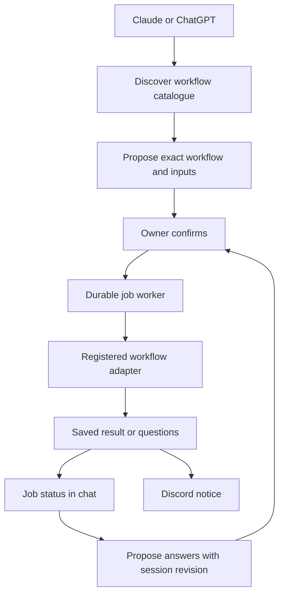

# Advisory workflow interface sketch

This is reference material for shaping, not an approved interface or implemented feature.

## Current foundation

Remote MCP already exposes action_propose, action_confirm, action_inspect, action_cancel and action_history. Its enabled action catalogue supplies tools/list schemas. Standards analysis and author actions already route to existing domain services. Worker submission MCP is a separate surface.

## Suggested extension

Keep a small stable MCP vocabulary. A workflow is a registered, versioned adapter with a description, input schema, continuation schema, impact classification, required permissions, availability requirements and result mapper. Only installed and enabled adapters can be started. Adding a custom research workflow would register another adapter; clients would not need a new tool name. Registering arbitrary commands, executable paths or graph names supplied by a model is outside this sketch.



## Illustrative proposed calls

These calls are proposals for an interface; they do not work today.

```json
{"name":"workflows_list","arguments":{"project":"github:marioatcloudvane/litefactory"}}
```

A response could list workflow identifiers such as log-analysis and standards-author, versions, plain descriptions, availability and required inputs. A detail read can return schemas and examples rather than placing every schema in the tool description.

```json
{"name":"workflow_describe","arguments":{"workflow":"log-analysis","version":"1","project":"github:marioatcloudvane/litefactory"}}
{"name":"workflow_propose","arguments":{"workflow":"log-analysis","version":"1","project":"github:marioatcloudvane/litefactory","inputs":{"period":{"after":"2026-10-24T00:00:00Z","before":"2026-10-31T00:00:00Z"},"dry_run":true},"client_request_key":"analysis-20261031-01"}}
{"name":"action_confirm","arguments":{"proposal_id":"<returned proposal ID>"}}
{"name":"job_status","arguments":{"job":"<returned job ID>"}}
```

Confirmation remains a separate call after the existing minimum delay and before expiry. The owner says yes; the client carries identifiers. Proposal creation launches no agent. Confirmation admits durable work and returns quickly. A retry with the same key and same input reads the existing operation; changed input with the same key conflicts.

```json
{"name":"workflow_propose","arguments":{"workflow":"standards-author","version":"1","project":"github:marioatcloudvane/litefactory","inputs":{"idea":"Keep database migrations safe to resume"},"client_request_key":"standard-01"}}
{"name":"job_status","arguments":{"job":"<author job ID>"}}
{"name":"workflow_continue_propose","arguments":{"job":"<author job ID>","session_revision":3,"answers":[{"question_id":"q1","answer":"Apply this to SQLite migrations"}],"client_request_key":"standard-01-answer-01"}}
```

Start and continuation proposals both need confirmation. Continuation must bind the exact session revision and question IDs; stale answers must not launch work. An author session can span multiple execution attempts; shaping must choose whether each continuation gets its own job ID or a child attempt under a stable job ID.

## Suggested discovery data contract

| Field | Purpose |
| --- | --- |
| id, version, title, description | Stable selection and plain explanation |
| input_schema, examples | Valid start inputs |
| continuation_schema | Valid answers or follow-up input |
| impact, required_scopes | Existing policy and consent requirements |
| availability, unavailable_reason | Whether the installed adapter can currently run |
| result_schema | Summary, links, proposed standards and questions |
| supports | Explicit capabilities such as continuation; no implied cancellation |

The server should filter discovery by current owner grant and project, and recheck on every proposal, confirmation and execution. Discovery is information, never authorization. MCP initialize guidance should teach discover → describe → propose → confirm → inspect. Refresh the catalogue rather than assuming a memorized list remains current. The current transport supports POST JSON responses and advertises no list-change notification capability; a fresh read is the safe baseline.

## Suggested status data contract

A job view should separate admission/execution state, result availability and notification delivery. Possible execution states are queued, running, waiting_for_input, succeeded, failed and uncertain. Include a plain summary, workflow version, project, proposal reference, domain analysis/session reference, session revision, pending questions, confirmed issue links, proposed standard references, timestamps and next permitted action. Report partial filings and uncertain external effects honestly. Discord delivery failure must not change a successful job into a failed analysis.

## Reuse and open shaping points

Reuse owneraction admission, consent, exact target rechecks, execution identities and recovery; reuse loganalysis and standards.Authoring services. Adapt their retained outputs rather than rerunning agents to summarize them. Existing action inspection remains valid. Existing cancellation only stops pending proposals; running-job cancellation would require separate semantics.

The existing owner-action worker executes Tick entries sequentially, with a ten-minute Step timeout. It cannot simply be relabelled a general concurrent scheduler. Log analysis permits a thirty-minute default ceiling. Shaping must settle scheduling, concurrency, restart handling, job identity, supported deadline policy, notification destination and whether named convenience wrappers are useful. None requires an owner fact to complete this research pass.

Custom research is an extensibility example, not a workflow implemented or automatically exposed by this issue. Existing shipped graph/team definitions may supply future adapters after explicit policy classification.

