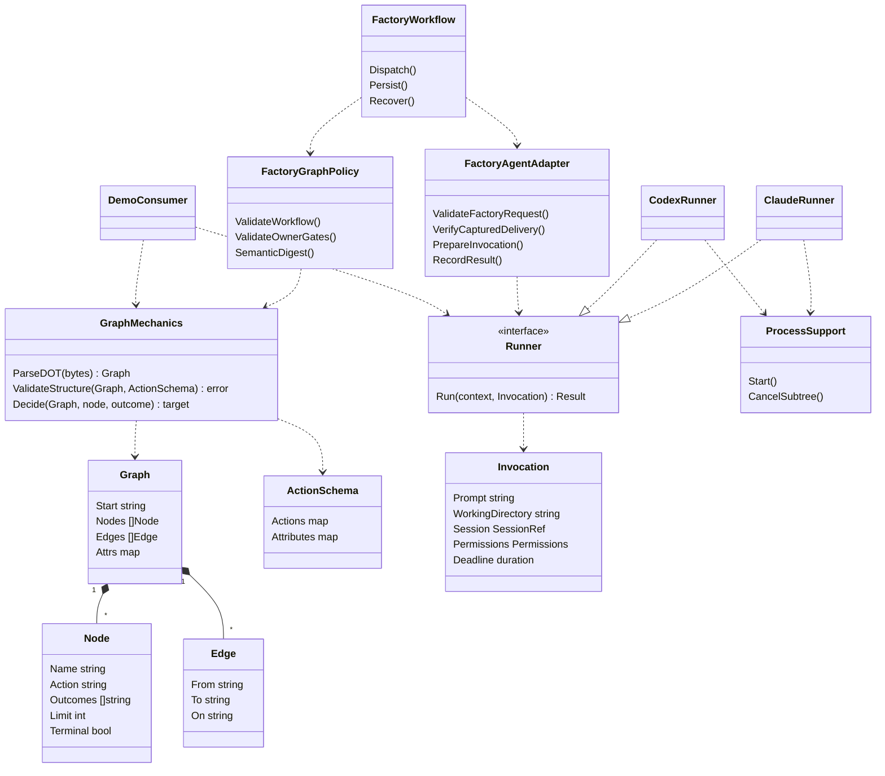

# Candidate library boundary

This is research reference material for shaping, not an approved API or implemented extraction. Names below are illustrative Go packages, structs and interfaces. Baseline: b356472dd10d0c8bd7bf21e0469bdce98d672639. One repository, one Go module, coordinated releases.

## Class diagram



Graph, GraphMechanics, ActionSchema, Invocation, Runner, provider implementations and neutral ProcessSupport belong to the library. Factory classes remain internal. No arrow from the library to factory core. Graph navigation selects an edge; it does not execute activities, save state, grant access or approve publication.

FactoryAgentAdapter represents responsibility that currently spans agent, turn, harness and codex. It is not a claim that one adapter struct is sufficient. Retained capture validation must stay at its current owning boundary, including checks immediately before launch and each retry. Passing prepared input must not make captured instructions mutable or omit authorization checks.

## Repository layout

Current relevant structure:
```text
go.mod
internal/
  graphexec/       DOT, navigation, schemas AND factory workflow policy
  agent/           neutral concepts AND factory requests/results/delivery
  harness/         Claude transport AND factory prompt/capture integration
  codex/           Codex transport AND factory prompt/capture integration
  providerprocess/ process helpers AND agent-dependent protocols
  turn/ daemon/   dispatch, integration, recovery
  store/ instructionpackage/ teampackage/
teams/
```

Candidate after extraction:
```text
go.mod                         unchanged module boundary
pkg/
  execution/
    graph/                     DOT structure, navigation, neutral schemas
    agent/                     invocation/result/session/permission contracts
    providers/
      claude/                  native invocation and stream decoding
      codex/                   native invocation and stream decoding
    internal/process/          shared lifecycle helpers
examples/
  execution/                   small non-factory main and test
internal/
  graphexec/                   factory vocabulary, gates, policy, digest adapter
  agent/                       factory request/result/delivery and translation
  harness/ codex/              factory integration wrappers, if still needed
  turn/ daemon/ store/         existing owners, wired through extracted code
  instructionpackage/ teampackage/  immutable capture ownership retained
teams/                         existing releases and captures unchanged
```

The pkg name is an agent's call to make the boundary importable by a separate consumer without promising public version support. Shaping may choose a different name. Do not move whole existing packages: split mixed files first. Retire duplicate parser/navigation/provider execution implementations after cutover; wrappers may remain only to perform factory responsibilities. No new go.mod, service, database or team release is implied.

## Test impact

| Area | Existing evidence | Candidate change in ownership / added proof |
|---|---|---|
| Graph mechanics | graphexec_test, engine_additions, semantic and registry tests | Move structural DOT, clone isolation, reachability, cycles, outcome navigation cases with mechanics. Split mixed policy cases; keep semantic identity compatibility at factory boundary. |
| Factory policy | plan gate/control/story/parallel, owner stops/conversation, research control, bug sync gate, validate suites | Keep in factory; exercise new adapter against current shipped graphs and saved legacy fixture. Preserve accepted and rejected definitions. |
| Dependency rules | TestGraphPackagePurity admits agent/config/planbrief | Add transitive dependency checks for library AND demo: no store, ticket, approval/publication or factory policy packages. Existing direct import check is insufficient. |
| DOT inventory | TestGraphShippedDOTScope allows only team graphs and one legacy fixture | Keep factory inventory test; explicitly account for any demo DOT fixture, or use in-memory graph construction to avoid changing inventory rules. |
| Agent contracts | request, permissions, deadline, delivery, contribution and prompt tests | Neutral invocation cases move; factory IDs, result schema, receipts and delivery selection stay. Add translation characterization before removing fields or validation from provider paths. |
| Providers | harness and codex fake/recorded subprocess suites; providerprocess start/kill tests | Move native argv, event, environment, cancellation, timeout, retry and cleanup coverage with execution. Preserve cold/resume and missing-session behavior, usage/error semantics, bounded output and credential isolation. |
| Capture and permission integration | advisor_capture, delivery, MCP, bug permissions, prompt fidelity tests | Keep factory end-to-end tests across adapter and provider; prove immutable capture replay, exact permissions and authorization recheck before retry. Do not weaken controls to let demo launch. |
| Workflow integration | turn graph_node, graph_delivery, graph_stop_recovery_persistent; daemon recovery tests | Retain durable state, owner approval, recovery, receipt and worktree tests. Import moves alone do not prove these behaviors survive. |
| Demo | None supplied for this extracted boundary | Add a non-lf action graph and fake runner path independent of factory config/state; also compile real provider construction with neutral options. No credential-dependent CI requirement. |

Recommended verification order: characterize uncovered mixed behavior; run relocated unit tests; compare factory parse/policy/navigation outputs and semantic digests on shipped and retained profiles; test provider adapters and workflows; run repository checks. These are proposed obligations, not checks already executed.

## Compatibility and limits

Keep DOT syntax, error categories, profile digests, session handles, stored identifiers, result receipt protocol and persisted state compatible. A package extraction should need no state migration (agent's call); if shaping finds one, define old-state fixtures and recovery before cutover. A rollback must not require translating newly written state merely to restore the previous deployment. No mutable team capture rewrite is proposed.

The provider APIs include auxiliary calls (classification, conversations, doctor, judge, repair and advisory execution). Shaping must inventory these before deciding which neutral execution primitives they share; the main Runner interface is not the whole surface. No new provider or independent engine is proposed.

Local baseline test outcome is recorded in the submitted findings. No whole-repository, race, coverage percentage, real credentialed provider, or deployed recovery claim is made.

