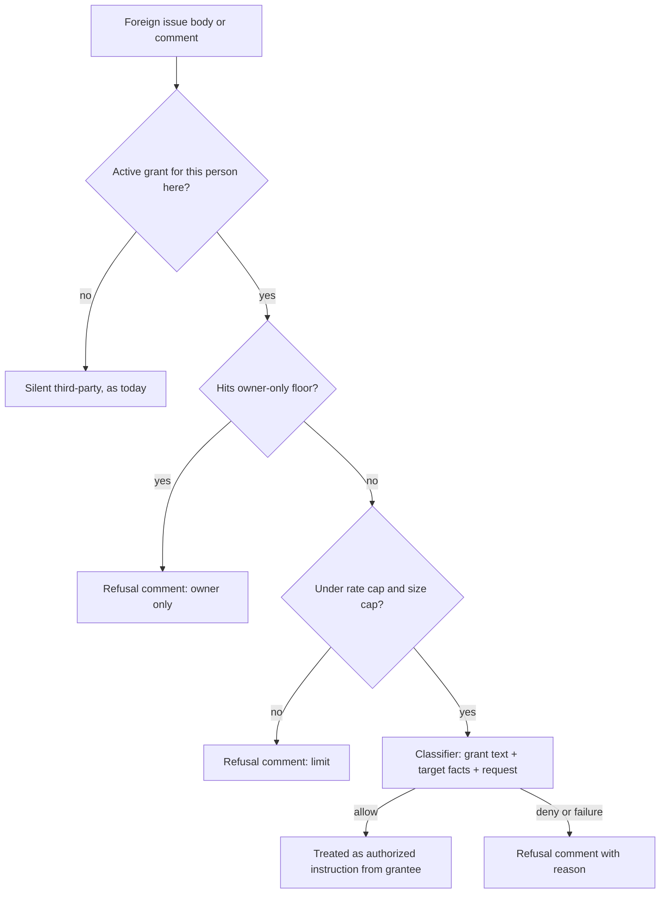

# Access grants: data model and interface sketch (#1489)

This is a sketch for Plan. Column names are proposals, and the shapes are what matter.

## Tables

`project_access_grants`: one row per grant revision; the current revision is the active grant.

| column | notes |
|---|---|
| id | primary key |
| repo_id | REFERENCES repos(id) ON DELETE CASCADE |
| grant_key | stable id across revisions |
| revision | > 0, UNIQUE(repo_id, grant_key, revision) |
| provider, api_origin, actor_id (TEXT), handle | same identity shape as `project_approver_appointments`; the provider must match the project's ticket connection |
| grant_text | the owner's plain text, NOT NULL, non-blank, ≤ 4 KiB |
| created_by_provider, created_by_id | the local owner |
| created_at | |
| revoked_at, revoked_by | both null or both set |

Constraints:
- at most one active (non-revoked, latest revision) grant per repo+identity;
- the owner/approver identity cannot be granted.

`project_access_history`: append-only, written in the same transaction as every grant, edit and revoke: sequence, repo_id, at, actor, kind (`grant`, `edit`, `revoke`), grant id, snapshot_json.

`project_access_decisions`: one row per request, unique on (repo_id, source_provider, source_origin, source_id).

| column | notes |
|---|---|
| actor identity | the requester |
| grant_id, grant_revision | null when refused by the floor |
| target_json | workflow, node, kind and access facts given to the classifier |
| request_digest | sha256 of the exact text classified |
| decision | `allow`, `deny`, `floor`, `error` or `rate_limited` |
| reason | one plain sentence, posted on refusal |
| model, at | |

## CLI (local, owner only)

```
litefactory repo access grant   <project-id> <login|linear-user> (--text TEXT | --file PATH)
litefactory repo access edit    <project-id> <login|linear-user> (--text TEXT | --file PATH)
litefactory repo access revoke  <project-id> <login|linear-user>
litefactory repo access list    <project-id> [--all] [--json]
litefactory repo access history <project-id> [--json]
litefactory repo access decisions <project-id> [--limit N] [--json]
```

## Classifier contract

Input sections:
1. Role text.
2. Trusted: the grant text and the target facts.
3. Untrusted, fenced: title, body, comment and the parsed command.

Target facts are read from the installed team graph:

```json
{"workflow":"plan","entry":"start|answer","node":"story_ask","node_kind":"question",
 "reachable_agents":[{"node":"story_agent","access":"read"}],"command":"/approve-plan"}
```

Output, parsed exactly; anything else is a deny:

```json
{"decision":"allow","reason":"The grant allows answering plan story questions."}
```

## Admission order for a non-owner, non-bot input


