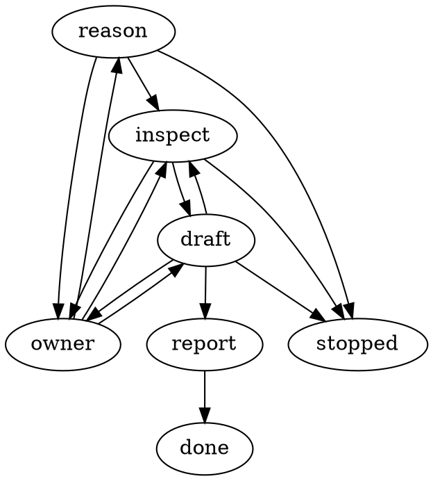

# Research brief: file-defined execution workflows

Status: complete for the bounded Research passes through run 0006. Run 0006 adds a concrete illustrative Research DOT file, minimal actions, proposed local execution/recovery mechanics, and BSD/Apache commercial-use guidance. No implementation or Plan started. Run 0005 recommends a bounded DOT profile and Go parser for the first Research slice, superseding run 0004’s SCXML preference in light of the owner’s DOT interest and explicit acceptance that durability belongs in the runtime. Temporal remains a possible runtime backend, deferred for the initial local slice. Optional clarification and one definition per mode remain settled. Earlier findings are retained as history, not current format decisions.

## Request and answered decision

Owner request, issue #230 runs 0001–0002, 2026-09-13: execute every mode through an editable, file-defined workflow; ship one standard workflow initially. Use the existing instruction chain as a blueprint. Move deterministic sequencing from model orchestrators into litefactory; keep agents for reasoning, writing and review.

The owner explicitly confirmed in run 0002 that the first duplicated “Implement Mode” heading means **Research Mode**. Research is interactive; Implement is autonomous. The run-0001 clarification is settled and must not be asked again.

Plan should develop story descriptions/problems first, then prose acceptance intent and concrete criteria, then architecture, with owner discussion at those stages. Publish stories only after this is complete. Implement should run story-tailored checks and bounded fixes; Validate should begin with the full suite and then assess acceptance. Research is deliberately shallow: a feasible direction and important boundaries, not a final schema or engineering plan.

## Evidence boundary

All repository citations below refer to revision `0b756e3bdccf2c9c6cacf0b62e280610be050aab`, inspected in the supplied macOS worktree on 2026-09-13. Evidence is focused source, instruction and test inspection, not executed behavior. For runs 0001–0002, no builds, tests, paid agents, external services or web research were run. Run 0004 adds primary-source web research, documented below. No token-cost or latency benchmark was performed; the owner's orchestration-cost concern is a reported motivation, not a measured saving. Source-byte counts and billed tokens are different measures; neither was measured here.

The prior incomplete brief recorded revision `6e52c3e8c0953a60509e65a2a64d2b9259c7bbbb` and inspected routing/session instructions only. Its mode-label uncertainty is now resolved.

## Current blueprint and runtime owners

| Area | Current observation and evidence |
|---|---|
| Entry and routing | `AGENTS.md:5` prioritizes supplied mode and role definitions; `AGENTS.md:14` maps Research/Plan/Implement to orchestrators, Validate to a read-only reviewer, and Spike directly to its contract. This is a routing blueprint, not itself an executable graph. |
| Shared source and delivery | `teams/source/index.json:1` catalogs roles, tiers, skills and mode rosters. `internal/teamsource/snapshot.go:35` captures the mode's source/skill closure with hashes; `internal/turn/delivery.go:35` renders that local snapshot for the selected provider, with parent permissions as a ceiling at line 74. Installed `.codex/skills` are therefore not the only instruction source to evolve. |
| Research | `.codex/skills/research-orchestrator/SKILL.md:8` delegates its contract to research-evidence. `teams/source/skills/research-evidence/SKILL.md:22` requires clarification before material assumptions, saved questions and an ended run; line 49 requires maintained brief/history. This is already a compact conversational loop. |
| Plan | `teams/source/agents/shared/plan-orchestrator.md:12` currently sequences requirements/specification, architecture, then story decomposition. `.codex/skills/plan-orchestrator/SKILL.md:98` preserves selected mode and discussion context; line 114 separates discussion from publication/readiness. Stories-first therefore changes stage order, not merely presentation. |
| Implement | `teams/source/agents/shared/implement-orchestrator.md:19` assigns ready stories to specialists and sequences tests/fixes in model instructions; line 28 bounds fixes to two cycles. `.codex/skills/implement-orchestrator/SKILL.md:45` adds story-level engineering evidence; line 62 requires aggregate gates, run once after all stories at line 70. The targeted-test idea partly exists, but removing final aggregate testing is a behavior change. |
| Runner and structured handoff | `internal/turn/submission_runner.go:20` runs the configured runner with an attempt-bound submission session; line 77 defines captured snapshots/checks as **agent-reported execution**. This is useful reusable transport, but it is not a factory-executed test recipe contract. |
| Publication | `internal/turn/plan_publication.go:49` validates the batch, retains replayable effects and returns a link-only index that must be saved before readiness. `internal/turn/plan_outcome_test.go:76` covers discussion followed by completion and explicitly checks at line 109 that discussion did not publish stories. |
| Engineering versus acceptance | `internal/turn/engineering_progress_test.go:48` covers dependency release without acceptance/closure; line 133 covers restart retention. Preserve this distinction when scheduling graph nodes. |
| Validate | `internal/turn/validation.go:17` builds context from approved revisions and retained engineering evidence; line 66 checks its attribution. Line 89 explicitly excludes fresh checks from harvesting. `internal/turn/validation_test.go:103` covers retained snapshots/checks and rejection of wrong revision attribution. The proposed full-suite entry step does not exist in this examined Validate path. |
| Mode durability | `internal/daemon/mode.go:130` pins effective mode before effects; line 219 recovers confirmed mode transitions. `.aiteam/APP_CONSTRAINTS.md:207` prohibits automatic mode chaining and preserves workflow versions; line 221 requires durable selected-mode semantics. |
| Spike | `docs/workflow/spike.md:5` defines direct, bounded work and a recorded result; `teams/source/index.json:117` has an empty Spike roster. “Every mode” should include a minimal Spike wrapper, without expanding its scope. |

Existing source tests were read as evidence, not run. No claim is made that current model orchestration actually polls continuously: the source establishes model-driven sequencing, while `AGENTS.md:30` itself says not to poll.

## Recommended direction

Use a small, **durable directed workflow graph**, with a **DAG for story dependencies** inside Implement. A graph that includes test → fix → test is not mathematically acyclic. Separating those concepts provides deterministic scheduling without denying the required backward transitions.

Keep three distinct responsibilities:

1. **Workflow file:** stable node IDs, action types, input/output references, outcomes, allowed transitions and retry limits. Ship one standard definition containing the mode entry points. Historical run-0002 suggestion: YAML was a provisional human-editable candidate. Superseded by the dedicated-format comparison in run 0004; YAML is not an agreed format.
2. **litefactory runtime:** choose ready nodes, enforce transitions, execute tools/tests, record results, suspend for owner replies and recover effects. It owns the control flow.
3. **Agent roles and skills:** perform bounded reasoning/writing tasks and return structured results. Keep the existing team roster, tier resolution and permission boundaries; remove duplicated scheduling instructions as the engine takes ownership.

The graph may transition backward **within the selected mode**. It must not automatically move Research → Plan → Implement → Validate. Existing owner-controlled mode selection remains the outer boundary.

A likely owner split is a small pure graph definition/transition component, `turn` action coordination, `store` persistence, and `daemon` readiness/timers/backoff. Reuse the existing runner, submission and publication boundaries. Exact packages are a later design decision, not a recommendation to grow `turn` into an unbounded interpreter.

## Standard mode shapes

| Mode | Proposed surface workflow |
|---|---|
| Research | Clarify scope → focused investigation → options/recommendation → saved brief/report. A material gap produces an owner-question outcome, persists context and ends the run; the reply resumes clarification or investigation. Keep this short and permit a useful partial report. |
| Plan | Draft story problems/descriptions ↔ owner discussion → prose acceptance intent → concrete criteria ↔ owner discussion → architecture draft/overview ↔ owner discussion → consistency/readiness check → factory publication. Architecture can send affected stories/criteria backward; changed earlier content invalidates dependent drafts. No child story publication during intermediate discussion. |
| Implement | Select dependency-ready story → engineer → test specialist prepares/updates story checks → factory executes scoped checks → engineering evidence/dependency release. Failure goes to bounded diagnosis/fix and affected checks. Finish when authorized stories and required scoped checks/save requirements are complete. Exhausted retries produce a blocked/failed result, without a routine human approval gate or invented pass. |
| Validate | Factory executes the configured full suite against the assessed snapshot → reviewer assesses criteria plus code/architecture/plan using recorded results → factory retains assessments and applies existing acceptance effects. Failed suite outcomes remain visible and block a clean overall result; review may still record useful findings. Recommend owner return to Implement for fixes, without switching automatically. |
| Spike | Bounded task action → necessary scoped verification when applicable → saved Spike result. Keep its existing scope limit; detailed redesign is deferred. |

The additional Plan consistency step should check dependency cycles, contradictory criteria, architecture alignment, and whether evidence/test prerequisites are feasible before publishing. It need not add another mandatory owner meeting. A later iteration should define explicit stage-completion signals so the engine never guesses completion from prose. Working story drafts can be structured planning context; they must not create a competing published story source.

## Actions and test-manager handoff

Start with a small typed action set: invoke a rostered agent; validate structured output; select/join dependency-ready work; run a declared check; record snapshot/evidence; persist discussion and emit an owner question; publish the completed plan; record engineering/assessment results; report/save through existing factory operations. Prefer fixed outcomes such as completed, needs-input, failed and blocked over arbitrary code in conditions.

A test-manager responsibility can initially be a focused assignment to an existing test specialist, rather than automatically adding another permanent agent. It should return a **test plan**, not merely prose saying “tests passed.” `teams/source/skills/test-evidence/SKILL.md:18` already requires exact commands and coverage reporting; extend that into an executable typed handoff.

Candidate fields: story/criterion coverage, command executable and argument array, worktree-relative directory, scoped-versus-full-suite classification, timeout, required environment names/fixture prerequisites and evidence output references. The factory supplies authoritative identity/revision/attempt bindings and records actual exit status, timing, logs, skip reason and snapshot identity. Missing prerequisites or a command that selects no required tests must not become success. Agent-authored recipes require validation within the existing execution boundary; a workflow file or story text cannot grant new permissions or credentials.

Full-suite commands should be declared per repository; do not hardcode Go commands into the engine. Here, `AGENTS.md:58` identifies `make check` and race-enabled `make test`, with no invented integration tags. The story's affected packages and acceptance criteria should determine Implement scope, including relevant consumers when a shared boundary changes. Check writers and production-code writers need coordinated access to the shared worktree so recorded evidence matches stable bytes.

## Durability and compatibility worth designing early

Persist the pinned definition/version/digest, selected mode, current node/attempt, input references, results, retry counts, owner-question state and pending external effects. Definition edits should apply to new workflow instances by default; do not silently alter a resumed feature. Keep workflow-definition version distinct from existing managed workflow/content/submission versions.

On restart, reconcile uncertain commands and external effects before replay. Publication must continue using its durable existing path rather than duplicate issue creation. An owner pause releases the runner; no agent stays alive waiting. Keep timer/backoff ownership in the daemon and SQL in store. Begin with serial writers; enable independent story concurrency only where ownership and evidence consistency are established.

This request deliberately changes current policies. `SEC-21` at `.aiteam/APP_CONSTRAINTS.md:102`, `CONC-11` at line 207 and `EXT-4` at line 275 currently prohibit fresh Validate checks and require Implement aggregate gates. Related shared skills and installed orchestrator/reviewer instructions say the same. A future implementation must revise/version these contracts together with code and tests. Making full-suite execution a **factory action before the read-only reviewer** preserves the reviewer boundary, but still requires changing the current mode-wide prohibition. Existing active legacy/separated features must retain their selected semantics unless explicitly migrated.

## Options, recommendation and next investigation

- Keep sequencing in orchestrator prompts: smallest change, but does not meet deterministic control-flow ownership.
- Add a small built-in file interpreter over existing runtime owners: recommended; supports the requested standard workflow while reusing durable mode/publication/evidence machinery.
- Adopt a general external workflow engine or scripting language: defer; this shallow pass establishes no need for the added deployment/runtime surface and makes no vendor comparison.

Next Research iteration should narrow the action/result contract, stage completion and rewind semantics, test execution provenance, and migration/recovery behavior, ideally around one representative Implement story cycle. Measure orchestration-only calls, exclusive tokens and elapsed time against the current path before claiming savings. Provider adapters and source delivery need verification for direct factory specialist invocation; existing support for a root runner plus delivered specialists does not by itself prove that new action path.

There are no unresolved questions blocking this bounded research result. Exact file placement/syntax, stage signals, retry policy and suite-failure reporting are intentionally deferred design topics. No stories were published and no source code or workflow policies were changed.

## Run 0003: one file per mode; start with Research

### Request and scope

The owner asks whether to have one file per stage and whether Research is a good first workflow to sketch. **Yes: recommend one file per mode, with the steps/nodes inside that file.** Here “mode” means Research, Plan, Implement, Validate or Spike; “step” means clarify, investigate or synthesize within Research. This resolves the terminology explicitly without requiring another owner decision. Do not split every node into its own file initially: the complete flow should be readable in one place.

Illustrative future layout: `workflows/research.yaml`, `plan.yaml`, `implement.yaml`, `validate.yaml`, and `spike.yaml` under the same directory. These paths are proposals, not files created by this research or existing executable configuration. Together they form the one shipped standard workflow set. A shared version/manifest can later tie the set together when needed; avoid building a variant registry or include language for the first slice.

This refines the earlier suggestion of one definition containing all mode entry points. Keep mode-specific changes reviewable independently while retaining common action semantics in the runtime. Agent role/skill files still hold the reasoning instructions referenced by nodes; runtime progress, replies, outputs and attempts belong in durable instance state, never in the editable definition file. Pin the definition identity/digest for each instance, as recommended above.

### Focused current-contract evidence

New citations in this section refer to revision `6dca1442b19e846866e4c9005dc7e1bfd68a248e`, inspected on 2026-09-13 in the supplied macOS worktree. Earlier citations remain attributed to the earlier revision and were not all reverified in this continuation.

- `teams/source/agents/shared/research-orchestrator.md:10` delegates the research work to the evidence contract and at line 14 returns after saving, without starting Plan.
- `teams/source/skills/research-evidence/SKILL.md:21` defines the initial clarity check; line 28 defines grouped owner questions, incomplete state and an ended run; line 31 prohibits waiting/polling and requires reusing settled answers.
- `teams/source/skills/research-evidence/SKILL.md:13` requires session reuse; line 49 requires maintained findings, decisions and history, with bounded completion at line 51.

These observations support a small Research graph grounded in the existing behavior. They do not establish that node persistence, typed Research outcomes or an editable graph interpreter already exist. This continuation inspected those contracts and the supplied session only; no tests, builds, external research or runtime experiments were performed. Source-byte counts and billed tokens were not measured, and no performance improvement is claimed.

### Proposed Research flow

```text
clarify -> investigate -> synthesize -> save/report -> complete
                ^             |
                +-- refine ---+  (bounded)

Any reasoning step --needs_input--> save partial brief + questions -> end run
Owner reply ---------------------> resume the saved reasoning step
```

`clarify` checks the request and existing answers, returning immediately when clear; it is not a mandatory owner meeting. `investigate` gathers only the evidence needed for the bounded question. `synthesize` produces options, a recommendation and uncertainties, requesting a further focused investigation only when needed. The factory handles outcome validation, durable state and reporting; bookkeeping and question delivery do not need separate agent calls. Logical node boundaries need not imply extra paid invocations solely to move data between steps; determine call granularity in the first runtime experiment.

The following YAML is **illustrative design notation, not runnable configuration or an agreed/current schema**. It deliberately omits bindings and transport details:

```yaml
mode: research
entry: clarify
refinement_limit: 2  # candidate default; not a settled policy
nodes:
  clarify:
    action: agent
    task: clarify_scope
    on: {done: investigate}
  investigate:
    action: agent
    task: gather_focused_evidence
    on: {done: synthesize}
  synthesize:
    action: agent
    task: recommend_and_draft_brief
    on: {done: finish, refine: investigate}
  finish:
    action: save_and_report
    on: {done: complete}
common_outcomes:
  needs_input: save_questions_and_end_run
  blocked: save_incomplete_result_and_end_run
  failed: record_failure_and_end_run
resume: saved_reasoning_node_with_owner_reply
```

Each agent result should have a typed outcome and artifact references, with questions for `needs_input` and a reason/focused evidence request for `refine`. The factory validates the result and chooses only allowed transitions; it must not infer progress from free-form prose. `done` means that node's work is complete, while Research completes only after its required brief/report is safely retained. Invalid or missing output becomes a recorded failure, never an implicit success.

Keep automatic refinement bounded; the candidate two-round limit is a starting point for discussion. Exhaustion saves an incomplete result explaining the unresolved issue and ends the run. Technical retries are distinct from evidence-refinement loops. Owner replies are new authorized turns, so they must not be rejected merely because a prior automatic loop exhausted its budget.

### The smallest useful runtime slice

Research is a good first slice because it exercises agent invocation, typed branching, artifact retention, owner pause/resume and restart recovery without the test scheduling and shared-writer concerns of Implement. It proves the control-flow foundation, **not** story dependency scheduling, test execution provenance, fix-loop quality or concurrent implementation; those need a later Implement slice.

The first slice should demonstrate:

1. A clear request reaches a saved brief and report through the declared graph.
2. A material question from any reasoning step saves the partial brief, records the resume node and ends the run. The owner reply resumes with the same session and settled answers.
3. A bounded refinement revisits investigation; exhaustion or an action failure ends with honest incomplete/failure state.
4. A restart retains definition identity, node/attempt, accepted output and question/report effect identity. Retried delivery reconciles the recorded effect rather than duplicating an owner question or report; a repeated reply event is not consumed twice.
5. Completing Research ends Research. Starting Plan remains an explicit owner-controlled mode choice.

These are proposed demonstration scenarios, not executed tests or published acceptance criteria. Persist pending question/report intent before delivery, then retain delivery acknowledgement; use the existing factory report channel. No new external message was sent by this research. Exact action envelope, persistence records and reply correlation are the next focused Research topic, with one pause/reply/restart example sufficient to keep it small. No implementation or mode transition is started here.

### Decisions and history

- Settled owner correction remains unchanged: the first original heading means Research; Implement is autonomous.
- Run 0003 recommendation: one definition file per mode, several nodes within each; Research is the first vertical slice. This is a recommendation responding to the owner's question, not a claim of approval to implement.
- No blocking clarification is needed for this sketch. Schema, storage layout, retry count and call granularity remain explicitly provisional.
- 2026-09-13 (run 0003): Preserved prior findings, refined file granularity, and sketched Research branching, bounded refinement, owner pause/resume and recovery. Research complete for this bounded request; no implementation changes, tests or publication.


## Run 0004: dedicated workflow formats and optional clarification

### Accepted direction and scope

The owner accepts one definition file per mode and Research as the first slice. The owner explicitly requires clarification to be skipped when the reasoning agent finds the instructions clear, and asks for a comparison of established graph/workflow formats. The earlier YAML was unapproved illustrative notation; it is superseded, not a schema to implement. There is no material ambiguity blocking this bounded comparison. Visual editing has not been requested, and is treated as a possible future preference rather than an invented requirement.

Clarification is a conditional branch, not an unconditional meeting or a separately required agent invocation. The first reasoning action can assess clarity while beginning useful work. Its structured result distinguishes `scope.clear` from `scope.needs_input`. Clear scope goes directly to investigation. Material gaps save context and questions, end the run, and resume on the owner's reply. Later reasoning steps retain the same ability to request missing input. Litefactory validates and routes these outcomes; it does not attempt to judge clarity from prose.

```text
initial reasoning --scope.clear-------> investigate -> synthesize -> save/report -> complete
                 --scope.needs_input-> save questions -> await owner
                                          owner reply -> resume saved reasoning
investigate/synthesize --needs_input--> same saved pause/resume path
synthesize --refine, within limit-----> investigate
```

This is a conceptual graph, not executable configuration. Automatic refinement remains bounded and runtime retry policy remains distinct from reasoning loops.

### What the format must specify

A serialization syntax alone does not define how a workflow runs. The important comparison is between a graph description language and a workflow/state-machine language with established transition semantics. YAML can serialize an established workflow language; replacing it with XML would not by itself remove a custom execution model. The earlier suggestion was premature because it invented workflow semantics before comparing established options.

Assess against these needs: directed cycles; event/outcome-driven branches; asynchronous agent work; owner pause/reply; editable, versioned mode files; future parallel work; and a small runtime embedded in litefactory. Definition portability, action implementation, durable execution and visual editing are separate capabilities. None of the formats alone supplies litefactory's database recovery, issue-reply correlation, idempotent reporting, or existing permission boundaries.

### Candidate comparison

The external sources below were inspected on 2026-09-13. Versions are identified where available; this is not a claim that an inspected version is the newest release. Suitability and relative complexity are research judgments, not benchmark results.

| Candidate | Established capabilities | Fit and cost for this project |
|---|---|---|
| **SCXML 1.0, `.scxml`** | XML statecharts with event transitions, hierarchy, history, parallel regions and external invocation. [W3C Recommendation, 1 September 2015](https://www.w3.org/TR/2015/REC-scxml-20150901/) | Leading candidate for the small event-driven Research runtime. Agent outcomes map to events and owner waiting to a state. Action bindings and durable persistence remain litefactory responsibilities. |
| **BPMN 2.0.2 XML, `.bpmn`** | Process execution semantics, service/user/receive tasks, exclusive and parallel gateways, loop activities, XML interchange and diagram interchange. [OMG specification, December 2013 document](https://www.omg.org/spec/BPMN/2.0.2/PDF/) | Strong alternative, especially if graphical workflow authoring becomes central. More process concepts than the first Research slice needs; an embedded runtime still needs a clearly bounded supported element set and task bindings. |
| **Graphviz DOT, `.dot`** | Concise directed edges, nodes, subgraphs and attributes in a graph language. [Official DOT grammar, page modified 28 September 2024](https://graphviz.org/doc/info/lang.html) | Excellent for generated diagrams and readable topology. Agent actions, event routing, waits, retries and joins would be a custom litefactory language layered on attributes. Does not eliminate the central semantics-design work. |
| **GraphML 1.0, `.graphml`** | XML graph interchange, directed edges, graph/node/edge data and extensibility. [Official primer](https://graphml.graphdrawing.org/primer/graphml-primer.html), [normative schema reference](https://graphml.graphdrawing.org/specification/xsd.html) | Useful if interchange with general graph tools matters. More verbose than DOT, while workflow execution meanings would still need custom definitions. Low priority for canonical execution here. |
| **Serverless Workflow DSL v1.0.0** | Task-oriented workflow language with calls, event listening, forks, branching, retries and named-task continuation. [Pinned official DSL reference](https://github.com/open-workflow-specification/specification/blob/v1.0.0/dsl-reference.md) | A real workflow-language alternative despite YAML-shaped examples. Its event/integration/task vocabulary may suit future actions, but adds surface beyond the small Research flow. Secondary candidate, not the recommended first format. The historical repository URL redirects to Open Workflow Specification; this comparison pins v1.0.0 rather than mixing current and older DSLs. |

BPMN has a concrete browser editor/viewer option in [bpmn-js](https://bpmn.io/toolkit/bpmn-js/) (toolkit page reports v18.16.0 on inspection). That is evidence of authoring tooling, not evidence of a compatible embedded Go execution engine. A BPMN task can represent owner work, or a receive task can represent the reply; litefactory must still implement the issue interaction and correlation. XML and standard diagram interchange make it a credible alternative rather than merely a presentation format.

For GraphML, the official primer explicitly identifies itself as non-normative and points to schema definitions. The normative reference appeared in search, but direct retrieval returned an internal error; topology/data findings are supported by the inspected primer. No unsupported conclusion about tool availability follows from that retrieval failure.

### Recommendation and boundaries

**Prefer SCXML for the next Research sketch, with BPMN as the alternative if graphical authoring is a primary goal.** This recommendation assumes text-reviewed files and an embedded litefactory runtime remain the near-term priorities. It is a recommendation to investigate, not owner approval of a format or permission to implement.

Use one mode definition such as `workflows/research.scxml`; keep runtime state outside it. Define a supported SCXML profile explicitly and reject unsupported constructs; do not claim full SCXML conformance. Long-running agent jobs should use asynchronous invocation/events: custom executable content must finish swiftly. SCXML history is state-machine history, not database crash recovery. Parallel regions do not create worker threads or solve story-dependency scheduling. JavaScript is not mandatory; data-model choices are explicit. [SCXML §§3, 4.10, 5.1, 6.4](https://www.w3.org/TR/2015/REC-scxml-20150901/)

Retain the earlier runtime responsibilities: pin definition identity for each instance, record action attempts/results, validate typed agent output, persist owner-question state before reporting, correlate replies, and reconcile uncertain effects after restart. Keep mode selection human-controlled. Implement's dynamic dependency DAG and concurrent worktree ownership require a later design even if the outer mode is a statechart.

Do not maintain a separately edited DOT/GraphML graph alongside the canonical workflow. If diagrams are useful, generate a view from the selected definition so two sources cannot disagree. Choosing BPMN later would change this authoring tradeoff: its standard explicitly includes model and diagram interchange.

### Next bounded investigation and evidence limits

The next useful Research artifact is the same small Research flow expressed in SCXML, with an explicit list of supported constructs and one typed agent-result/reply example. Compare a compact BPMN representation only if that helps assess authoring ergonomics. The example should demonstrate both a clear request bypassing clarification and a question/reply that survives restart. Do not select an engine merely because it parses the file.

Unverified topics remain: suitable maintained Go interpreter or parser, compliance of any candidate library, action invocation bindings, restart correctness, rejection of unsupported elements, and the migration cost from existing contracts. No Go package, external engine, dependencies or executable workflow was installed or created. No source implementation or policy changed, no tests/builds ran, and no performance or token-saving claim was measured. This run read the supplied session and research contract and researched official external sources; earlier repository observations were preserved without re-auditing source. Source bytes and billed tokens were not measured.

No owner question is required to complete this comparison. Choosing the final format remains a future decision; this run supplies a reasoned shortlist rather than silently accepting the provisional YAML.

- 2026-09-13 (run 0004): Accepted optional clarification and Research-first/mode-file direction; compared dedicated statechart, process and graph formats from primary sources; recommended SCXML for the embedded text-reviewed first slice, with BPMN for stronger visual-authoring requirements. Research complete for this bounded pass. No implementation, tests, publication or mode transition.


## Run 0005: DOT authoring, Go implementations, licenses and Temporal

### Request, conclusion and evidence boundary

The owner asks for deeper DOT investigation, license implications, Go implementations, and whether Temporal would be excessive. The request is clear; no clarification question or mode change is needed. The owner accepts that durability must be built into the execution layer. The observation that people like DOT is owner-reported preference; this pass does not measure popularity.

**Recommendation: use DOT as the authoring format for the first Research workflow, parse it with Gonum into a small validated litefactory model, and initially execute that model through the existing local runtime. Keep Temporal on the runtime shortlist, but defer adopting it for this first slice.** This replaces the prior SCXML preference because concise graph authoring now has explicit owner support and custom runtime semantics are an accepted responsibility. DOT and Temporal can coexist: one describes the graph, the other can run durable orchestration.

Primary documentation and tagged upstream source were inspected on 2026-09-13. Pinned versions below are inspected examples, not claims of latest releases or selected dependency versions. Existing litefactory architecture findings above were reused without another source audit. No dependency was installed, no candidate library or workflow was compiled or executed, no tests or benchmarks ran, and no implementation, executable graph or policy changed. A few web cache misses were resolved through read-only HTTP retrieval of the same official raw source URLs. Source bytes and billed tokens were not measured. The license observations concern the inspected components; they are not a complete distribution/dependency audit.

### What DOT provides and what litefactory must define

DOT describes directed graphs (`digraph`), including cycles, through node IDs, edges and attributes. It supports defaults, repeated statements, subgraphs, ports, quoted IDs and HTML-like labels. `strict` means no parallel edges; it does not mean acyclic. A node can be introduced implicitly by an edge. Defaults apply according to declaration order, and subgraph endpoints can expand into several edges. These are useful drawing conveniences but need careful handling when the file controls execution. [Official DOT grammar](https://graphviz.org/doc/info/lang.html)

Parsing produces topology and data. Graphviz’s `dot` engine computes layout, and output plugins render formats such as SVG or PNG. Those steps do not execute agents or supply retries, owner interaction, durable state or workflow validation. [Graphviz dot layout engine](https://graphviz.org/docs/layouts/dot/), [output formats](https://graphviz.org/docs/outputs/)

Proposed execution profile, deliberately smaller than all legal DOT:

- One directed graph per mode file, stable explicit node IDs, one declared entry, explicit terminal nodes, and a versioned `lf_` attribute vocabulary. Actions reference existing registered capabilities and task instructions; keep prompts and runtime state outside the graph.
- Edges select typed results through `lf_on`. A source/outcome pair has exactly one destination. Do not interpret edge order, color, position or display labels as execution priority. Multiple differently named outcomes may target the same node; retain them as separate transitions.
- Initially reject subgraphs, edge chains, ports, implicit nodes, repeated node definitions, duplicate attribute keys and inherited execution attributes. Allow a small documented set of visual attributes. Report unsupported constructs rather than silently dropping them. This limits authoring conveniences in exchange for reviewable execution meaning; it does not claim full DOT compatibility.
- Accept directed loops but require explicit bounded automatic refinement and separately bounded technical retries. Validate entry/terminal reachability, action references, required result coverage and ambiguous transitions before starting any action. Serial Research needs no invented fork/join semantics; defer concurrency until the Implement slice.
- Parse into an AST, validate, then normalize into a typed internal graph. Keep original definition bytes, digest and profile version with the instance. Runtime progress belongs in the database, and presentation changes must not redefine result routing.

The following is **illustrative DOT text, not an implemented schema**. `lf_` names and action bindings are proposed litefactory semantics; standard DOT only carries them. The first agent action includes the clarity assessment, so a clear request skips the owner branch without a separate clarification-only invocation.



For this sketch, the runtime records the originating node before entering `owner`, saves questions/report intent, then ends the run. Only a correlated owner reply emits the matching `reply.*` outcome. It does not keep an agent running or wait for a response in the current run. The profile would define technical failure, invalid output and refinement-exhaustion handling as recorded incomplete/failure outcomes; those common paths are omitted from the drawing. The candidate limit of two remains provisional. A terminal `done` is reached only after report effects are safely retained; an interrupted delivery is reconciled on recovery. No automatic transition to another mode is introduced.

### Go implementation options

| Inspected option | Parsing / writing / rendering | Deployment and license | Recommendation |
|---|---|---|---|
| **Gonum v0.16.0**, `graph/formats/dot` and `graph/encoding/dot` | AST parsing; separate graph marshaling/unmarshaling APIs. These packages do not provide Graphviz layout or workflow execution. | Go parser with generated Go lexer/parser; no Graphviz binary or C binding in this path. Gonum BSD-3-Clause; inspected parser files additionally offer CC0. Module declares Go 1.23.0. | First candidate for the execution-definition loader; use AST validation before constructing the runtime model. |
| **goccy/go-graphviz v0.2.9** | DOT parsing/writing plus Graphviz layouts and SVG/PNG/JPG rendering. | Embeds Graphviz compiled to WASM, run through wazero; no separate Graphviz installation required. Module declares Go 1.22.0. Wrapper MIT, embedded Graphviz separately EPL. | Credible optional renderer, heavier than a topology parser; not a workflow engine. |
| **emicklei/dot v1.10.0** | Go graph-building/writing API and Mermaid output; documented image example pipes DOT to the external `dot` executable. | MIT. | Useful for producing diagrams, not the documented solution for loading edited workflow files. No workflow execution is supplied. |

Pinned Gonum evidence: [AST entry points and file license](https://github.com/gonum/gonum/blob/v0.16.0/graph/formats/dot/dot.go), [generated Go parser](https://github.com/gonum/gonum/blob/v0.16.0/graph/formats/dot/internal/parser/parser.go), [decoder](https://github.com/gonum/gonum/blob/v0.16.0/graph/encoding/dot/decode.go), [module](https://github.com/gonum/gonum/blob/v0.16.0/go.mod), [license](https://github.com/gonum/gonum/blob/v0.16.0/LICENSE). Pinned goccy evidence: [README](https://github.com/goccy/go-graphviz/blob/v0.2.9/README.md), [module](https://github.com/goccy/go-graphviz/blob/v0.2.9/go.mod), [license](https://github.com/goccy/go-graphviz/blob/v0.2.9/LICENSE). Pinned emicklei evidence: [README](https://github.com/emicklei/dot/blob/v1.10.0/README.md), [license](https://github.com/emicklei/dot/blob/v1.10.0/LICENSE).

Two concrete decoder concerns strengthen the AST recommendation. Gonum’s decoder copies attributes only when destination values implement the relevant setter interfaces, and ignores standalone graph attribute statements in its `ast.Attr` case. A valid parse into a generic graph therefore does not establish preservation of workflow metadata. Its separate `UnmarshalMulti` API also signals the distinction between a simple graph and a graph with parallel edges. [Pinned decoder source](https://github.com/gonum/gonum/blob/v0.16.0/graph/encoding/dot/decode.go)

For litefactory, `node -> next [lf_on="done"]` and another edge to the same `next` with a different outcome must not collapse. Avoid `strict digraph` for this proposed multi-transition profile and avoid a simple-graph carrier that silently merges edges. Read the AST directly or use a carefully implemented multigraph. Verify quoted IDs, attribute retention, invalid input and self-loops in a later implementation probe; no claim of complete parser conformance or production readiness follows from this source review.

### License findings: language, parser and renderer are different choices

Writing an original `.dot` workflow and using a Go parser does not itself bundle Graphviz. The official Graphviz license identifies the software it covers; choosing the language should not be described as automatically importing the renderer’s license. The proposed Gonum path is evaluated against Gonum’s own license. No blanket conclusion about all possible derived code or distribution arrangements is made.

Gonum’s BSD-3-Clause license permits source and binary redistribution with retained copyright/conditions/disclaimer and a non-endorsement condition. MIT licenses for the two other Go wrappers require retention of their copyright and permission notices. These observations support a straightforward parser dependency choice, subject to checking the actual chosen release and shipped dependencies. [Gonum v0.16.0 license](https://github.com/gonum/gonum/blob/v0.16.0/LICENSE), [goccy v0.2.9 license](https://github.com/goccy/go-graphviz/blob/v0.2.9/LICENSE), [emicklei v1.10.0 license](https://github.com/emicklei/dot/blob/v1.10.0/LICENSE)

**A version-sensitive distinction matters:** the current Graphviz website publishes **EPL-2.0**, but goccy v0.2.9 pins **Graphviz 12.1.2**, whose actual tagged `LICENSE` says **EPL-1.0**. Its wrapper README explicitly states that embedded `graphviz.wasm` follows Graphviz’s license. Therefore describing the bundled library as “MIT only” or automatically assigning today’s EPL-2.0 webpage to that historical WASM would be inaccurate. [Current Graphviz license page](https://graphviz.org/license/), [goccy pinned Graphviz version](https://github.com/goccy/go-graphviz/blob/v0.2.9/graphviz.version), [Graphviz 12.1.2 license](https://gitlab.com/graphviz/graphviz/-/blob/12.1.2/LICENSE)

EPL-1.0 §3 imposes conditions on object-code redistribution, including informing recipients how to obtain the Program’s source; source distribution retains the agreement and notices. Its definition of Contributions distinguishes separate non-derivative modules. These terms concern the licensed Program and relevant modifications; this research does not conclude that all litefactory code must be relicensed. Packaging an embedded Graphviz renderer would require following the exact upstream version’s terms and checking bundled components. Keeping rendering optional avoids making that software part of the execution loader. [Graphviz 12.1.2 license §§1, 3](https://gitlab.com/graphviz/graphviz/-/blob/12.1.2/LICENSE)

### Temporal: useful durability, a separate deployment decision

Temporal has an official Go SDK. Workflow code can coordinate Activities and receive Signals or Updates from outside; Queries read workflow state. That maps naturally to agent/test invocations and owner replies. The SDK requires deterministic orchestration: direct external I/O belongs in Activities, and normal nondeterministic Go scheduling/map iteration cannot drive replay decisions. [Official Go SDK](https://github.com/temporalio/sdk-go), [workflow package](https://pkg.go.dev/go.temporal.io/sdk/workflow), [Go message passing](https://docs.temporal.io/develop/go/workflows/message-passing)

A possible future adapter is a deterministic Go workflow interpreter consuming a pinned, normalized DOT definition. Registered actions become Activities and correlated owner replies become Signals/Updates. Keep both graph/profile identity and interpreter compatibility stable across replay. This is a proposed integration, not an existing Temporal DOT interpreter verified in this pass. DOT file choice need not determine whether the backend is local or Temporal.

Temporal persists workflow history and supports retrying Activities, but an Activity’s external action can occur before its completion is recorded. Applications still need idempotent effects or reconciliation for agent launches, tests and GitHub publication; the engine cannot guarantee that a shell command or issue comment happens exactly once simply by wrapping it. Worktree ownership, credentials, artifact availability and routing jobs to the correct host also remain litefactory concerns. [Temporal Activity definition](https://docs.temporal.io/activity-definition)

Production Temporal means an operated service or Temporal Cloud alongside workers. Self-hosting adds persistence configuration, schemas and service operation. It need not mean Kubernetes. Temporal also documents embedding a server through Go, but the embedded SQLite setup is explicitly for testing/development; its production guidance points to MySQL, PostgreSQL or Cassandra. It is therefore inaccurate both to call Temporal impossible to embed and to treat its embedded SQLite example as a supported production replacement for litefactory’s local store. [Self-hosted deployment](https://docs.temporal.io/self-hosted-guide/deployment), [embedded server guidance](https://docs.temporal.io/self-hosted-guide/embedded-server)

The inspected Temporal server `main` and Go SDK `master` license files are MIT; retain their notices when applicable. These are moving-branch inspections on the stated date, not pinned release audits. Cloud service terms and all transitive dependency licenses were outside this bounded check. [Server license](https://github.com/temporalio/temporal/blob/main/LICENSE), [Go SDK license](https://github.com/temporalio/sdk-go/blob/master/LICENSE)

**Assessment:** for the current local daemon/SQLite architecture and Research-first scope, Temporal is likely more operational machinery than this first slice warrants. That is a deployment-fit judgment, not a performance benchmark or a claim that durability is easy. Reconsider it if multi-host workers, shared service operation, durable timers/cancellation/visibility at scale, or the maintenance cost of custom recovery become central requirements. If production infrastructure is acceptable, buying that runtime behavior may cost less overall than expanding a local engine indefinitely.

### Next bounded slice and remaining limits

Next investigate the DOT profile and durable action boundary through one Research example: clear scope proceeds immediately; missing input saves and ends; a correlated reply resumes the correct node after restart; uncertain report/agent completion is reconciled without blindly replaying effects. Compare the local recovery responsibilities with a Temporal-backed outline before expanding to Implement concurrency. Keep stable operation identities, persisted intent/results, reply deduplication, definition pinning and explicit incomplete outcomes in either design.

Library compatibility with the selected litefactory toolchain, full DOT edge-case conformance, memory limits, binary size, parser diagnostics, renderer packaging and real restart correctness remain untested. These are next-slice verification tasks, not unanswered owner decisions blocking this research. No final dependency version or executable profile has been approved or implemented.

- 2026-09-13 (run 0005): Completed DOT syntax/profile and Go implementation assessment, distinguished current Graphviz EPL-2.0 from the EPL-1.0 Graphviz version embedded in inspected goccy release, and compared local durability with Temporal. Recommended Gonum AST plus a bounded DOT profile for the first Research slice, with Temporal deferred as a possible runtime backend. Preserved optional clarification, prior decisions and all history; no implementation, tests, publication or mode transition.


## Run 0006: Research actions, shipped DOT and local execution

### Request and recommendation

The owner asks for a Research action sketch, an example of the shipped workflow, execution-engine placement, and whether the BSD dependency conflicts with an intended Apache-2.0 core plus proprietary commercial extensions. These are clear bounded Research questions; no further owner decision is needed. Previous decisions stand: one file per mode, DOT, optional clarification, durable local orchestration, no automatic mode change. This section and the adjacent `RESEARCH_WORKFLOW_EXAMPLE.dot` are design examples, not implemented configuration, a final engineering plan or an approval to implement.

Recommend three action types for the first slice: `agent`, `owner_pause`, and `save_report`. Parsing, output validation, evidence retention, transition choice, retry bookkeeping and failure checkpointing are runtime functions; they do not need model invocations or independent graph nodes. The sample has two bounded reasoning tasks to make evidence collection and synthesis separately resumable. Their separation is a provisional cost/observability tradeoff: a future small-request profile could combine them. A graph node does not imply another owner-triggered run, commit, publication or issue comment.

| Action | Inputs and responsibility | Results |
|---|---|---|
| `agent` | Resolved roster role plus bounded task instructions, original request, accumulated answers, accepted evidence/brief revision and optional focused refinement request. The evidence task assesses clarity before substantial investigation, then investigates immediately in the same call if clear. The synthesis task develops options/recommendation and a final draft. | `done`, `needs_input`, `blocked`; synthesis additionally permits `refine`. Engine transport/schema errors are separate from these reasoning outcomes. |
| `owner_pause` | Accepted partial result, questions, originating node and stable question identity. Save partial brief and pending report intent, use the existing factory reporting channel, end the current run and release the worker. | No immediate transition while waiting. One authorized correlated reply emits `reply.investigate` or `reply.synthesize`, chosen by the saved originating node, never by free-form agent routing. |
| `save_report` | Accepted brief/report content or retained partial content and a concrete stop reason; requested completion status. Persist the brief/history and report effect, deliver through the existing factory channel. | `done` only after durable completion/acknowledgement. The complete and incomplete node variants reuse this action. |

There is no compulsory clarification-only call. The evidence agent starts by assessing scope. Clear instructions continue directly into evidence collection; material ambiguity yields `needs_input` before choosing consequential assumptions. Either reasoning node can request input. Agents are still responsible for quality of evidence and conclusions; deterministic validation checks structure and attribution rather than claiming to judge correctness.

### Concrete shipped example and its execution profile

The complete illustrative file is [RESEARCH_WORKFLOW_EXAMPLE.dot](RESEARCH_WORKFLOW_EXAMPLE.dot). Its normal path is `investigate → synthesize → publish → complete`; missing input detours through `owner`, and targeted refinement revisits investigation. `publish` here means reporting Research through the existing task channel, not creating user stories or starting Plan.

The file's `lf_*` vocabulary is a proposed litefactory profile carried by standard DOT. Graphviz does not supply these semantics. All nodes are explicit, edges are single directed edges, and display styling is omitted. A loader must reject unknown execution attributes, ambiguous outcomes, missing destinations, implicit nodes, unsupported constructs and unbounded automatic cycles. Declared `owner` loops are externally gated and consume no automatic retry budget.

Common behavior, explicitly defined rather than omitted from the example:

- `lf_on_blocked="partial"`: any agent `blocked` result retains its reason and partial brief, then routes to the incomplete-report action. It is not a technical retry or a request for approval.
- `lf_limit="2"` allows at most two automatic `refine` traversals during the current owner-triggered run. Attempting a third uses `lf_on_limit="partial"`, retaining the unresolved question/evidence gap. Technical retries and process restarts never reset this count. A new authorized owner continuation starts a new reasoning budget while preserving prior history and answers; duplicate input events do not.
- `lf_on_error="stopped"`: invalid structured output, unavailable bindings, irrecoverable execution failure or exhausted safe retry policy records a failure checkpoint and terminates as failed. The factory attempts its ordinary failure report from retained data; failed delivery remains pending for bounded reconciliation, not an infinite recursive failure-report node. A definition that fails validation never starts an instance action.
- `lf_retry_policy="research-safe-v1"` is an engine-owned named policy, not arbitrary script text. Proposed first policy: at most one automatic technical retry, only for failures proved to occur before an effect or for a reconciled idempotent effect. Agent runs with uncertain completion are not automatically relaunched. Database failure prevents further effects; restart recovery must inspect the durable record before retrying. The exact numeric budget is illustrative.
- `owner_pause` is a suspended state, not a long-lived agent or blocked worker. The runtime persists the originating node and question ID. A duplicate reply is ignored; an unrelated comment does not emit a reply transition. Current owner-command and mode-selection rules remain authoritative. Reply correlation is not inferred from a DOT label.
- `save_report` retains content before external delivery. Delivery uncertainty leaves a pending effect; it must not erase the saved brief, silently complete, or blindly post again. `partial` sets Research incomplete; `publish` sets Research complete only after the report operation has been reconciled. Cancellation preserves the current checkpoint as interrupted; it is neither a domain `blocked` result nor successful completion.

A production loader would normalize these common paths into explicit transitions in its internal model and generated diagrams, so implicit error routes remain inspectable. No expression evaluator, shell command execution, dynamic Go loading, fork/join semantics or renderer is needed for this Research profile. The mode file cannot expand agent permissions or select arbitrary external commands.

### Typed agent handoff

Illustrative content submitted by the reasoning action:

```json
{
  "schema": "research-result-v1",
  "outcome": "needs_input",
  "summary": "The migration boundary changes the recommendation.",
  "brief": {"artifact": "research/attempt-004/brief.md"},
  "evidence": [{"source": "internal/turn/execute.go", "revision": "<commit>", "lines": "20-41"}],
  "questions": [{"id": "migration", "text": "Must existing sessions migrate?"}]
}
```

The runtime supplies and verifies workflow instance, definition digest, node, attempt and input-event identity; the agent cannot invent a resume destination or authoritative attempt identity. Artifact references are resolved only inside the owned session, content-hashed and retained before acceptance. `needs_input` requires nonempty actionable questions and a partial brief; `refine` requires a focused evidence request; `blocked` requires a reason; `done` requires the task's declared output. Unknown outcomes, escaped paths and missing or mismatched outputs are errors. Evidence cites source/revision and separates observation from inference. JSON here is an action-result transport example, not a replacement for the DOT definition.

Accepted immutable content or equivalent recoverable bytes must be durable. A path/hash alone is insufficient if a later run can overwrite or delete the only copy. The human-readable RESEARCH_BRIEF.md and MANIFEST.md are projections of accepted retained content and can be recreated after interruption. Exact database tables and transport API remain implementation-design work.

### How it would ship

Recommend shipping `workflows/research.dot` in the standard distribution/catalog, alongside versioned task/role resources. A management operation installs the standard definition; an explicit managed edit/import later replaces the definition used for new instances. The workflow is text-editable DOT, while roles and skills stay in their existing source format. Task references `research_evidence` and `research_synthesis` in the sample are proposed bounded assignments to the resolved Research role, not claims that these task IDs are registered today. The current research-orchestrator role could supply their reasoning initially, with scheduling instructions removed as the engine takes over.

**Current-source correction:** earlier APP_CONTEXT and research described embedded/static/repository fallback for team sources. At this run's revision, `internal/teamsource/resolve.go:35` explicitly resolves only the centrally installed catalog and reports a missing catalog as an installation error; `internal/teamsource/snapshot.go:47` captures the central team/mode closure. Do not copy the older fallback design into workflow loading. If defaults are embedded in the binary for distribution convenience, use those bytes as an explicit management-install source; do not silently fall back during execution. Whether release assets or Go embedding carry those install bytes is a packaging choice, not a second runtime source of truth.

On new instance creation, resolve one installed definition and its role/task resources, validate them, and pin immutable bytes, profile version, content digest and engine compatibility identity. Do not reread an editable file on every node. Existing instances resume the frozen bundle after edits or upgrades; incompatibility must produce an explicit migration requirement rather than silent reinterpretation. A management edit governs new instances, not an in-flight owner's pending reply. Runtime paths must be added through `config.Paths`; no manual changes to the live daemon state were made in this Research run.

### Execution engine inside litefactory

Proposed ownership extends current boundaries rather than introducing an external service:

| Component | Proposed responsibility | Existing evidence at current revision |
|---|---|---|
| New small pure `internal/workflow` package | Gonum AST loading, supported-profile validation, normalized nodes/transitions, deterministic next-step decisions from supplied state/events; no database, clock, runner or GitHub I/O. | A proposed package, not an existing runtime claim. |
| `internal/turn` adapter | Assemble bounded action inputs, invoke registered runners, validate results, coordinate store updates, session artifacts and existing reporting. | Runner abstraction and registry in `internal/turn/execute.go:20` and `:32`; runner submission in `internal/turn/submission_runner.go:20`. |
| `internal/store` | Definition snapshots, instance/node/attempt state, accepted results, input deduplication, suspended questions and durable external-effect intent/acknowledgements. New SQL remains here. | Store ownership/single-connection invariant in `internal/store/store.go:19`; transactions at `:168`. Never hold a transaction during agent execution or network calls. |
| `internal/daemon` | Admit ready work, enforce existing task/worktree ownership, provide time and retry scheduling, receive authorized owner events, recover unfinished work after restart. | Worker lifetime/admission in `internal/daemon/worker.go:59`; existing mode persistence remains the outer boundary. |
| Config/catalog delivery | Resolve installed workflow/role resources and snapshot them together; define managed runtime paths. | `internal/config/paths.go:28`, `internal/teamsource/resolve.go:35`, `internal/teamsource/snapshot.go:35`. |

Operational cycle:

1. Receive the owner event through existing admission. Deduplicate it, preserve the selected Research mode and find the active workflow or create an instance with its frozen definition/resources.
2. Load current accepted state. The pure transition component decides whether an action is ready, the workflow is waiting, or it is terminal. Claim ready work with a persisted instance generation/attempt so two dispatchers cannot start it concurrently.
3. Commit the action intent and exact inputs before launching external work. Execute the agent or report outside the database transaction under existing process/worktree ownership and permission controls.
4. Validate outputs and retain recoverable content. Atomically accept the result, mark its attempt complete and record the next node/state. A repeated delivery of that same result must not advance the graph twice.
5. Run another immediately ready node within the same authorized run if appropriate. A pause records questions and ends the run; terminal completion ends Research. There is no orchestrator model continuously selecting the next worker.
6. On restart, reconcile pending attempts/effects before scheduling. Completed accepted nodes are not rerun; waiting workflows remain waiting; due technical retries are selected by the daemon with persisted counts. Engine compatibility and the frozen definition must still match.

A compact persisted snapshot plus an append-only attempt/effect history is sufficient as a first design; a full event-sourcing framework is not required. Store calls update short transactions, not a database lock held across the whole workflow. Snapshot and immutable result storage must agree before downstream work starts. No measured token saving follows from the sketch, but transition selection/validation contains no model calls.

### Recovery cases the design must handle

| Interruption window | Required recovery |
|---|---|
| Intent saved, action definitely not started | Start the recorded attempt once under renewed ownership. |
| Agent started, result not accepted | Reconcile the existing runner/session/job and retained result. If its state is unknowable, mark interrupted/uncertain and stop for recovery rather than duplicate expensive work. A durable intent alone cannot provide exactly-once process launch. |
| Result accepted, next node not dispatched | Resume the recorded next node; never rerun the accepted result. |
| Question/report posted, acknowledgement not stored | Use a stable operation marker and existing reporting reconciliation to find the effect before retrying. If the external API cannot deduplicate or establish absence reliably, retain uncertainty instead of promising exactly once. |
| Reply received twice or daemon restarts mid-consumption | Deduplicate by stable event identity; atomically record consumption and resume the saved originating node. |
| Workflow or role source edited while paused | Resume frozen bytes/resources and compatible engine semantics, not the newly edited definition. |

The minimum next verification slice is an isolated parser/runner/recovery prototype covering clear scope, owner pause/reply, bounded refine, malformed output and the crash windows above. That is a recommendation for subsequent work, not tests executed here. Temporal remains a possible future backend for the normalized action contract; it would not remove application effect reconciliation or worktree ownership responsibilities.

### BSD-3-Clause with Apache-2.0 and commercial extensions

General license reading: **the inspected Gonum BSD-3-Clause license does not conflict merely because litefactory has an Apache-2.0 core and proprietary commercial additions.** BSD-3-Clause permits use, modification and source/binary redistribution with or without modification. It does not require publishing your source or prohibit charging for software. Its three conditions are preserving the copyright/conditions/disclaimer in source distributions, reproducing them in documentation/materials for binary distributions, and not using the author's or contributors' names to endorse derived products without permission. [Gonum v0.16.0 LICENSE](https://raw.githubusercontent.com/gonum/gonum/v0.16.0/LICENSE), [OSI BSD-3-Clause text](https://opensource.org/license/bsd-3-clause)

For the owner's intended arrangement, license your own core under Apache-2.0 and your own separate commercial extension under the chosen commercial terms, while retaining Gonum's BSD terms/notices for Gonum. You are not relicensing the dependency itself. One practical packaging approach is an Apache-2.0 LICENSE for the core and a THIRD_PARTY_NOTICES or licenses/gonum.txt containing the full BSD notice/text, also shipped with binary/install materials. Those filenames are suggestions, not license-mandated names.

Apache-2.0 also permits commercial use and distribution; its redistribution conditions include a license copy, notices identifying modified files, retention of applicable attribution notices, and preserving relevant NOTICE content when provided. Its derivative-work definition excludes separable works and works that merely link/bind to its interfaces. Combining or modifying core code must still follow the applicable Apache terms; closed commercial code is not automatically required to become open because it uses BSD or Apache dependencies. [Apache License 2.0 §§1–4](https://www.apache.org/licenses/LICENSE-2.0) The Apache Software Foundation lists BSD-3-Clause among Category A licenses allowed in ASF products, corroborating compatibility, although ASF project policy does not govern litefactory. [ASF resolved license questions, Category A](https://www.apache.org/legal/resolved.html)

This concerns the inspected Gonum dependency and the owner's stated intended Apache license, not verification of the repository's current license or a complete audit of a future commercial distribution. Each additional dependency and any other contractual obligations must be assessed on their own terms. No commercial licensing or attribution files were changed in this run.

### Evidence limits and history

Focused current source inspection was in the supplied macOS worktree at revision `90eeab1b4cc1526387f5542f41bce858df024f05`, on 2026-09-13. Older sections retain their original revision and may describe prior behavior; the current catalog-source correction above supersedes that earlier loading recommendation. A broad initial location search produced excess output and two missing candidate paths; focused actual files supplied the cited evidence, and missing guesses were not treated as evidence of absence. Source bytes and billed input tokens were not measured.

Primary license sources were checked on 2026-09-13, with Gonum pinned to v0.16.0 as previously inspected; no dependency version was selected or installed. The sample was inspected as research text only: no parser, Graphviz, Go build, tests, workflow execution or recovery experiment ran. Only this session's brief, manifest and illustrative DOT were written. No source implementation, policy, daemon state, external publication or mode transition occurred.

- 2026-09-13 (run 0006): Completed minimal Research actions, illustrative DOT/profile with common failures, shipped catalog/snapshot model, runtime ownership and crash-recovery sketch; corrected outdated catalog-fallback assumptions against current source; explained BSD-3-Clause compatibility with intended Apache-2.0 core and proprietary additions. No blocking owner question; Research complete for this bounded request.
