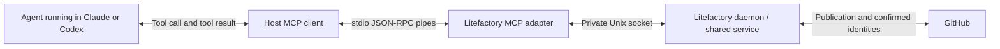

# Research approval record — run 0005

Status: Research complete. Date: 2026-09-13.

The owner replied **“yes, approved!”** to the run 0004 Issues-family proposal. The following are now approved product decisions:

- List issues with an open/closed filter, defaulting to open, with pagination.
- Get one issue and comment on an issue using its repository-local issue number as the targeting ID. List entries carry that targeting identity alongside the minimal read content.
- Both read operations return title and mode labels when present.
- Research can discover candidate relationships across issues in the current repository and comment on an authorized target.
- Litefactory publishes comments and returns durable receipts with confirmed comment identity when available; retry/reconciliation prevents duplicate publication after uncertain replies.

This approval settles the targeting, default-filter and pagination recommendations in run 0004. Earlier Research issue-creation direction and other recorded decisions remain preserved. It does not settle tentative eligibility for every other mode, bug/follow-up taxonomy or other previously open details.

**JSON rework must finish before MCP implementation begins.** This remains a Research run; approval records the product direction and does not start implementation or authorize live issue creation/commenting in this run. No clarification is needed. Only the session brief and manifest were updated; no new source/web investigation, tests or remote operations were performed.

---

# Run 0004 retained findings (recommendations approved above)

# Research discussion — issue discovery, reads and comments

Status: bounded Research complete. Run 0004, 2026-09-13. Revision inspected: `c6efb21fce3152bc2a15cb3a85e9a98dcf14b448`.

## Settled additions

The Issues family includes listing issues filtered by open/closed state, fetching one issue by ID, and commenting on an issue by ID. The initial content returned by both read operations is **title and mode labels, when set**. The motivating workflow is a future enhanced Research mode that inspects other issues for possible relationships deserving attention. This is a discovery surface: titles and modes help identify candidates; they do not establish a relationship conclusively.

Earlier decisions remain: actual Research issue creation/decomposition; factory-owned publication; one local stdio MCP server organized into families; preflight as an ordinary request/result; terminal JSON as the default. JSON rework completes before implementation begins. The request adds cross-issue operations to the proposed product, not authorization to post a comment in this research run. Capability exposure in other modes remains a later policy choice.

## Issues family additions

Tool and field names below are illustrative. Required behavior is distinguished from recommended defaults.

| Operation | Accepted input/behavior | Initial response | Recommended semantics |
|---|---|---|---|
| `issues_list` | Filter by `open` or `closed`; inspect issues in the authorized repository. | Entries containing title and optional mode labels. | Default to open if omitted; bounded pages with a continuation cursor. A page cursor belongs to the response envelope and filter. Recommend a minimal target ID on each entry, as explained below. |
| `issues_get` | Fetch one issue by ID. | Title and optional mode labels, as with list entries. | Read the identified issue whether open or closed; return an explicit not-found/unauthorized result rather than inventing an empty issue. The caller already supplied the target, so echoing it is optional. |
| `issues_comment` | Target issue ID and comment text. Litefactory publishes the comment. | Durable operation receipt and confirmed comment ID when available, or a truthful pending state. | Bind target repository and operation authority to the run. Retain request identity before publication and reconcile uncertain replies to prevent repeated comments. |
| `issues_create_batch` (already settled) | Publish related smaller Research issues, or applicable bug/follow-up work. | Receipt plus confirmed item IDs/URLs and relationship states. | Preserve the prior batch keys, source relationships and recovery discussion. |

### Small targeting recommendation

The requested title/mode-label content stays minimal. For list results, recommend including **one target ID or opaque handle** as addressing metadata so the agent can immediately call get/comment for an entry. This is an explicit recommended addition, not silently accepted extra issue content. An alternative is a response-envelope mapping of handles to title/label entries. Without some identity mapping, duplicate titles cannot be reliably targeted.

For this repository, the simplest recommendation is the repository-local issue number (for example 265) as the user-facing ID, with the repository supplied by the run. The current gateway already gets/comments using that number. GitHub's database ID is a different identifier, used for some relationship operations; litefactory should map these internally and name the public field unambiguously. Exact wire naming remains open, without blocking research.

### Reads, labels and pagination

Recommend open as the list default because the user specifically described checking other open issues; closed remains selectable. An additional all-states filter is not necessary for the stated requirement. Keep response content at title/optional mode labels; the state filter does not require adding state to every entry. A cursor and next-page control are transport metadata, with bounded page size and a consistent ordering. Ordinary live pagination is not a snapshot of concurrent repository changes; use targeting identities to avoid treating a repeated entry as a new issue.

Return the issue's observed mode labels; omit the label field when none are set. Do not invent a mode from its title or assume every candidate has already been classified. If several mode labels are present, preserve that fact rather than arbitrarily selecting a mode. The existing canonical labels are `Mode: Research`, `Mode: Plan`, `Mode: Implement`, `Mode: Validate` and `Mode: Spike`. Precise malformed-label presentation can follow the existing validation vocabulary without widening the initial issue content.

### Cross-issue comments

The future Research workflow intentionally looks beyond its originating issue. Therefore a capability restricted to commenting only on the source issue would not satisfy the request. Recommend the current repository as the initial boundary, with read and comment capabilities explicitly covering authorized targets within it. The server checks repository, target and operation on every request; eligibility in Research does not automatically grant the same commenting surface to every mode.

A comment such as “This issue may be related to the behavior investigated in #265; compare the shared dependency” is a possible workflow output when the run has enough evidence. Litefactory applies its existing outbound processing, posts through the bot gateway and returns a receipt. Identical text in a later intentional comment must remain distinguishable from retrying the same operation: use request identity plus immutable target/content, not text-only deduplication. After a timeout, query/reconcile the original operation before another publication attempt. Acknowledgment may confirm durable acceptance before remote confirmation, so the tool result must report which fact is known.

## Updated category overview

| Family | Illustrative tools | Purpose |
|---|---|---|
| Feedback | `feedback_preflight` | Validate contributions and publication requests; return repair diagnostics. |
| Issues | `issues_list`, `issues_get`, `issues_comment`, `issues_create_batch` | Discover relevant issues, inspect minimal metadata, communicate a finding on a target issue, and publish decomposition/follow-up work. |
| Evidence | `evidence_submit` | Record milestones, assessments and invalidation with stage-specific semantics. |
| Activity | `activity_update`, optionally `activity_get` | Provide useful run visibility and scoped factory state. |
| Receipts | `receipts_get` | Recover durable outcomes and confirmed publication identities. |

## Focused repository evidence

All references in this section use the run 0004 revision above.

- `internal/github/issues.go:25` distinguishes database `ID` from repository `Number`; title, labels and state already exist on the internal value. Only the small requested projection should reach the read tool result.
- `internal/github/issues.go:146` is the existing poll-oriented list owner and fixes state to open at `:159`; it also uses an update cursor and collects pages. `internal/github/followups.go:12` has an all-state listing for publication reconciliation. These are useful read owners, not a ready-made paginated open/closed agent API. Add suitable query semantics through the gateway when implementation is authorized.
- `internal/github/issues.go:219` reads one issue by repository-local number. `internal/github/comments.go:230` posts by the same number using a processed `redact.Body`, and `:260` requires a returned comment ID.
- `internal/agent/mode.go:35` produces canonical mode labels; `:50` parses exact canonical labels. `internal/daemon/mode.go:21` distinguishes absent, ambiguous and malformed mode labels. Read projections should preserve observations rather than silently performing workflow selection.
- `internal/turn/followups.go:212` to `:226` demonstrates checking an exact marker and bot identity before publishing a notice. This is an existing comment recovery pattern to reuse through shared service semantics; the new general comment operation still needs its own durable request binding.

## Continuation result

No clarification is necessary to record these requirements. Accepted behavior is the three added operations and minimal read content. Recommended details are open-default pagination, repository-number/opaque-handle addressing, current-repository scope and receipt-based comment recovery. Mode exposure and exact field names remain design details. No tools were used to fetch live issues, post comments, create issues, run tests or implement code. Prior setup/protocol analysis is retained below; no additional web research was needed for these repository-local observations. Probe environment remains Darwin arm64. The five core files issues.go, comments.go, agent/mode.go, daemon/mode.go and turn/followups.go total 55,217 on-disk bytes; focused excerpts were inspected, so this is a corpus-size measurement rather than transmitted bytes or billed input tokens.

---

# Run 0003 retained setup and publication analysis

# Research discussion — local MCP setup, publication and tool families

Status: bounded Research complete; naming and detailed issue taxonomy remain discussion choices. Run 0003, 2026-09-13.
Current revision: `5028d988a9187383cd67136d4d8eab5f37bde9f3`. Focused comparison with run 0001 found no changes in the submission package, submission service, Plan publication, follow-up publication, Claude runner or Codex runner used below.

## Settled direction and clarification

- JSON rework completes before real MCP implementation begins. Terminal JSON remains the standard result path.
- Research should be able to request **actual issue creation** when an oversized researched issue should be split into digestible work. The owner supplied #258 → #263/#264/#265 as the concrete example; this example is owner-reported, not independently reconstructed here.
- Litefactory performs forge publication; the agent invokes the scoped communication service and receives its result. This supersedes the earlier draft-only recommendation for this case.
- Bug/follow-up creation from other modes is a desired direction with tentative breadth: exact kinds and eligible mode combinations remain to be defined. A published research decomposition establishes backlog work; implementation approval remains a later workflow decision.
- This run researches that capability. It does not create issues or implement the interface.

## Preflight is a normal tool call

There is no need for litefactory to call an agent back or start a second model. The running agent calls a tool; litefactory validates the submitted data and returns diagnostics as that tool's result; the host delivers that result into the same agent conversation; the agent repairs its payload and can call again. The adapter does not make an LLM request to produce the diagnostics.

Example: the agent calls `feedback_preflight` with a proposed batch. The result says an item references an unknown local dependency key and identifies the field. The agent fixes the reference, preflights again if useful, then calls the publication operation. Existing preflight already parses contributions, checks scoped semantics and returns JSON diagnostics (`internal/turn/submissions.go:187`, `:200`, `:220`). Preflight for issue publication would reuse the new shared contract's corresponding validation.

The protocol supplies tools/call and a correlated result. That is sufficient for this loop. [MCP tools, version 2025-11-25](https://modelcontextprotocol.io/specification/2025-11-25/server/tools)

## Recommended local setup

Use one local stdio MCP adapter per host/attempt, connected to the daemon-owned service through the private local broker. This is a recommendation supported by the existing socket boundary, not an implemented or live-host-verified integration.

The host starts the adapter process and owns its stdin/stdout pipes. MCP messages use newline-delimited JSON-RPC; the adapter reserves stdout for protocol messages and sends logs to stderr. A local MCP HTTP listener is unnecessary for this design. GitHub publication still uses the daemon's normal network connection. These pipes are separate from the host process's final-output stream consumed by litefactory. [MCP transports, version 2025-11-25](https://modelcontextprotocol.io/specification/2025-11-25/basic/transports)

The local hop already exists: `submission.Call` reads a private descriptor and dials a Unix socket (`internal/submission/client.go:19`, `:36`, `:67`); the broker creates the socket and descriptor (`internal/submission/broker.go:91`, `:120`). The future adapter can translate MCP tools into that service boundary. The current method set is preflight/submit/receipt; issue and activity operations require their shared service support as part of the agreed work. The broker's socket protocol is an internal transport, not MCP itself.

| Host | Officially documented setup capability | Litefactory recommendation |
|---|---|---|
| Claude Code | Local stdio commands are supported. `--strict-mcp-config` uses explicit `--mcp-config` servers. | Generate a private per-attempt config pointing at the adapter executable and descriptor; supply it at launch alongside the existing strict flag. |
| Codex CLI | A named `mcp_servers` configuration supports `command`, `args`, environment settings and `enabled_tools`; command-line config overrides are supported. | Inject the current adapter command, descriptor and allowed tool names through factory-controlled launch configuration/overrides. |

Sources: [Claude Code MCP](https://code.claude.com/docs/en/mcp), [OpenAI MCP documentation](https://learn.chatgpt.com/docs/extend/mcp?surface=cli), [OpenAI configuration precedence](https://learn.chatgpt.com/docs/config-file/config-basic). These are current documentation claims, checked 2026-09-13, not a certification of installed binary versions. The repo currently appends Claude's strict flag without an adapter config (`internal/harness/runner.go:629`) and constructs Codex overrides without a litefactory MCP entry (`internal/codex/runner.go:398`). Exact behavior with supported host versions remains an implementation verification step.

Recommended lifetime: litefactory binds a fresh attempt and allowed operation set, starts its broker and supplies adapter startup data; the host launches the adapter, negotiates MCP initialization and discovers permitted tools. Resume/fallback launches receive a fresh attempt binding. Credentials consist of the private attempt capability/descriptor, not forge credentials in the model's tool arguments. Reconnecting within a still-active attempt can recover receipts; a replacement attempt does not inherit old authority. On host shutdown, the adapter exits and litefactory revokes the attempt while keeping durable receipts. The protocol uses transport closure for shutdown; stdio clients close child input and can terminate an unresponsive server process. [MCP lifecycle, version 2025-11-25](https://modelcontextprotocol.io/specification/2025-11-25/basic/lifecycle)

## Actual issue creation for a research decomposition

The accepted use case is a tool such as `issues_create_batch`: after researching a large issue, the agent submits several concrete smaller issue bodies, their relationship to the source issue and dependencies between them. Litefactory validates and publishes the authorized batch, returning the real issue IDs and URLs plus a durable receipt. The agent can use those links while finishing the research and in its final report. Calling the same shared operation after final JSON remains appropriate when nothing needs the publication result earlier.

Recommended request/result semantics:

1. Use local item keys within a batch, such as `contract`, `lifecycle`, `mcp`; dependencies refer to those keys until litefactory resolves the new remote identities. Include complete proposed content and a rationale for the decomposition. These illustrate the owner's #258 example without claiming its historical mechanics.
2. Express the intended relationship separately: a source link, a child relationship and a dependency are distinct facts. The factory binds the actual source/repository and validates the requested relationships against the attempt's scope. Recommended starting scope is the current repository and source issue.
3. Preflight checks the complete batch before publication: references, cycles, content and relationships. The publication operation repeats applicable validation because preflight is an earlier observation.
4. Persist an operation identity before remote effects. Return a per-item mapping from local key to confirmed issue ID/URL and individual creation/link/dependency states. A partially published batch remains recoverable; a later retry reconciles the same operation instead of creating another set. Changed content must not silently reuse an immutable request identity.
5. A receipt that says pending is useful when GitHub confirmation takes longer than the tool deadline. The agent can continue independent work and later retrieve the receipt if it needs the resulting URLs. Previously confirmed publication remains a fact even if the parent agent subsequently fails.

Existing publication owners demonstrate reusable mechanisms: `internal/turn/plan_publication.go:269` coordinates story publication and `:308` records durable create intent; follow-up creation uses durable attempted/identity state before attachment (`internal/turn/followups.go:262`, `:289`, `:308`, `:326`). The new Research action should reuse shared factory publication/reconciliation mechanisms while expressing research decomposition as its own operation. This recommendation does not assume managed Plan readiness or its terminal gating is the research action's meaning.

The user has explicitly selected the publication capability. A further approval question is unnecessary to continue this discussion. Concrete run permissions should express that scoped capability; exact labels and bug/follow-up taxonomy can be chosen later. Publishing researched backlog issues does not imply that their implementation is approved or dispatched.

## Tool families within one litefactory server

These are organizational categories with proposed names, not committed API names. MCP lists individual named tools; it does not standardize a folder hierarchy for these categories. Prefixes, concise descriptions and mode-filtered discovery keep them understandable. Each service call still checks the authenticated attempt's authority. [MCP tool definitions and names](https://modelcontextprotocol.io/specification/2025-11-25/server/tools)

| Category | Illustrative tools | Positive purpose | Who uses it? |
|---|---|---|---|
| Feedback | `feedback_preflight` | Validate a proposed contribution or issue batch and return correction diagnostics. | Any mode with an applicable shared payload contract. |
| Issues | `issues_create_batch` | Publish a researched decomposition; create a concrete bug or follow-up with source relationships when the mode has that capability. | Research definitely; other mode/type combinations follow the owner's tentative extension. |
| Evidence | `evidence_submit` | Retain a story checkpoint, assessment or invalidation with its evidence and stage semantics. | Implement/Validate and applicable managed profiles. |
| Activity | `activity_update`, optionally `activity_get` | Show phase/findings/blockers to the owner; retrieve scoped factory state when it changes the agent's next action. | Research, Spike and managed modes. |
| Receipts | `receipts_get` | Recover the durable outcome and publication identities of an earlier operation after uncertainty or pending delivery. | Every profile with a receipted operation. |

Multiple categorized tools can share the same validation and submission service. Favor concrete tool names over a universal arbitrary action dispatcher: schemas and descriptions remain visible to the host and agent. Categories organize the interface; profile filtering controls what a run needs to discover, and server-side authorization enforces what it may execute.

## Remaining discussion and evidence limits

No required question blocks this research result. Open preferences are exact category/tool names; labels and issue types for bug/follow-up creation; eligible other-mode/type combinations; default source-link versus child relationships; and owner-facing activity presentation. Recommended next product detail is the relationship expected for a Research decomposition (linked follow-ups or actual children), using #258 as the example. It need not delay the agreed transport or capability discussion.

OpenAI Docs skill was used for Codex-specific setup. Only primary host/protocol documentation was browsed. Local probe environment remains Darwin arm64. Seven relevant source files total 127,889 on-disk bytes (wc -c); only focused excerpts were read, and that count is neither transmitted bytes nor billed tokens. No tests, nested host invocation, implementation, commits, daemon changes or issue publication were performed. Host documentation establishes support; actual litefactory integration remains unverified.

---

# Run 0002 retained discussion (publication direction superseded above)

# Research discussion — positive in-flight MCP needs

Status: bounded Research complete; product preferences below remain open for discussion. Run 0002, 2026-09-13.
Current revision: `20ff75952c1253bca4db739406f607821a5248f2`. The eight focused source files cited in this continuation are unchanged from the run 0001 evidence revision `6e52c3e8c0953a60509e65a2a64d2b9259c7bbbb` (scoped git diff checked).

**Settled prerequisite: no real MCP implementation work starts before the JSON rework is complete.** End-of-run JSON remains the standard communication path. This continuation discusses the positive reasons for communicating while useful work is still running. Recommendations are proposed behavior, not implementation authorization. The earlier evidence inventory is retained below as historical reference; its broad exclusion catalog and host details are not the agenda for this discussion.

The useful decision is what becomes better because the communication happens before exit. Five cases stand out. The first two improve the running agent's work; the third makes those interactions reliable; the fourth helps the owner see what is happening; the fifth is conditional on how proposals are used.

| Positive need | Concrete moment during a run | Who benefits, and what comes back? | Why communicate before exit? | Recommendation and tradeoff |
|---|---|---|---|---|
| Interactive preflight and repair | A planner has assembled several related stories; a reviewer has assembled findings. The factory identifies an invalid reference or incomplete contribution. | The agent receives precise diagnostics and repairs the content while its reasoning context is still available. | A correctable payload problem need not consume another full run. | Strong candidate. Use preflight for complex contributions and repair loops. It is optional for simple results; each call adds latency and validation cost. Recheck after meaningful changes rather than repeatedly validating identical drafts. |
| Durable story milestones and invalidation | Story A has passing executed checks while B and C still need work. Later, a B change may require revisiting A. | The factory retains A's exact evidence and returns its record identity; the agent can refer to that checkpoint. The owner can see completed intermediate work. | A later interruption need not erase the durable milestone; subsequent edits may change the files that established it. If rework invalidates the milestone, record that transition when rework begins. | Strong candidate at story boundaries. Preserve useful milestones, then reference them from the final result. More checkpoints cost storage and coordination, so begin with completed story/check boundaries rather than every edit or command. |
| Receipts for uncertain delivery | The agent submitted a checkpoint or proposal but the reply was lost. | The agent gets a known record and its current state, or a clear pending/unknown response. | Remaining work may depend on whether the submission was durably recorded; blindly resubmitting can duplicate effects. | Treat this as the reliability companion to other in-flight writes. Lookup when uncertainty occurs, preserve request identity and use bounded retries. Waiting for remote publication is useful only when its result is needed by the next action. |
| Advisory activity updates | Research is still tracing an unfamiliar path; implementation is running checks; a long run encounters a blocker but can continue elsewhere. | Primarily the owner receives a phase, latest useful finding or blocker with its freshness. Acknowledgment to the agent is normally enough. | The value is visibility during the wait. A final report cannot provide that timely visibility. | Strong candidate for long runs, including Research and Spike. Prefer meaningful phase changes and a bounded cadence; choose delivery/display behavior so updates remain easy to follow. Agent reads of status are conditional: add them where a factory-observed fact actually changes the agent's next action. |
| Draft issue or substory proposals | While working on A, the agent discovers separate work D or a useful split of a story, and then continues A. | The factory could return a stable proposal identity, validation feedback and, if supported, a match to an existing proposal. The owner could see the proposal before the run finishes. | Useful when factory acknowledgment/feedback is needed by subsequent work, multiple contributions need a shared identity, or early visibility lets the owner consider the proposal sooner. | Conditional candidate. Distinguish factory-retained drafts from ordinary saved notes. Begin with a concrete proposal containing title, intended work, source, rationale and relationship. Decide whether early feedback, shared retention or owner visibility is the actual desired benefit. |

Source anchors for the table: preflight and snapshot checks at `internal/turn/submissions.go:200` and `:220`; immediate engineering milestones at `internal/agent/story_progress.go:243`, invalidation handling at `internal/turn/submissions.go:208`; correlation at `internal/submission/client.go:51`, receipts at `internal/turn/submissions.go:190`; internal activity observations at `internal/daemon/worker.go:40`; concrete follow-up proposals at `internal/turn/followups.go:112` and `:235`. These establish the existing building blocks. Advisory agent updates and a general draft-proposal operation are proposed extensions.

## How these cases fit together

Preflight and receipts solve different problems. Preflight asks whether a contribution is acceptable before recording it; a receipt answers what happened to a contribution already sent. A routine successful write returns its receipt directly. An extra lookup is primarily recovery from uncertainty, not a mandatory extra step after every call.

A checkpoint should capture a meaningful unit of work. For example, after A's scoped checks pass, the agent records A and moves on to B. If B later requires changing A's checked implementation, it invalidates A's milestone, makes the change and records fresh checked evidence. This makes intermediate evidence useful even if the run stops later. The current instructions already give this timing significance (`internal/agent/story_progress.go:243`), so this is the clearest established in-flight need. Durable input remains separate from final aggregate outcome; a new attempt receives whatever retained work the factory deliberately supplies.

Activity updates have a different audience. The owner benefits from “traced the submission path; checking recovery next” even when the agent gains no new information from sending it. For the first discussion, decide what the owner should see and where. An agent-facing status read is valuable when it supplies a fact the agent cannot obtain from its own work or existing receipt, such as a factory-confirmed milestone relevant to its next step. General status polling has no demonstrated additional benefit in the inspected paths.

Issue and substory proposals deserve a concrete example before choosing their timing. Suppose an agent finds a separate defect halfway through a long task. Saving the finding in its working artifact already preserves an ordinary note. An MCP handoff becomes useful when the factory needs to acknowledge a shared draft now, validate the proposed relationship, provide a reusable identity, help reconcile an existing proposal, or make it visible for owner consideration while the agent continues. Reuse/matching is a potential product benefit, not a demonstrated existing generic operation. Current follow-ups supply evidence for concrete proposal retention; typed Plan uses local story keys and one retained valid outcome per attempt (`internal/turn/typed_plan.go:133`; `internal/planbrief/typed_content.go:28`). A new issue and a proposed story split can share the draft concept while carrying different intended relationships.

Early publication has a further positive motivation only if the next useful action requires the actual remote issue identity or URL. That situation should be described separately from early draft retention because it adds observable remote effects and different recovery needs. Nothing in this discussion requires settling that choice before exploring the simpler draft use case.

## Discussion choices, not blockers

The research can finish while these product preferences remain open. They need not be answered in one questionnaire. Suggested discussion order:

1. **Agree on the strongest operational cases:** interactive repair, per-story durable milestones and receipt recovery. Recommendation: retain all three as the core positive candidates after JSON rework.
2. **Choose the owner experience for status:** latest activity versus a short milestone history, and the place the owner reads it. Recommendation: a concise current activity plus meaningful transitions, avoiding a separate issue comment for every update. Exact display surface remains open.
3. **Clarify the proposal benefit with one example:** is the main value early owner visibility, factory-acknowledged retention/shared identity, or feedback required by the continuing agent? Recommendation: discuss this next, because it determines whether a mid-run draft handoff adds value beyond final JSON and saved context.

A useful next question for the owner is: **For newly discovered issues or substories, which benefit matters most during the run: letting you see the proposal early, retaining it with a factory identity, or giving the agent feedback it needs before continuing?** These benefits can coexist; the purpose is to identify the primary scenario, not require a permanent exclusive choice.

## Continuation record

Run 0002 used the current session and retained run 0001 evidence. The scoped eight-file revision comparison showed no changes. No new source content, test execution, host probe, implementation, commit or remote publication was needed. Product discussion remains open; the bounded research is complete. The JSON prerequisite is settled and must not be re-asked. Source-byte/token measurements remain those documented in run 0001; the continuation does not infer cost savings.

---

# Run 0001 retained evidence and earlier broad analysis

# Research brief — scoped in-flight MCP communication

Status: Research complete. Date: 2026-09-13. Issue #265, run 0001.
Revision inspected: `6e52c3e8c0953a60509e65a2a64d2b9259c7bbbb`.

The recommended policy is **terminal JSON by default; in-flight calls only when the current run needs a response, an intermediate durable record, or visible advisory status before it ends**. MCP supplies discoverable native tools for those exceptions. It does not independently justify new workflow powers. Routine Plan story creation and proposed new issues can normally wait until the final response.

## Request, scope and decisions

The owner requests detailed repository analysis and brainstorming, especially substories and entirely new issues, presented as a table. Research covers current communication, workflow ownership, exceptional timing needs, adapter feasibility and limits. No implementation, issue publication, new stories, Plan invocation or runtime mutation was authorized or performed. The scope is sufficiently clear to complete research without questions. New capabilities below are recommendations, not approved product scope. The supplied issue describes dependencies #263/#264; their completion is not inferred from issue numbers or titles. The historical #258 brief was not supplied and no other `.aiteam` session was accessed.

Interpretation: “substories” includes normal children of a feature, further decomposition of an already approved story, and nested GitHub children. These have different semantics and are considered separately. “New issues” includes linked follow-ups and unrelated backlog proposals. Research does not assume authority to create any of them immediately.

## Current behavior and evidence

All repository references below are at the revision above.

| Area | Observed implementation | Consequence |
|---|---|---|
| Existing live contract | `internal/submission/broker.go:216` accepts only preflight, submit and receipt; `internal/cli/cmd_submission.go` exposes the helper; `internal/turn/submissions.go:187` handles shared validation/recording. | There is a useful existing service path to adapt. MCP should not copy validation, acceptance or publication logic. |
| Attempt binding | `internal/turn/submissions.go:54` creates fresh attempt identity at actual launches; `internal/store/submission_receipts.go:27` replaces old authority and `:178` checks active run/current generation/frozen selection. | Existing protections are a foundation, not evidence that every future MCP operation is already protected. |
| Managed-only admission | `internal/turn/submissions.go:74` returns no session without a managed parent; `:84` requires submission version 2; `:128` requires stories unless Plan. | Research/Spike status needs lifecycle admission independent of managed story scope. Do not invent a dummy story or parent. |
| Terminal output | `internal/turn/submission_runner.go:78` retains Validate's no-shell final contributions JSON and consumes it after successful exit; `:134` calls the same session handler. | A concrete precedent exists for terminal input feeding shared semantics. A universal terminal envelope is not established by this code. |
| Typed Plan | `internal/turn/typed_plan.go:133` retains one valid outcome per attempt; `internal/turn/plan_handoff.go:115` gates publication on terminal success; `internal/turn/plan_publication.go:49` validates the whole batch. | Live Plan submit is currently a final-outcome submission, not an arbitrary stream of draft updates or immediate issue creation. |
| Engineering milestones | `internal/agent/story_progress.go:243` explicitly requires immediate per-story completion evidence before sibling/aggregate/save gates. `internal/turn/submissions.go:202` verifies the current snapshot. | Some intermediate submissions are semantically meaningful. Moving everything to exit could lose snapshots or delay observable dependency progress. |
| Follow-ups | `internal/turn/followups.go:112` derives proposals from validation findings; `:53` and `:61` require numeric-owner controls; `:235` separates proposal publication from approval-driven issue creation. | Proposal, creation and attachment are separate operations. An MCP call must not stand in for owner authorization. |
| Frozen implementation scope | `internal/turn/approved_context.go:18` loads approved revisions; `.aiteam/APP_CONSTRAINTS.md:205` requires quiescent parent replanning to reopen unfinished scope. | Splitting an approved story during Implement is a change proposal, not an automatic extension of the run's authority. |
| Native hosts | `internal/harness/runner.go:572` and `:629` enforce strict MCP configuration without supplying a server. `internal/codex/runner.go:398` constructs execution arguments without an explicit litefactory MCP server; `:407` disables shell and multi-agent execution in Validate. | No working native litefactory MCP integration was demonstrated. Preserve the explicit host boundaries when adding it. |
| Receipts/recovery | `internal/submission/client.go:51` journals correlation; `internal/submission/broker.go:238` cancels work on disconnect; `internal/turn/submission_recovery.go:12` recovers or abandons pending input according to current authority. | A lost reply is not a failed effect. Query/retry must preserve identity; cancellation must not invent rollback or success. |

The current result is mixed: live CLI submissions, legacy artifact transports, and terminal Validate JSON coexist. Therefore the owner's terminal-default policy requires the shared contract/lifecycle work as well as the MCP adapter. Existing code partially covers the foundations requested in #263/#264, but does not establish those issues' full completion.

## Communication candidates and recommendations

“Needed” below means needed before exit for the stated behavior. CLI could carry many of the same operations; MCP's additional value is native discovery, schemas and use in profiles without shell access.

| Situation | Current evidence | Terminal JSON default | When in-flight MCP is justified | Recommendation and boundary |
|---|---|---|---|---|
| Research/Spike findings and final report | `internal/agent/result.go`; managed-only admission in `internal/turn/submissions.go:74` | Return findings, assumptions and artifact references at exit. | The work lasts long enough that an advisory phase/blocker update is useful. | Final JSON for results; optional bounded status updates. Status grants no workflow success. |
| Clarifying questions or approval requests | `internal/harness/prompt.go:714` explicitly says stop and ask through the final report. | Save incomplete context, return batched questions, end run. | Only a separately designed resumable human-dialogue workflow could benefit. | Exclude blocking ask/wait tools from #265; preserve existing asynchronous behavior. |
| Normal Plan creates feature child stories | `internal/planbrief/typed_content.go:28`; `internal/turn/plan_publication.go:49` | One complete typed plan with local story keys; factory validates and publishes after exit. | Early preflight helps fix a large or invalid proposal within the same run. | No need for general create_issue MCP. Preserve full-batch validation and terminal publication/save gates. |
| Need issue numbers before continuing the same Plan | `internal/turn/typed_plan.go:133`; publication deferred by `internal/turn/plan_handoff.go:115` | Refer to local keys; let factory resolve remote identities after exit. | A concrete external action truly requires a published URL during the run. | Defer immediate publication. It changes Plan commit semantics and crash recovery, not just transport. A reserved key is not a published issue. |
| Further divide an approved story | `internal/turn/approved_context.go:18`; `APP_CONSTRAINTS.md:205` | Return a concrete decomposition/change proposal; finish unrelated authorized work or report blocked. | Preflight a proposed change or retain it before long work continues. | Proposal-only candidate after shared-contract support. Do not extend frozen acceptance criteria, selectors or dependencies mid-attempt. |
| Nested children beneath a story | `internal/planbrief/typed_content.go:35` has typed tasks but no nested child-story collection; `internal/turn/plan_publication.go:37` binds one parent. | Express internal tasks or propose a hierarchy change. | Only if litefactory intentionally supports recursive managed workflows. | Separate feature: parent ownership, scheduling, approval, acceptance and readiness must be defined first. GitHub AddSubIssue alone does not supply them. |
| Follow-up for a validation finding | `internal/turn/followups.go:112`, `:235` | Return findings; factory builds and reports concrete proposal for approval. | Retaining/retrieving a proposal during a long run is useful. | Reuse existing proposal/content and creation/attachment approvals; do not expose raw forge mutation. Check typed-contract follow-up compatibility before widening support. |
| Entirely new issue discovered in Research/Implement | `internal/agent/contribution.go:24` lacks an arbitrary issue proposal stage; existing follow-ups are managed-validation oriented. | Include a proposed title, body, rationale and source in final output. | The draft must survive interruption or its receipt is required by remaining work. | Useful future shared-contract extension: propose_issue, not unrestricted create_issue. Cross-repository destination and publication/attachment policies are additional scope decisions. |
| Contribution schema/semantic correction | `internal/turn/submissions.go:200`, `:220`; `internal/agent/contribution_schema.go` | Terminal validation can reject and report diagnostic results after exit. | Correcting the payload before exit saves another full agent run. | Strong first-release MCP candidate: preflight, using exactly the shared validator and limits. Preflight records no proof. |
| Per-story engineering completion/checkpoint | `internal/agent/story_progress.go:243`; `internal/turn/submissions.go:202` | Final contribution works if no later work depends on the record or changes its snapshot. | A story is complete while siblings continue; later edits could change captured files; interruption could lose unrecorded work. | Strong exception: scoped submit of actual immutable snapshot/check evidence. Preserve engineering/acceptance separation and no auto mode chaining. |
| Invalidation or blocked engineering | `internal/turn/submissions.go:208`; `internal/turn/submission_runner.go:77` | Return blocked/invalidation outcome if ending immediately. | Earlier completion must be invalidated before rework, or other work continues after a blocker. | Use shared submit, not advisory status. Status cannot revoke evidence or release dependencies. |
| Validate findings | `internal/turn/submission_runner.go:78`; `internal/codex/runner.go:407` | Keep existing complete final contributions output and coverage checks. | Optional preflight prevents invalid final output; per-story recording can retain findings before long sibling review. | Preflight/receipt are useful without shell. Enable assessment submit only if its already-authorized timing is needed; preserve terminal support, no fresh tests, no acceptance override. |
| Lost reply and remote-effect state | `internal/submission/client.go:51`; `internal/turn/submissions.go:190` | Final output cannot answer an uncertainty that affects subsequent work. | A submission timed out or was disconnected after possibly being recorded. | Strong candidate: receipt lookup with stable request identity and separate input/engineering/acceptance/effect states. No tight polling loop. |
| Live phase, blocker and run activity | Existing daemon worker status at `internal/daemon/worker.go:40` is internal; broker has only three methods. | Final summary remains authoritative for reported findings. | Operator needs visibility before exit; agent needs current scoped activity. | Add shared advisory status update/read semantics first, then expose to Research/Spike and managed modes. Coalesce/rate-limit text; distinguish agent report from factory observations. |
| Dependency/context refresh | `internal/turn/approved_context.go:40` already supplies frozen bundle and completion flags. | Use supplied immutable context. | Confirm a factory-recorded checkpoint or read a bounded fresh receipt within the same scope. | Receipt/status should suffice initially. Avoid a broad issue browser or silently importing newer scope into a frozen attempt. |
| Owner steering, scheduling, mode change, merge, waiver, close | `internal/turn/ask.go`; `internal/turn/feature_delivery.go:78`; `APP_CONSTRAINTS.md:207` | Return suggestions and blockers; owner/daemon controls perform transitions. | No demonstrated need for the agent to gain these powers mid-run. | Exclude mutation tools. MCP cancellation cancels a request, not an arbitrary workflow/run. |
| Artifacts, token telemetry and subagent coordination | `internal/agent/request.go:56` has usage capture; story capture has bounded snapshots; `docs/story-contract.md:71` defines limits. | Return artifact references; retain runner-owned accounting. | Domain-specific evidence capture may use existing submission contract. | No generic upload/download, shell, subagent spawning or telemetry-replacement MCP in #265. Coordinate workers through their existing orchestration. |

## Minimal proposed surface

Tool names here are illustrative, not established interfaces: `communication_preflight`, `communication_submit`, `communication_receipt`, `run_status_update`, `run_status_get`. The first three should map to existing shared operations. Status needs a service contract and general run binding first. Avoid one tool per story action and avoid a general “execute command” tool.

| Execution profile | Initial MCP exposure | Terminal behavior retained |
|---|---|---|
| Research / Spike | Advisory status update/get only; other operations only after contract support | Final findings, questions and proposals |
| Plan | Preflight, applicable receipt and status; submit only where shared policy requires pre-exit durable outcome | Complete/discussion JSON, with publication and readiness after terminal success |
| Implement | Preflight, scoped engineering/blocked/invalidation submit, receipt, status | Final aggregate outcome and references to already-recorded contributions |
| Validate | Preflight of retained-evidence assessment, receipt and advisory status; assessment submit optional | Existing complete terminal contributions; no shell, evidence capture, fresh execution, waiver or extra acceptance authority |
| Classifier/schedule/conflict advisors | No communication tools unless a separate concrete need is demonstrated | Existing constrained terminal outputs |

All transports must feed one application service. Server-owned binding supplies run/attempt, mode, parent/generation when applicable, authorized story revisions and capabilities. The model supplies content and permitted local selectors only. MCP tool discovery and schemas improve usability, but the handler must independently enforce permissions even if a client fabricates a tools/call request.

Terminal results should identify already-submitted contributions by stable receipts rather than cause duplicate durable effects. The shared contract must define missing/contradictory final output, terminal failure after a valid checkpoint, partial multi-story recording, and outcome versus pending remote delivery. Existing durable story records must not be retroactively treated as final run success.

## Risks, gaps and verification needed before activation

1. **Lifecycle parity:** add general run-scoped admission without mandatory managed parent; fresh capability on cold/resume/fallback; deny replaced, closed, cancelled and expired attempts for every operation, including preflight/status/receipt. Current submit storage checks are stronger than simply having a socket: preflight and receipt paths need explicit parity review. Old-attempt receipts must not become queryable from a replacement attempt unless an owner-approved recovery mechanism explicitly mediates them.
2. **Delivery semantics:** disconnected requests may have produced durable effects. Preserve stable idempotency and reconcile uncertain issue creation through existing factory paths. Cancellation does not imply that a receipt, database write or remote issue was rolled back. A broker restart must never resurrect old authority.
3. **Mode security:** provide only factory-configured MCP servers; reject ambient/project-server widening. Validate must remain usable without shell. Pin/test exact supported Claude/Codex versions, cold/resume/fallback configuration and tool discovery/invocation; no current live-host certification was observed.
4. **Plan timing:** typed Plan currently allows one valid outcome per attempt. Do not market submit as an incremental draft service or publish children early without a changed lifecycle contract. Test stale readiness, discussion, failed terminal output and publication/save debt.
5. **New issues:** generic proposal ingestion and nested hierarchy are absent from the inspected typed contribution model. They require shared business semantics first. Preserve content approval and separate attachment; creating a follow-up must never waive its source requirement.
6. **Follow-up compatibility probe:** typed assessments store a marker pointing to submission receipts (`internal/store/submission_progress.go:124`), while `ListFollowupAssessments` selects assessment JSON (`internal/store/followups.go:106`) and `retainFollowups` parses that as legacy validation output (`internal/turn/followups.go:126`). This is a source-level compatibility concern, not a reproduced bug. Verify typed finding-to-proposal coverage before claiming existing follow-up support covers both contracts.
7. **Advisory status:** status must never complete a story, approve scope, keep expired authority alive, or manufacture a percent complete from tool counts. Retain source and freshness, bound text and rate, redact outbound messages; surface factory-observed terminal state separately. Sharing MCP request-progress notifications is insufficient to implement a run-status feed.
8. **Host/schema errors:** return actionable path/code/expected/actual diagnostics, truthful pending/unknown states and bounded outputs. The current broker masks handler errors with generic retry guidance (`internal/submission/broker.go:242`); useful MCP diagnostics should be improved in the shared service rather than an adapter-only fork.

Existing tests provide a starting inventory: `internal/submission/broker_test.go:58` authorization/isolation; `:118` retry/correction; `:151` close cancellation; `:189` deadline; `:215` filesystem replacement; `:349` concurrent correlation; `:391` lost reply; `internal/turn/submissions_test.go:235` replacement attempts; `:357` retained-evidence Validate; `:534` terminal receipts; `:590` fresh-store recovery. The two-host test at `internal/turn/submissions_test.go:259` explicitly uses synthetic runners and does not prove native host discovery. Adapter parity tests and authentic supported-host evidence remain necessary.

## External protocol evidence and limits

Checked 2026-09-13 against MCP specification version 2025-11-25:

- [Tools](https://modelcontextprotocol.io/specification/2025-11-25/server/tools): tools/list, tools/call, input schemas and structured results support a thin discoverable adapter. Schema availability does not grant workflow authorization.
- [Progress](https://modelcontextprotocol.io/specification/2025-11-25/basic/utilities/progress): progress is correlated to a request/token, including task-augmented request lifetimes; it is not automatically an overall litefactory activity feed.
- [Cancellation](https://modelcontextprotocol.io/specification/2025-11-25/basic/utilities/cancellation): request cancellation is optional and may race completion; receipt semantics still need application-level reconciliation.

Probe environment: supplied worktree on Darwin arm64; repository inspection with rg/nl/sed and Git revision read, plus read-only upstream documentation. No nested host invocation, daemon operation, test execution or benchmark was performed. Existing tests were read, not claimed passing. The eight core source files submission_runner.go, submissions.go, typed_plan.go, plan_publication.go, followups.go, broker.go, client.go and contribution.go total 96,280 on-disk bytes (wc -c); inspection used focused excerpts plus other supporting files, so this is a corpus-size measurement, not bytes transmitted or billed input tokens. No token/cost measurement was made.

## Recommended handoff

Complete the shared terminal-default envelope and run lifecycle first, preserving the explicit per-story checkpoint exception. Then implement the small MCP adapter and host profiles, keeping the CLI and terminal paths on identical semantics. Treat generic issue proposals, immediate issue publication and recursive substories as separately scoped workflow extensions. All user questions needed for this bounded research are resolved by the request; detailed implementation choices remain for a later, separately requested Plan mode.

History: 2026-09-13 — run 0001 inspected current contract, publication, follow-up, evidence, host and recovery owners; completed candidate matrix and protocol cross-check; no implementation or remote publication.
