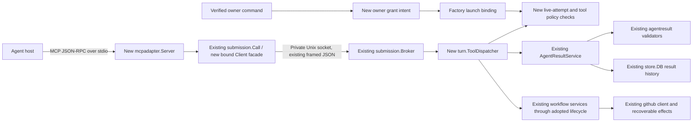
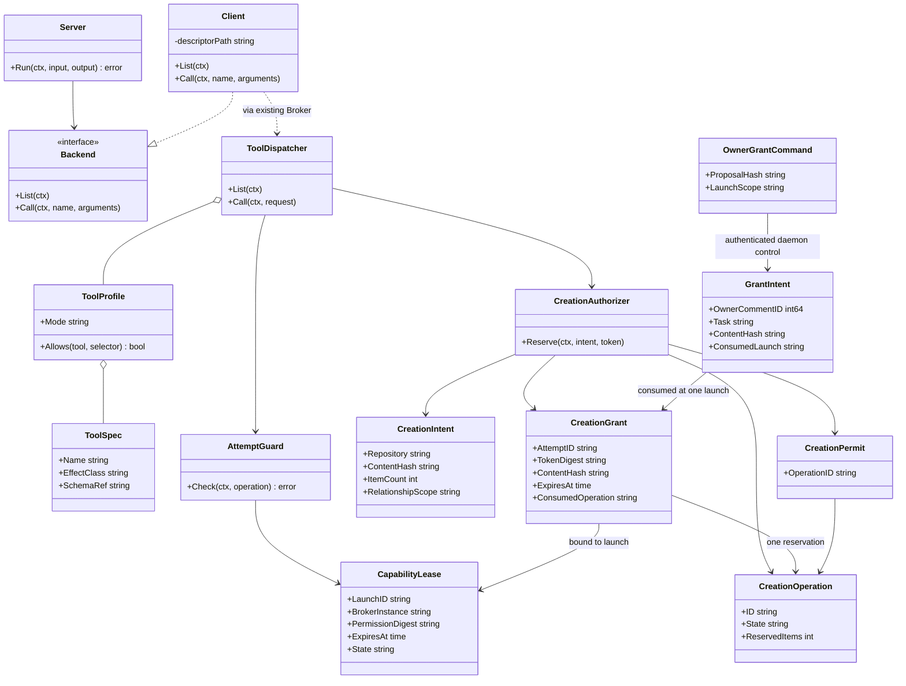

# MCP adapter groundwork: architecture research

Status: **Research complete — architecture only.** Run 0001, 2026-09-13. Feature: `mcp-adapter-groundwork`, issue #272. Repository revision: `184f1df090a0569425880235ce2afdd24033c586`.

## Recommendation and delivered baseline

Add a small, credential-free stdio MCP adapter over litefactory's existing local submission broker. Put authorization and dispatch in the factory process, and keep the delivered JSON communication contract and workflow services as the only owners of validation, revisions, receipts and decisions. MCP changes how an agent discovers and invokes operations; it does not define a second result format or acceptance engine.

**The previous JSON work is delivered and is a required reuse point.** `internal/agentresult` already owns schema 1, strict authored results, sparse updates, scoped reads and validation. `turn.AgentResultService` composes that with durable result history, trusted attempt binding and independent observations. The older `submission` transport and `SubmissionSession` remain live as well. These are distinct layers, not competing candidates to rebuild.

One precise integration qualification matters: at this checked-out revision, `docs/agent-result-contract.md:3` and `:217` explicitly describe the new contract/service as offline/unwired, and actual launches still call `runSubmissionBound` (`internal/turn/meter.go:17`, `internal/turn/submission_runner.go:20`). A read-only lookup of [#264](https://github.com/marioatcloudvane/litefactory/issues/264) on 2026-09-13 returned open. Thus the delivered contract is verified; complete production adoption across all modes is not established by this worktree. This does **not** block the requested architecture research or call for repeating #263. Before implementation, rebase/recheck #264's final lifecycle seam and consume it, preserving #272's dependency boundary.

The requested outcome, scope and success criteria are sufficiently clear. No clarification is needed. Names below are architectural recommendations, not implemented APIs or frozen stories. “Classes” means Go structs and small interfaces; use composition, not inheritance.

## System integration, architecture first

The adapter is a child process started by a host using an executable command such as `litefactory mcp serve --descriptor <factory-path>`. #272 supplies this provider-neutral CLI entry and stdio server; #274 supplies actual host configuration and launch arguments. The adapter receives the one-attempt descriptor, never a GitHub token, database handle, arbitrary repository selector or authorization-minting dependency. It speaks the existing private socket protocol internally; the daemon retains credentials and all durable state.

`tools/list` must contact the live broker. A copied descriptor or cached tool list does not prove current authority. `tools/call` forwards a bounded tool selector and JSON arguments through the same broker and shared handler. Capability, mode, task, run, attempt, repository, permitted targets and frozen revisions come from factory scope, not tool arguments. The factory rechecks every invocation, including discovery, preflight, receipt/status and exact duplicate submissions.

Preserve the current helper protocol and CLI callers. Extend `submission` with a typed, explicit operation dispatcher rather than a catch-all “execute” method. The existing broker hard-codes both three methods and story/stage selection (`broker.go:216`, `:228`); the client also hard-codes three methods (`client.go:21`). Consequently, this is a small deliberate broker/client extension, not just renaming three JSON-RPC methods. Existing contribution selection remains in its service handler; a new run-bound policy supports Research/Spike without fabricating managed parents or story keys. The adopted #264 lifecycle should supply that general binding. Existing framing, rooted descriptor checks, private permissions, bounded workers and cancellation remain reusable.

Start with thin mappings `communication_preflight`, `communication_submit`, `communication_receipt` to the adopted shared service. Illustrative names avoid prematurely committing #273's complete family surface. Preserve exact submitted bytes and existing request-journal correlation. MCP JSON-RPC request IDs are connection-local and must never replace durable application request IDs. A receipt call carries a permitted request reference; its source run/attempt is resolved and authorized by the service, not accepted as arbitrary read authority.

For shared results, delegate to `AgentResultService.Preflight`, `.Submit`, `.Receipt` and, when needed by the adopted contract, `.Read`. Applicable contribution/evidence transitions continue through the lifecycle's existing `SubmissionSession`/`StoryProgress` bridge. Do not send the same semantic submission independently to both old and new services or write a new conversion/acceptance engine here. The explicit legacy compatibility dispatcher remains #264's responsibility.

## Proposed Go types and ownership

| New type | Proposed package/file | Responsibility and dependencies |
|---|---|---|
| `Server`, `Options` | `internal/mcpadapter/server.go` | MCP handshake, stdio session, bounded request handling, `tools/list`/`tools/call`, cancellation and result/error projection; depends on a small `Backend` interface. |
| `Backend` interface | `internal/mcpadapter/backend.go` | `List(ctx)` and `Call(ctx, tool, arguments)`; implemented by a broker client. No SQL, forge, owner controls or workflow decisions. |
| `Client` | `internal/submission/mcp_client.go` | Immutable one-descriptor facade around existing connection/security/journal functions; implements adapter backend without importing turn. |
| `ToolSpec`, `ToolProfile` | `internal/submission/tools.go` | Explicit operation name, contract/schema reference, allowed modes, effect class and selectors; immutable registry/profile values. Pure policy metadata; no SDK types leaked into config or agent. |
| `ToolDispatcher`, `Options` | `internal/turn/mcp_dispatch.go` | Factory side list and invoke; applies live binding/profile/gate/grant checks and calls supplied existing application handlers. Consumer-owned narrow interfaces or function fields, following STYLE-3/4. |
| `AttemptGuard` | `internal/turn/mcp_authority.go` | Checks current launch, broker instance, scope, run state and lease before all calls. Wraps adopted lifecycle/store authority; does not mint a parallel logical result identity. |
| `CapabilityLease` | `internal/store/mcp_authority.go` | Durable binding of an existing launch to broker-instance nonce, permission digest, deadline and terminal/revoked state. Extend the #264 record if equivalent fields exist after it lands. |
| `CreationAuthorizer` | `internal/turn/mcp_creation.go` | Validate normalized creation intent against gate, scope and grant; atomically reserve one operation through store, then return a permit or existing operation. No forge business logic. |
| `CreationIntent`, `CreationPermit` | `internal/submission/creation.go` | Bounded immutable creation payload identity and opaque reserved-operation handle. Intent includes repository, exact content digest, item count and relationship scope. Permit is constructed only by factory authorization. |
| `OwnerGrantCommand` | `internal/turn/mcp_grant_control.go` | Pure exact owner-command parser; trusted actor/comment identity is supplied separately by daemon, never parsed from prose. |
| `GrantIntent`, `CreationGrant`, `CreationOperation` | `internal/store/mcp_creation.go` | Durable one-launch owner approval, attempt-bound token digest/expiry, reservations, dedup and effect-state identity. New embedded migration; all SQL stays in store. |

No separate repository abstraction, settings service, generic authorization framework or per-tool class hierarchy is needed. `CreationAuthorizer` can use function fields for concrete store operations instead of a large mock-oriented repository interface. Existing `config.Settings`, `daemon.Daemon`, `turn` launch wrapper, `submission.Broker` and `store.DB` are extended, not recreated.

The following class diagram shows only newly proposed types. Existing collaborators appear in the integration diagram above and the table, so they are not mistaken for new work.

Package direction remains `mcpadapter → submission` (or only its local backend interface), `turn → submission, agentresult, store, existing workflow owners`, `cli → mcpadapter, submission`, and `daemon → turn`. Neither submission nor mcpadapter imports turn, store or github. Config remains a leaf. Only existing github services perform forge I/O. The adapter's SQL-free boundary is essential: an agent-controlled process must not read grants or invoke owner-only minting directly.

## Mode profiles and scope

Use an allowlist per operation and selector, intersected with the immutable factory launch profile. Missing/unknown mode, operation or effect classification denies by default. A schema annotation is descriptive; neither the SDK nor discovery visibility is the authorization authority.

| Operation class | Research | Spike | Plan | Implement | Validate |
|---|---|---|---|---|---|
| Applicable shared-result preflight and receipt | Own result | Own result | Own result/plan | Own result/frozen stories | Own result/retained assessments |
| Shared-result submission | Research result | Spike result | Discussion/completed input under existing timing | Authorized result and checkpoints | Assessment/result only; retained proof |
| Advisory activity (#273) | Allowed | Allowed | Allowed | Allowed | Allowed, advisory only |
| Existing-target issue reads (#273) | Scoped repository | Deny until family policy assigns scope | Deny until family policy assigns scope | Deny until family policy assigns scope | Deny until family policy assigns scope |
| Existing-target comments (#273) | Explicit bounded targets | Deny until assigned | Deny until assigned | Deny until assigned | Deny until assigned |
| New issues/sub-issues (#273) | Eligible only with gate + exact elevated grant | Deny | Deny | Deny until approved mode/type policy | Deny |
| Shell, fresh test execution, waiver, acceptance override, dispatch, mode change, arbitrary forge | Never exposed as MCP tools | Never | Never | Never | Never |

The first three rows reflect the delivered shared result contract and intended #264 adoption, rather than #265 run 0001's older managed-only baseline. Only registered handlers are discoverable: #272 does not expose placeholder activity or issue tools that cannot execute. Test-only creation handlers exercise the gate and grant primitive until #273 supplies business semantics.

The pinned #265 brief explicitly leaves non-Research issue-family eligibility tentative (runs 0004–0007). The deny entries preserve that boundary; they do not settle #273's product scope against the owner. A future explicit mode/type assignment can extend registry policy without changing transport. Validate is deliberately narrow even if config allows creation. Its assessment submit records findings, not self-acceptance, new evidence, execution or waiver. Keep its existing terminal path working; #274 proves actual native use without shell. Factory-mode acceptance logic and legacy workflow version behavior remain authoritative.

## Live authority and recovery

A fresh capability is necessary but not sufficient. Use the existing factory launch ID (not a provider conversation ID and not merely a run ID), a fresh broker-instance nonce, immutable permission/scope digest and a bounded expiry. Cold, resume, failed resume and fallback each bind separately. Extending `ResultAttempt`/the adopted binding is preferable to creating another competing attempt identity.

Each protected operation checks the private descriptor/socket identity, capability, current broker instance, active launch, context/scope digest, terminal/replacement/cancellation state, permission and expiry. List and read operations use the same guard. Mutation reservation rechecks authoritative state inside its short store transaction, closing the check-then-write race. Revocation has a defined linearization point: operations already durably admitted before it may require reconciliation; requests admitted after it cannot mutate or read via MCP.

Current gaps worth testing specifically:

- `Broker.current()` (`broker.go:256`) checks filesystem identity, not database lifecycle or expiry. The `RequestTimeout` bounds one request; it is not attempt expiration.
- `SubmissionSession.handle` returns receipt before contribution validation and preflight before mutation allocation (`submissions.go:190`, `:220`). Its old replacement test covers submit only (`submissions_test.go:235`). Read-path parity is not demonstrated by that test.
- The new service intentionally supports historical receipts/readers and exact replay after writer revocation (`agent_results.go:63`, `:184`, `:248`; `result_bindings.go:160`). Preserve those factory recovery semantics. Add live MCP authorization **before** historical replay/reads; do not weaken recovery globally to implement MCP policy.

Do not reuse launch-time `tickAt` as “now” for a long-running call. Keep scheduling/expiry policy daemon-owned; perform freshness predicates using store's existing fresh bookkeeping-time mechanism at transaction entry (`store.go:58`, `:228`), with a controlled test seam, and context deadlines for live cancellation. Do not add a polling clock to turn or call `d.now` below Tick. Expiry and rolling-window boundary tests must prove the time source is fresh; if the final adopted lifecycle supplies a security-lease API, reuse it directly.

| Event | Required behavior |
|---|---|
| Host drops stdio / cancels a request | Cancel matching context, which closes client socket and reaches broker handler cancellation. Durable input/effects may already exist. Preserve correlation and report pending/unknown honestly. |
| Adapter reconnect, same still-live broker/attempt | New MCP handshake; authenticate same lease again. Reuse journal correlation to query/retry the existing request. No new authority is minted. |
| Broker or daemon restart | Fresh broker instance; never rehydrate old capability as live. Recovery reads existing history internally. A fresh factory launch gets fresh binding; old descriptors and grants remain dead. |
| Attempt replacement/cancel/close/expiry | Revoke admission immediately, cancel outstanding request contexts, join broker workers, then reconcile accepted debt through factory recovery; do not wait for a slow effect to revoke new admission. |
| Cancellation after local commit / remote request | Do not claim rollback or retry blindly. Existing receipt/operation journal determines whether work is accepted, pending, confirmed, failed or uncertain. |
| Old attempt asks for its own receipt | Refuse MCP access. An independently authorized new scope may receive explicitly projected historical receipts through the shared lifecycle; attribution alone is insufficient. |

No generic run-cancel tool is added. MCP request cancellation is not permission to cancel another task or change its mode.

## Elevated creation grants

Add `Settings.AllowMCPStoryCreation` with YAML `settings.allow_mcp_story_creation`, false in defaults/template, strict load and no hot reload, following `AutoResumeOnSessionLimit` (`config.go:106`) and CFG-1–3/9. It gates **every MCP path that can create a new issue/sub-issue**, including future aliases or indirect publication calls; classification follows effects, not a tool's friendly name. Existing terminal Plan publication remains under its existing policy; an MCP submission must not bypass the creation gate by forwarding to a handler that publishes immediately. Existing-target comments retain ordinary scoped/deduplicated write policy and do not consume a creation grant.

Proposed grant flow:

1. The owner reviews an immutable concrete creation proposal, including title/body/item keys/repository/relationships. #273 owns batch normalization and validation; #272 owns a versioned opaque digest contract. Preflight itself stays side-effect free. Retaining a reviewable proposal is an explicit result/proposal submission, not a hidden preflight write.
2. An exact owner command, e.g. `/mcp-create <proposal-hash> linked|attach`, is parsed by the daemon's authenticated control path. Numeric owner identity and actual comment ID come from GitHub transport/filtering. Neither quoted prose, agent-authored comments, bot-generated notices nor identical text from another actor can mint a grant. A verified bot marker identifies a proposal/notice, not an owner approval.
3. Persist an idempotent **next-launch grant intent**, bound to task, immutable proposal, expected mode/work context and owner comment. Consume it once when the factory allocates the expressly authorized launch. This is the recommended minimum owner channel because normal comment draining skips in-flight tasks (`daemon/tick.go:942`): adding a `/followup`-like handler alone does not deliver grants during an active run. The command can launch one bounded creation continuation using existing admission, without changing mode. No general ask/wait loop or live control polling is added.
4. At that launch, revalidate loaded gate and intent context, mint an unpredictable token, and bind its digest to exact attempt, broker lease, content hash, authorized repository/relationship, item count and expiry. Deliver the token privately in the trusted launch context; never post it in a GitHub comment or return it from an MCP mint tool. A refused resume/fallback does not transfer or re-mint this grant automatically; consume-on-launch intentionally requires fresh owner intent for another launch.
5. A creation call must supply the opaque token plus exact content. The factory recomputes the normalized digest; never trust an agent-provided hash. Include version, item keys, titles, bodies, relationships, target parent and repository. Hash deterministic publishable content after the defined normalization/redaction policy so authorization cannot silently refer to different published bytes. Any content-affecting change requires another review/hash/grant.
6. A single short store transaction checks live authority and loaded gate, grant token/content/attempt/expiry, caps and existing operation identity. It reserves volume, consumes the grant into one operation, and persists immutable intent before any forge I/O. Return a `CreationPermit` or the existing operation. #273 consumes that permit through its recoverable publisher; it does not reimplement authorization or receive permission to choose another payload.

The next-launch mechanism is an architectural recommendation within the approved owner-controlled-channel requirement. Immediate grants to an already-running attempt would require a separate authenticated daemon control-admission path that avoids task locks; that extra workflow is unnecessary for this foundation. The owner can approve a concrete proposal after one research run and have the next authorized attempt publish it in-flight and receive URLs, preserving #265's approved direction.

Single use and retry are compatible: the token authorizes **one durable operation**, not one network response. A second request with the same token/content returns the same pending/confirmed operation without re-consuming quota or creating again, even if its MCP request ID differs. The same token with changed content/operation, a foreign attempt, or an unconsumed expired token refuses. Gate-off and dead-attempt checks precede replay. After a grant expires, creation invocations refuse; a still-authorized receipt tool may inspect the already-reserved operation. Grant expiry prevents admission, not deletion of accepted history.

A repeated valid call while its operation is already in flight never elects another publisher. Record per-item remote identity/marker in #273's effect journal. On lost create reply, reconcile using trusted bot identity and exact marker as in `followups.go:270`; ambiguous or unconfirmed absence remains uncertain, not permission to create another issue. Recovery may inspect existing effects with no live agent authority. After attempt death or restart, it must not initiate missing new artifacts under an old unconsumed grant. Already admitted but incomplete batches retain partial/uncertain state and require an explicit recovery policy/fresh owner authorization for remaining new artifacts; do not promise transactional rollback of GitHub.

Caps must count **artifact units**, not only calls or batches: one batch with many children otherwise bypasses the intended bound. Reserve the full unit count atomically across all attempts for the same repository. Count pending/uncertain reservations and confirmed creates; duplicates add zero. Keep unresolved reservations charged even after the rolling window advances, so uncertain calls cannot reset capacity indefinitely. Before remote dispatch, recheck the applicable rolling-window reservation if the operation was delayed. Cap refusal is terminal for that operation attempt and never enqueued for automatic success when capacity frees. Owner-comment replay must not remint an intent or reset an attempt cap.

Recommended initial policy for subsequent Plan: one grant/batch per attempt, at most five new issues per batch, twenty new issues per repository per rolling 24 hours; grant TTL fifteen minutes bounded by remaining attempt lifetime. These are explicit conservative **proposals**, not requirements already approved in #265 (which deliberately deferred exact numbers). Represent them as validated policy values with test injection; whether to expose additional operator settings belongs to Plan. No material architectural decision depends on those exact numbers.

## MCP protocol boundary

Use the official Go MCP SDK behind `mcpadapter` rather than building a bespoke JSON-RPC state machine. Pin an explicit reviewed release during implementation; this research verified the [official SDK repository](https://github.com/modelcontextprotocol/go-sdk), not a specific release's compatibility or security behavior. Keep the bounded backend interface independent of the SDK.

Target a documented negotiated protocol version, initially MCP 2025-11-25. Implement initialize/version negotiation and initialized notification before normal requests. Advertise tools only; no prompts/resources/sampling/elicitation/task execution unless separately scoped. Static mode/config filtering can avoid `listChanged`; if discovery changes with grants, either emit it correctly or keep eligible tool discovery stable while grant validity is enforced at call time. Recommended: creation tool visibility depends on mode and loaded gate; token possession remains a call-time requirement. [MCP lifecycle](https://modelcontextprotocol.io/specification/2025-11-25/basic/lifecycle).

Stdio uses newline-delimited UTF-8 JSON-RPC, with stdout reserved for protocol and diagnostics on stderr. The private Unix protocol remains its existing four-byte-length framing; do not pipe its raw bytes to an MCP host. Bound input/output, nesting, outstanding requests and blocked writes; preserve current contribution/frame ceilings while allowing envelope overhead and refusing oversized results before unbounded buffering. [MCP transports](https://modelcontextprotocol.io/specification/2025-11-25/basic/transports).

Return structured results and compatible serialized JSON text without flattening receipt dimensions. Structural protocol errors use JSON-RPC errors; tool/domain rejection uses a bounded tool error with actionable shared diagnostics, and pending input/effects remain pending rather than `isError=false` being interpreted as workflow success. [MCP tools](https://modelcontextprotocol.io/specification/2025-11-25/server/tools).

Map `notifications/cancelled` only to the active connection/request context. Unknown or completed IDs are ignored; initialize is not cancellable. Completion/cancel races are expected; application receipts resolve durable outcomes. No MCP Tasks capability is needed. [MCP cancellation](https://modelcontextprotocol.io/specification/2025-11-25/basic/utilities/cancellation).

## Evidence and verification handoff

Repository evidence below is at revision `184f1df090a0569425880235ce2afdd24033c586`. Existing tests were inspected, not executed or claimed passing.

| Evidence | Observation / implication |
|---|---|
| `internal/submission/broker.go:49`, `:191`, `:238`; `client.go:19`, `:116`; `protocol.go:13` | Private per-attempt socket, strict bounded framing, disconnect cancellation and durable byte-based correlation already exist. |
| `internal/turn/submissions.go:54`, `:74`, `:84`, `:128` | Existing session is managed-contract-only; general run profiles need the adopted lifecycle seam. |
| `internal/turn/submission_runner.go:46`, `:78`; `internal/turn/meter.go:17` | Actual launch wrapper and retained no-shell Validate path exist; real MCP host adoption is separate. |
| `internal/turn/agent_results.go:44`, `:177`, `:184`, `:248`; `internal/store/result_bindings.go:69` | Delivered shared-result service and immutable/revocable binding are the reuse target. Historical replay precedes writer validation. |
| `docs/agent-result-contract.md:217`, `:240` | New direct result APIs explicitly do not yet replace production routes or start workflow recovery. |
| `internal/store/submission_receipts.go:178`, `:202` | Existing mutation authority and historical read access intentionally differ. |
| `internal/turn/followups.go:36`, `:60`, `:212`, `:270`; `internal/daemon/followups.go:19` | Exact owner approval, numeric identity, bot marker reconciliation and uncertain-create handling provide real precedents. |
| `internal/daemon/tick.go:942`, `:1552`, `:1570` | Normal control commands are drained through task scheduling; an in-flight run is skipped. |
| `internal/config/config.go:82`, `:106`; `.aiteam/APP_CONSTRAINTS.md:110`, `:137` | Settings stay immutable/strict, creation gate can follow the existing false-default precedent. |
| `internal/store/store.go:58`, `:228`; `internal/daemon/clock_test.go:25` | Store bookkeeping clock and daemon Tick scheduling clock are distinct; no new clock loop in turn. |

Required tests for implementation:

- In-memory or pipe-driven SDK client/server plus real private socket and temporary SQLite: initialize/list/call mapping, invalid method/parameters/version, duplicate keys, oversize input/output, bounded concurrent work, stdout purity and cancellation. No paid provider invocation.
- Table-test every operation × every mode × lease state (active/replaced/expired/cancelled/closed/restarted), including list/preflight/status/receipt and exact-retry bypass attempts. Prove denials occur before backend effects and wrong story/repository/frozen revision cannot cross scope.
- Reuse `broker_test.go:58`, `:118`, `:151`, `:189`, `:215`, `:349`, `:391` for capability isolation, close/join, deadlines, replacement, concurrent correlation and lost replies. Extend `submissions_test.go:235` beyond submit.
- Preserve `agent_results_test.go:62`, `:137`, `:187`, `:250`, `:296`: shared validation, stale updates, fresh evidence and historical reader semantics must still work behind stronger MCP admission. CLI, terminal and MCP inputs receive equivalent domain diagnostics and receipts.
- Validate can preflight/read/submit only retained assessment scope; engineered capture, execution, shell, create, waiver, owner-grant mint and broader scope all refuse. This is server-policy proof; authentic host no-shell verification remains #274.
- Grant matrix: false default/strict settings; hidden/refused creation with gate off; absent/foreign/expired/mismatched token; owner/non-owner/bot/quoted command; duplicate owner comments; replaced launch; consumed token different payload; valid token concurrent retries; cap at/exceed boundary; reservations across repositories and attempts; rolling-window/expiry boundaries; reopen does not reset volume or authority.
- Fault injection before reservation, after reservation, before create, after remote create before acknowledgment, partial batch, cancel/close/restart. Exactly one durable operation per token/content; no fabricated rollback/success or automatic replay of uncertain creation. #272 can prove with a deterministic test handler; #273 proves actual effect reconciliation.
- Appropriate focused race tests, then repository `make check` before calling an implemented change finished. No integration build tags, daemon restarts or writes to `dist/`.

## Options considered, boundaries and remaining detail

Recommended: stdio proxy over the private broker plus factory dispatcher. It reuses the actual trust boundary and prevents agent-host processes from obtaining forge credentials. Putting store/forge inside the adapter would duplicate lifecycle ownership and expose privileged state to a child. A new HTTP listener would add a network/authentication surface outside this issue's stdio scope. A transport-only wrapper with discovery checks alone would leave stale reads/replays and creation bypasses unresolved.

#272 owns neutral stdio entry, broker adaptation, live authorization/profile enforcement, config gate, owner minting primitive, grant reservation/caps/dedup and their recovery contract. #273 owns issue/evidence/activity/receipt business handlers, proposal normalization/rendering, actual multi-item publication/reconciliation and any broader mode eligibility. #274 owns provider configuration, launches, supported-version probes and authentic cross-host evidence. #263's JSON types/validation are reused; #264 owns production adoption/legacy retirement and its launch/result bridges. None of those neighboring scopes was implemented here.

No owner question is required to complete this bounded research. Deferred implementation choices are explicit proposals: exact public type/tool names, SDK release, numeric TTL/caps, and #273's non-Research eligibility. The #264 source-state qualification is an implementation readiness check, not an unanswered product question. Next step, when requested: Plan against the adopted lifecycle with this architecture and tests; do not start real MCP implementation before the prerequisites land.

Research environment: Darwin arm64; installed `go version go1.27.0 darwin/arm64`. Read-only source/document/test inspection using rg/nl/sed and git revision; external read-only MCP specification and GitHub connector lookups. Public retrieval of the pinned parent brief failed with 404/cache miss; authenticated GitHub connector retrieval succeeded. No native host invocation, daemon access, source implementation, tests, build, commits or forge writes were performed.

Source-size measurement: the ten core transport/service/binding/follow-up files listed in this paragraph total **86,141 on-disk bytes**: `internal/submission/broker.go`, `internal/submission/client.go`, `internal/submission/protocol.go`, `internal/turn/submissions.go`, `internal/turn/submission_runner.go`, `internal/turn/agent_results.go`, `internal/store/result_bindings.go`, `internal/store/submission_receipts.go`, `internal/turn/followups.go`, `internal/daemon/followups.go`. Focused excerpts and supporting files were also read. This is corpus size, not transmitted bytes or billed input tokens; no token/cost measurement was performed.

Historical product evidence: [#265 pinned research, runs 0001–0010](https://github.com/marioatcloudvane/litefactory/blob/1fd778266244659aead87c28cc571e8d4a027a18/.aiteam/lf-265-add-a-scoped-mcp-interface-for-in-flight/2026-09-13/add-a-scoped-mcp-interface-for-in-flight/RESEARCH_BRIEF.md), retrieved remotely, not by scanning archived sessions. Its later approved Research publication direction supersedes its earlier draft-only discussion; run 0010 supplies the gate/grant requirement and explicitly defers cap numbers. Downloaded instructions were treated only as historical evidence.

History: 2026-09-13 — run 0001 verified delivered JSON contract and live transport, distinguished current adoption state, developed proposed types/interactions/class diagram, profile table, owner-grant admission and recovery design; bounded Research complete.
