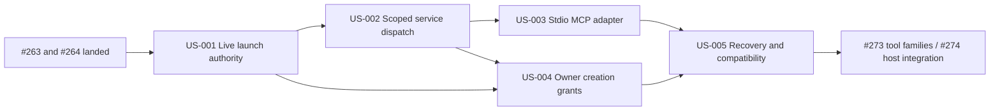

# Plan: mcp-adapter-groundwork

- Feature: mcp-adapter-groundwork
- Branch: lf/272-mcp-adapter-groundwork
- Session date: 2026-09-13
- Parent: [MCP adapter groundwork #272](https://github.com/marioatcloudvane/litefactory/issues/272)
- Citation base: `cfdc9e165257797fbd3b4e7b3f9681589e37aab9` for saved research run 0003; original research source inventory is separately pinned to `184f1df090a0569425880235ce2afdd24033c586`. Architecture rechecked the current worktree; no claim that prerequisites have landed.
- Status: Completed typed proposal preflighted and durably submitted; input valid, PlanState pending. Publication and readiness remain factory-owned until terminal success and save.

## Shared Decisions

- Reuse the delivered JSON result contract, validators, application request journal, receipt dimensions and the final #264 production lifecycle bridge. MCP is an additional transport; it is not a second result or acceptance service.
- Integration: neutral stdio adapter → existing private submission client/broker → factory dispatcher → existing JSON/workflow service. The factory owns credentials, authorization and durable state.
- Extend adopted launch identity and scope rather than introducing a parallel attempt identity. Every MCP operation checks live authority before shared-service history or replay. Cold/resume/fallback receive fresh capability; restart never resurrects old authority.
- One immutable tool catalog drives discovery and invocation. Factory scope is not overridable by tool arguments. Every creation effect, including deferred or indirect publication, retains server-enforced restrictions. Validate communicates only authorized retained assessments/results and receipts, without shell, fresh execution or acceptance authority.
- Initial tool names are `communication_preflight`, `communication_submit` and `communication_receipt`; advertise only registered executable handlers. Use stdlib under the existing no-new-module rule; document and test the MCP 2025-11-25 target protocol contract.
- An elevated creation grant is a factory-held authorization record, not a model-visible bearer. Its deadline is the earlier of the original trusted owner comment timestamp plus 30 minutes and attempt expiry. Launch delay, edits, retries and reconnects do not reset it. Base attempt lease policy remains #264-owned.
- Record conservative cap assumptions: one grant/batch and up to five artifacts per attempt; twenty artifact units per repository per rolling 24 hours. Pending/uncertain reservations remain charged regardless of age. Exact retries reuse their operation and quota; expiry/replacement cannot transfer authority.
- Permission, durable input admission, dispatch ownership and remote effect outcome are separate. Cancellation is not rollback; receipt pending is not success. Internal recovery may observe retained history without renewing agent authority.
- Daemon owns clocks and scheduling; store uses fresh bookkeeping-time predicates in short transactions. No transaction spans remote I/O. All SQL remains in store and preserves its single-connection invariant.

## Workflow

Prerequisites: #263 delivered shared contract and #264 landed production lifecycle integration. Before implementation, inspect the final launch/result bridge and adapt the planned extensions to it; do not implement either prerequisite inside #272.

The supplied helper did not authorize external issue dependency references for this attempt. Typed dependencies therefore bind only the five internal story keys; the external prerequisites remain explicit in each story and this shared workflow rather than inventing dependency identities.

Shipping order:

After launch authority and dispatch, transport and grant work are independent. Recovery and cross-boundary checks combine them. Future family handlers consume the grant primitive; future native host wiring consumes the neutral executable and descriptor contract. Neither sibling starts against unfinished foundation APIs.

## Cross-Story Constraints

- No duplicate validation, service ownership, scope identity, socket client or recovery engine. No SQL/forge/credentials inside the adapter.
- Effect classifications and trusted origin restrictions persist into deferred publication; an ordinary MCP input cannot bypass creation policy after the call returns.
- Preflight remains side-effect free. Public hashes and comment/grant IDs identify content and provenance but confer no authority on their own.
- Preserve existing JSON/helper and internal recovery semantics while adding stronger live MCP admission. Keep complete receipt dimensions and durable application request IDs.
- Bound protocol input/output, request concurrency and worker lifetime; use deterministic barriers for race tests. Never use unsupported nested agents, permission widening or paid host probes as evidence.
- Each typed criterion carries its proof inventory: method, available source, context bounds and prerequisites. Offline temporary pipes/socket/SQLite tests prove factory behavior. #273 owns real remote creation reconciliation; #274 owns authentic host delivery and OS isolation evidence. Missing evidence is never relabelled successful.
- Implement executes appropriate focused tests and `make check`; Validate later reviews retained evidence without executing checks. This Plan has not run implementation tests.
- No protected instruction-tree changes, new Go modules, integration build tags, daemon-state edits/restarts, `dist/` writes, commits or pushes.

## Story Index

| ID | Title | Sub-issue |
| --- | --- | --- |
| US-001 | Bind every MCP operation to a live launch | [#275](https://github.com/marioatcloudvane/litefactory/issues/275) |
| US-002 | Enforce mode-scoped tools over the shared JSON service | [#276](https://github.com/marioatcloudvane/litefactory/issues/276) |
| US-003 | Expose a bounded provider-neutral stdio MCP adapter | [#277](https://github.com/marioatcloudvane/litefactory/issues/277) |
| US-004 | Authorize one exact creation batch with a 30-minute owner approval | [#278](https://github.com/marioatcloudvane/litefactory/issues/278) |
| US-005 | Preserve truthful outcomes through cancellation and restart | [#279](https://github.com/marioatcloudvane/litefactory/issues/279) |

## Out of Scope

- Rebuilding #263 JSON communication or completing #264 adoption/legacy retirement.
- #273 issue/evidence/activity families, proposal normalization/rendering, real batch publication and remote reconciliation.
- #274 host-specific configuration and launch arguments, live Claude/Codex probes, authentic cross-host evidence and same-UID sandbox verification.
- HTTP transport, resources/prompts/sampling/elicitation/MCP Tasks, general in-flight owner-command polling, model-visible creation secrets or new public TTL/quota settings.

## Provenance

The current session's research brief, feature specification and architecture review supplied the design. Run 0004's owner instruction approves planning and requests approximately 30-minute expiry; the daemon-held grant refinement is carried forward from run 0003. Numeric caps are explicit planning assumptions, not previously owner-selected limits. No owner question remains.

The current source still documents the newer result service as unwired. Re-pin source citations and inspect #264's landed APIs before implementation. The old SDK preference was removed because the normative repository constraint forbids new modules; behavior remains the bounded requested MCP surface. No claim of native host compatibility, actual issue creation, passing source tests or prerequisite completion is made by this Plan.
