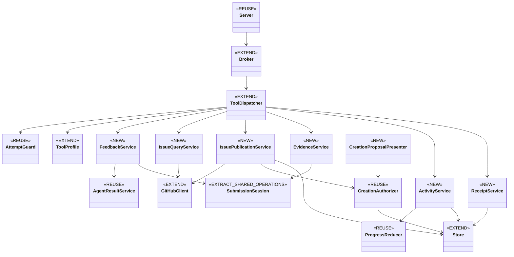

# MCP tool families — research runs 0001–0002

Research date: 2026-09-14. Current revision: `14674782dce0a9e15b3ba27e759776d7b4390cd4` on `lf/273-mcp-tool-families`. Run 0001 inspected `dda6f72c704cc6e84cb2c09649853de2d85d9b44`; run 0002 verified no changes under `internal/` or `docs/` between those revisions. Source citations below remain valid.

Status: **Research complete**. Run 0002 records the owner’s explicit reuse direction and clarifies the recommended #273/#274 handoff without another permission gate. The diagram and service names remain a researched design recommendation, not a frozen implementation plan. No implementation or Plan was started.

## Request and settled boundaries

Inspect current source after the reported landing of #272 and JSON groundwork; identify reusable owners and propose a class diagram plus service table describing functionality, purpose and security constraints for #273. #274 is explicitly a later consumer, never a prerequisite. Include Research, Implement and Validate behavior; preserve engineering/assessment separation and no automatic mode chaining. Issue creation is included in this recommended design because the issue's detailed completion criteria require it, despite the optional wording in its scope. Activity get is recommended alongside update. These are recommendations for review, not implemented API commitments.

Before substantial investigation the intended Research output was clear enough to proceed: a source-grounded design rather than code or a new feature specification. Run 0001 raised two decisions from focused current-source evidence; the run-0002 resolution and clarification are recorded below. The owner reports prior issues landed; this brief does not infer their GitHub status from comments left in code.

## Findings: what exists now

1. **The transport and authority foundation exists, but the advertised family catalog does not.** `submission.ToolProfile.List` exposes only `communication_preflight`, `communication_submit`, `communication_receipt` for the five assigned modes. `turn.ToolDispatcher` binds that catalog to an immutable permission digest and `AttemptGuard`; its switch handles those three names. Extend these owners rather than add another MCP server. Evidence: `internal/submission/tools.go:20`, `:44`; `internal/turn/mcp_tools.go:29`, `:45`, `:66`; `internal/mcpadapter/server.go:80`.
2. **JSON result recording and story checkpoint ingestion are different existing services.** `AgentResultService.Preflight/Submit/Receipt` validates and records shared application JSON; it deliberately does not capture proof, mutate readiness, publish, or dispatch. `SubmissionSession.handle` parses stage contributions, verifies snapshots, allocates durable submission receipts and calls engineering or assessment recording. Evidence: `internal/turn/agent_results.go:23`, `:139`, `:191`, `:198`, `:272`; `internal/turn/submissions.go:187`; `internal/turn/submission_records.go:14`, `:97`. `evidence_submit` must use extracted/reused checkpoint operations, not just rename `communication_submit`.
3. **There is no bounded agent issue-list API in the inspected owner.** Existing `github.Client.ListIssues` walks daemon polling pages, fixes open state and carries full issue fields. `GetIssue` already targets repository-local numbers and excludes PRs. Add a bounded page read in `internal/github` while preserving polling behavior, then project only number, title and optionally canonical mode labels at the family boundary. Number and next-page metadata are necessary targeting/pagination data; issue bodies, arbitrary labels, comments and account details are excluded. Evidence: `internal/github/issues.go:25`, `:141`, `:219`; `internal/github/followups.go:12` (all-state recovery walk, also not the requested page contract).
4. **Publication/recovery precedents are reusable, but generic comment receipts are new.** `PostComment` requires `redact.Body` and returns a confirmed ID. Story progress effects use bot identity plus an exact marker to recover comments. Follow-up creation additionally persists attempted state and refuses blind recreation after uncertainty. Generic comments need that stricter dispatch journal plus serialization: scanning then posting alone does not guarantee duplicate prevention during concurrent calls or an ambiguous network failure. Evidence: `internal/github/comments.go:224`, `:229`; `internal/turn/story_progress.go:472`; `internal/turn/followups.go:235` (especially `:278`).
5. **The creation security primitive is substantial and reusable.** `CreationAuthorizer` binds startup gate, numeric owner identity, exact command/proposal, Research-only visibility and attempt grant. `CreationStore` grants one batch/five artifacts per attempt, twenty artifacts per rolling repository 24 hours, 30-minute approval lifetime, exact-content reservation and a first-dispatch-only private permit. Unknown or partial effects remain charged. It stores operation state, not per-created-issue publication identities. Evidence: `internal/turn/mcp_creation.go:43`, `:72`, `:92`, `:113`; `internal/store/mcp_creation.go:16`, `:71`, `:80`, `:313`, `:368`; `docs/mcp-adapter.md:25`–`:44`.
6. **Activity already has a pure reducer, not a live persistence service.** `agentresult.ReduceProgress` enforces sequence/hash replay rules, 2 KiB messages, 1,024 updates and 32 retained identities; terminal retention is at most 24 hours. `ProgressState` is explicitly process-local and may disappear after restart. Reuse it and inject factory time; durable request disposition can be retained separately without making status authoritative. Evidence: `internal/agentresult/progress.go:12`, `:46`, `:90`, `:147`, `:162`.
7. **Recovery identities need generalization below the family handlers.** The client journals only `communication_submit`; only `communication_receipt` maps to receipt correlation. Journaling uses exact argument bytes, so merely adding new handler names would leave their request IDs empty. Namespace new stable identities by family/method plus bound scope and payload, retaining the existing communication identity behavior. Result and submission receipts have independent decision dimensions but no generic confirmed comment/batch identity projection. Evidence: `internal/submission/client.go:58`, `:141`; `internal/store/result_history.go:38`; `internal/store/submission_receipts.go:112`.
8. **Production adoption remains a concrete seam in this checkout.** A production-source search across `internal` excluding tests found definitions but no call sites for `NewToolDispatcher`, `NewCreationAuthorizer`, `AdmitMCPOwnerCommand` and `BindCreationGrant`. `BuildMCPLaunchSpec` and the docs describe production adoption as #264 and host consumption as #274. This establishes a wiring gap in inspected HEAD, not the status of those issues. Evidence: `internal/turn/mcp_launch.go:11`; `internal/daemon/mcp_creation.go:11`; `docs/mcp-adapter.md:21`, `:44`, `:65`.

## Proposed class diagram

Go uses structs and consumer-owned interfaces; these names describe responsibilities, not new deployable microservices or a requirement to introduce one new struct per tool family. Thin responsibilities such as FeedbackService may be methods or small facades on existing services. NEW means proposed; EXTEND/REUSE identify existing owners. All family orchestration lives under `internal/turn`; SQL remains in `internal/store`, forge I/O in `internal/github`.

## Proposed services and extensions

| Service / owner | Added functionality | What it does and solves | Security constraints and impediments |
|---|---|---|---|
| `FeedbackService` — new thin `turn` facade | `feedback_preflight` for application contributions, stage checkpoints and researched batches | Returns correction diagnostics before submission. Delegates to `AgentResultService.Preflight`, shared `agent.ParseContribution`/checkpoint validation and existing typed story validation plus `submission.CanonicalCreation` as applicable. The batch presenter and publisher use the same validation path. | No proposal retention, grant minting, proof capture or publication during preflight. No adapter-local business validation. Preserve current MCP refusal of publishable Plan content through communication paths. Batch support needs a shared facade because current application preflight is not a generic creation-envelope validator. |
| `IssueQueryService` — new facade; extend `github.Client` | `issues_list`, `issues_get`; open default, explicit open/closed filter, bounded page/cursor contract, local issue number | Gives agents a small repository-local discovery view: number, title and optionally normalized recognized mode labels. A page endpoint avoids loading every issue just to return a small slice. | Repository comes from factory binding, never a supplied URL/owner/repo. Exclude PRs, bodies and arbitrary labels. Reads confer no comment or creation permission. Validate positive numbers and cap pages/response bytes. Canonical mode projection must deliberately respect the existing ban on echoing arbitrary raw label strings. |
| `IssuePublicationService` — new `turn` service | `issues_comment`, `issues_create_batch`, per-artifact reconciliation | Persists intent before remote writes; records confirmed comment IDs and created issue numbers/IDs plus relationship outcomes. Replays return the same operation. Uncertain effects remain visible until authoritative reconciliation. | Comments require an existing factory-authorized target, but do not use the creation gate. Creation delegates every grant/cap/dispatch decision to `CreationAuthorizer`. Bot identity, exact markers/content and target checks protect recovery. Serialize dispatch; never blindly retry uncertain publication. Partial batches need per-artifact durable state and cannot be marked wholly confirmed. No DB transaction over GitHub I/O. |
| `CreationProposalPresenter` — new factory collaborator | Validate/render/redact exact researched batch, retain canonical envelope, expose reviewable hash and exact approval command in the existing report flow | Bridges the presently missing step between an agent's researched decomposition and owner approval of exact publishable content. Retention and presentation happen before a later authorized creation attempt. | Not a minting tool. Preflight never calls it. Include final markers/relationships in reviewed bytes; any later byte change requires a fresh proposal and approval. Use authenticated owner-control ingestion separately; copied prose and comment volume grant nothing. Its reusable content/presentation operations belong to #273; attaching them to live reporting/intake follows the integration handoff below. |
| `EvidenceService` — new facade over extracted `SubmissionSession` operations | `evidence_submit` for engineering checkpoints, retained assessments, allowed invalidation | Makes the existing per-story JSON workflow callable through MCP without fabricating a second evidence engine. A recorded application result remains distinct from an applied checkpoint. | Implement binds exact frozen story/revision, current snapshot and executed checks; Validate uses retained evidence and cannot capture/run checks. Preserve legacy versus separated workflow semantics and current stage validation. Receipt acceptance is not owner acceptance. No automatic transition to another mode. |
| `ActivityService` — new service using `agentresult.ReduceProgress` | `activity_update`, recommended `activity_get`; synchronized per-attempt state and bounded request dispositions | Supplies advisory progress to the owner and a scoped latest-status view to the agent. Reuses ordering/dedup/expiry rules instead of writing another reducer. | No readiness, completion, scope, grant or expiry extension. Factory supplies time and attempt activity. Keep status process-local; a separate durable disposition may say an update was recorded while its latest display is no longer available after restart. Bound/sanitize visible status. |
| `ReceiptService` — new read facade; extend `store` | `receipts_get` across families; durable family request index and publication projections | Presents a stable recovery address and honest independent states for accepted input, engineering, assessment and remote effects. Joins existing result/submission/creation records rather than replacing their workflows. For reads/preflight, record bounded request disposition/references if cross-family durable recovery is required; do not treat that bookkeeping as accepted domain input. | Reads require current scoped reader authority; knowing an ID is not authorization. Never return private permits, raw unrelated payloads or credentials. Lookup does not retry effects or revive leases. Distinguish no durable operation, pending, rejected, uncertain and confirmed; avoid recursively creating receipts for receipt lookup. |
| Existing `ToolDispatcher`, `ToolProfile`, broker/client and `store` — extend | Register real family schemas, explicit mode/effect permissions, expanded permission digest, family-aware journal correlation and operation persistence | Connects the new semantics to the already-bounded MCP edge. Keep existing communication tools compatible; introducing public names alone is insufficient. SQL additions use new embedded migrations. | Current profile only admits read/input effects: authorize ordinary publication and elevated creation explicitly, not by relaxing all effects. Bind repository/targets/catalog to immutable factory authority. All new handlers propagate cancellation; factory reconciliation may record known facts after cancellation but cannot mint a fresh dispatch owner. |

Recommended permission matrix for the three requested modes: reads, preflight, activity and scoped receipts in Research/Implement/Validate; comments only to their explicit factory-authorized existing targets; engineering evidence/invalidation only through existing Implement stage rules; retained assessment only through existing Validate rules; creation only in Research with enabled startup gate and one valid exact grant. Keep existing Plan/Spike communication behavior; do not implicitly grant them new publication powers.

## Run 0002 clarification and resolved decisions

The owner asks what feedback, activity and receipts actually do, directs reuse of existing work, and challenges placing integration in #273 when #274 follows. These are explanatory questions; no further owner permission is needed for this Research handoff.

**Reuse is settled.** Reuse the existing validator, transport, authority, private permit, progress reducer and receipt storage mechanisms. The earlier question was about a wording mismatch: the issue describes a token supplied with a batch, whereas the implemented groundwork keeps the grant/one-use dispatch permit entirely inside the factory. It was not a proposal to rebuild the groundwork. Follow the implemented private permit contract; its public content hash identifies the exact reviewed batch without becoming a bearer credential. Carry this wording alignment into a later specification; do not expose the permit through MCP.

**FeedbackService is a validation front door.** An agent can ask whether its proposed structured contribution is admissible before recording or publishing it. For example, an engineering contribution referencing an unknown check ID gets a diagnostic pointing to that field; a stale application update gets the expected/current revision rather than an unusable generic error. The agent corrects the input and then uses the actual submission tool. The same validators run again at submission, because successful preflight does not reserve authority or guarantee that scope/evidence will remain current. This is a thin logical facade over existing validation, not another validation engine. `AgentResultService.Preflight` is already implemented at `internal/turn/agent_results.go:191`; shared stage validation is at `internal/turn/submissions.go:200` and `agent.ParseContribution`. Preflight neither retains a creation proposal nor approves its publication.

**ActivityService exposes two proposed agent functions.**

| Tool | Example and returned information | Meaning and limits |
|---|---|---|
| `activity_update` | Input such as `{"sequence":3,"message":"Checking duplicate-comment recovery"}`. Returns accepted/replayed/stale/rejected for that attempt’s update. | Updates the owner-visible latest status. Sequence ordering prevents an older update replacing newer information. It does not record proof, finish a story, or renew authority. |
| `activity_get` | No caller-selected repository/run needed: use the bound attempt. Returns its latest message/sequence and bounded available advisory metadata, or reports unavailable/cleared status. | Reads current advisory visibility. A message saying “tests passed” is still only a message; evidence must be submitted separately. Status may be lost after restart under the existing process-local contract. |

Factory-only lifecycle operations mark the status terminal and clean it up; those are not agent tools. Reuse `AdvisoryProgress`, `ProgressDisposition`, `ProgressState.View`, `ReduceProgress`, `MarkProgressTerminal` and `CleanTerminalProgress` (`internal/agentresult/progress.go:28`, `:35`, `:82`, `:90`, `:147`, `:162`). The issue makes activity_get optional; the design recommends it as the small read counterpart to update.

**A receipt answers what happened to one specific request.** Example: `issues_comment` reaches GitHub, but the reply is lost. The agent retains the stable request ID and calls `receipts_get` instead of creating a new publication request. The receipt may show the confirmed comment ID, a rejection, or an uncertain/pending outcome awaiting factory reconciliation. A confirmed ID recovers the existing comment; “uncertain” does not mean safe to post again. For evidence, the receipt keeps accepted input separate from engineering/assessment decisions. Receipt lookup does not execute the request again or approve anything. Existing receipt dimensions are at `internal/store/result_history.go:38` and `internal/store/submission_receipts.go:112`; family-specific publication identities and a common lookup projection are the extension.

Thus preflight describes whether proposed input is valid **before** submission; activity describes what the agent says it is doing **now**; a receipt records what the factory knows happened to a particular submitted request. Cross-family read/preflight correlation can retain bounded diagnostic disposition when required, without turning those checks into domain mutations or storing an entire issue listing as durable workflow state.

## Recommended #273 / #274 handoff

The earlier recommendation to pull missing production connections into #273 was broader than necessary. Keep #273 responsible for callable tool-family behavior and #274 responsible for connecting those tools to real agent hosts. #273 does not wait for #274.

| Responsibility | #273: tool families | #274: native integration and verification |
|---|---|---|
| Tool implementation | Tool schemas/catalog, dispatcher-to-service registration, family validation and authorization, issue reads/writes, evidence, advisory activity, request identities and receipts. | Consume that completed catalog through actual configured agent hosts. |
| Creation flow | Reusable exact-batch preparation/presentation operations, delegation to existing grant/permit primitive, publication and per-artifact reconciliation; tests with trusted factory bindings. | Connect remaining production report/owner-intake/next-attempt grant seams to actual launch lifecycle if they remain unconnected at handoff. Never replace the primitive or let an agent mint grants. |
| Process and permissions | Family handlers propagate cancellation and respect the supplied guard; tests prove mode/target refusal and safe uncertain outcomes. | Merge native MCP registration with existing servers and native permissions, launch/teardown the real child, honor opt-out, bind cold/resume/fallback attempts and revoke old authority. |
| Recovery | Durable family operation state, reconciliation operations and scoped receipt recovery, exercised through socket/SQLite/forge fixtures. | Invoke the recovery/lifecycle operations in the running factory and verify interruption, reconnection and restart through real hosts. |
| Evidence | Deterministic tests for business semantics and transport-to-family calls. | Authentic Claude/Codex startup, tool inventory, isolation, cancellation and recovery verification. |

Distinguish two meanings of “wiring”: registering a family handler so an already-bound broker can call it is necessary #273 work; arranging for every real host launch to receive and use that broker is integration work. The family must be usable through the existing server in controlled tests before #274 consumes it.

**Established repository boundary versus recommendation:** `docs/mcp-adapter.md:21` explicitly assigns provider-specific consumption/server merging/actual child startup and teardown/authentic isolation evidence to #274, and real tool-family publication logic to #273. The same document at `:44` and `:65`, plus `internal/turn/mcp_launch.go:11`, still assigns factory launch/intake adoption to #264. That residual factory-adoption wording is why run 0001 surfaced the seams. It does not require expanding #273. Grouping any still-missing production factory connections with #274 is the recommended integration handoff, consistent with the owner’s requested sequencing; it is not a claim that the existing #274 issue text already lists each such connection. Do not reimplement connections that have landed by the time integration begins. This source-based distinction resolves the Research question without making #274 a prerequisite.

No open question blocks this bounded Research handoff. The next mode may translate these responsibilities into a concrete plan when requested; none is started here.

## Risks and validation handoff

The most consequential implementation risks are uncertain GitHub writes, concurrent duplicate dispatch, partial creation/attachment, accidental target broadening, cross-family identity collisions, and routing an evidence call through input-only result storage. An exact-once claim at GitHub is not established by a local SQLite reservation. Preserve an explicit uncertain state when the remote outcome cannot be proven.

Follow existing socket/pipe/SQLite fixtures. Extend mode-catalog and dispatcher tests for each family and direct forbidden calls; verify immutable scope/digest rejection; test default-open and closed paging/PR exclusion/minimal projections; simulate comment acceptance followed by lost response and concurrent retries; test all creation gate/grant/content/expiry/reuse/cap/refusal combinations, partial effects, restart and spam-volume duplicates; prove invalidation/assessment separation; prove activity never changes authority/workflow; test cross-family receipt isolation and revoked-attempt recovery. Existing relevant tests inspected by source include `internal/submission/tools_test.go:22`, `internal/turn/mcp_tools_test.go:129`, `internal/store/mcp_creation_test.go:86`, `:185`, `:251`, `internal/store/mcp_creation_serialization_test.go:10`. No tests executed during this Research run; no passing-test claim is made. A later implementation must run `make check`; no integration tags, daemon builds or runtime state writes.

## Evidence limits and probe environment

Repository files and supplied issue/comment evidence only; the historical #265 brief was not needed or consulted. Current source takes precedence over historical architecture assumptions. Searches were restricted to current `internal`, focused `docs`, the supplied session and project context/constraints; no `.aiteam` archives were scanned. Environment: Darwin 25.5.0 arm64; installed toolchain reports `go1.27.0 darwin/arm64` (APP_CONTEXT describes module Go 1.26). No external API, host startup, or live daemon probe was performed. Focused source excerpts and definitions were inspected, not an exhaustive audit. The 22 principal source/test files inspected have aggregate on-disk size **182,802 bytes**; this is a file-size measurement, not exact returned excerpt bytes or billed input tokens. Billed input tokens are unavailable and were not inferred from byte size.

## History

- 2026-09-14 run 0001: Inspected HEAD, documented existing owners and missing family semantics, produced proposed diagram/table, and preserved two material owner decisions. Research remains incomplete pending the reply; no Plan or implementation started.

- 2026-09-14 run 0002: Reused the supplied session and checked current HEAD; internal/docs unchanged. Explained feedback/activity/receipts with examples, recorded explicit reuse direction, replaced the prior broad wiring recommendation with a family-versus-production integration handoff, and marked Research complete. No tests, implementation, or Plan started.
