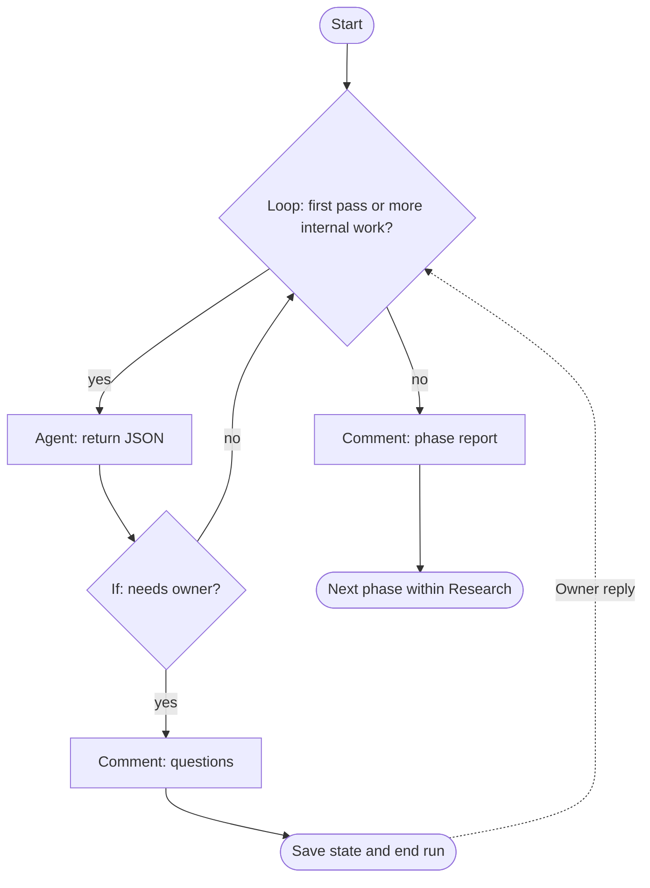

# Research brief: Wire graph-based execution into Research mode (#316)

Status: Research COMPLETE for the bounded investigation and owner-decision handoff. Run 0009 below is current: ask means owner clarification; no owner questions remain. Source/documentation conclusions are retained with explicit live-host and recovery verification gates for implementation/adoption. Completion does not claim implementation, acceptance, deployment or a mode change.

## Current completed Research handoff — 2026-09-18, run 0009

Latest owner decision: Q-20 option 2, ask is the agent asking the OWNER questions. Prior conditional internal-continue recommendation is superseded. The owner asks again about CURRENT parent/specialist delivery, not future main-node delivery. This section answers that exact distinction; no new preference question is needed.

### Current source evidence and limits

Focused reads at `b1bf108c808635a8cfe3f4e3bb8d3d64f83bc524`:

- `CLAUDE.md:5-7` and `AGENTS.md:7-9`: both actual repository files favor supplied role definitions, mark routing as fallback, and exempt supplied workers from dispatch-only rules. This is concrete text, not a claim that instruction prose is an enforcement boundary.
- `internal/turn/delivery.go:106-133`: selects CLAUDE.md for Claude and AGENTS.md for Codex, reads ordinary project text, and copies it to bootstrap with the selected roster/role-precedence guidance. Does not combine both project filenames merely because they coexist.
- `internal/turn/prepare.go:417-421`: Codex bootstrap is in parent user input. `internal/harness/runner.go:642-644`: Claude parent receives plugin directory and appended-system bootstrap. Parent role is not automatically replaced by registered specialist files.
- `internal/render/native.go:38-58`: Claude role body is native plugin-agent markdown; Codex role body is developer_instructions in TOML. `internal/codex/runner.go:439-442` registers those per-role configs. `internal/turn/delivery.go:75-81` intersects tools with the parent's mode ceiling.
- Official documentation retrieved 2026-09-18: https://code.claude.com/docs/en/sub-agents documents normal non-fork child context and applicable project memory, with fork/omit/built-in exceptions. https://developers.openai.com/codex/subagents documents custom configuration layers and inherited settings/live overrides. https://developers.openai.com/api/docs/guides/latest-model?model=gpt-5.3-codex previously retrieved establishes AGENTS user-role layout. These support intended role priority; they do not prove exact version-specific prompt composition or compliance in a real litefactory child launch.

Do not transfer the Claude parent's appended project-system text to the child by assumption: normal non-fork agents get their own system prompt and delegation task, with memory loaded separately. Do not assert Codex drops all inherited parent context: actual spawn settings and parent higher-level instructions can still apply. The useful current-source conclusion is narrower and sufficient: repo files are supplied, registered roles govern the invoked specialist, and this repository's own routing explicitly defers to that supplied role.

### Final loop semantics

1. Initialize the loop's first pass once before any agent result exists.
2. Invoke the Research agent; validate and persist its internal JSON.
3. response=ask means real owner clarification. Persist question/result/correlation, execute the explicit comment operation and end the run, releasing its worker. Pending comment delivery remains recoverable; it is not an agent waiting for input.
4. An authenticated, correlated owner reply permits the next pass. Reuse the correct continuing node session when applicable; selected latest-content/topology policy remains in force. No automatic agent retry after a crash.
5. Initial-research completion exits the loop and uses an explicit comment activity before the next phase inside Research. No automatic mode selection.
6. Missing field, wrong type, unknown result or malformed JSON is invalid output. First-pass default cannot conceal it. Finite dispatch limits and subprocess timeouts remain. Node result validation and final application-result/publication contracts require the explicit bridge previously identified.

All owner choices are now recorded: default graph with legacy compatibility, team-local shared cross-mode roles, native main-role/skill direction, latest content and start-over-on-topology-change with saved findings, one simplified Research role, explicit publication, no automatic agent retry, chosen cancellation triggers, simple limits, indefinite owner pause, inherited defaults, collision rejection and owner-operated usage comparisons. Four activities are agent/loop/comment/if; ask is owner-facing. No additional owner approvals are inferred for routine engineering design.

### Completion scope

The bounded research and decision work is complete. Actual native main-role/skill execution, child instruction composition, resume/compaction/fallback, deterministic recovery/cancellation/publication behavior and authentic #274/#296 observations are unperformed implementation/adoption gates. They remain factual limitations in the handoff, not outstanding product preferences or claims of acceptance. No source implementation, test execution, live model invocation or mode transition occurred. Earlier main/branch/CLI observations remain dated historical evidence, not freshly checked here.

### Owner-facing answer

**In the current setup, the repository instructions are picked up. They are not meant to override the invoked specialist’s role.** Having both files present does not mean both hosts automatically load both: litefactory copies `CLAUDE.md` for Claude and `AGENTS.md` for Codex into its instruction bundle.

The distinction I missed is **the parent session versus the specialist it invokes**:

| Current session | What it receives |
|---|---|
| Claude parent | Repository `CLAUDE.md` text in the appended system bootstrap, plus the available specialist roster. Registering those specialists does not make one of their roles the parent’s role. |
| Invoked Claude specialist | Its own markdown body as its system prompt. Ordinary custom subagents also load applicable `CLAUDE.md` guidance. A normal non-fork subagent does not simply inherit the parent’s entire system prompt or transcript. |
| Codex parent | Repository `AGENTS.md` text in the user-message bootstrap, plus registered specialist configurations. Normal native project-instruction discovery is a separate source of context. |
| Invoked Codex specialist | Its role body is rendered into `developer_instructions` in its own configuration. Repository guidance can remain present; it is not promoted above the specialist merely because it came from `AGENTS.md`. |

Those launch/configuration paths are in the current code. The child-context behavior is documented by [Claude](https://code.claude.com/docs/en/sub-agents) and [OpenAI](https://developers.openai.com/codex/subagents). Codex documents project instructions as user-role messages, so the specialist’s developer-role instructions have higher intended priority. Inherited parent instructions and the exact spawn configuration still matter; I have not observed the complete composed child prompt live. [OpenAI message layout](https://developers.openai.com/api/docs/guides/latest-model?model=gpt-5.3-codex).

**For this repository specifically, both project files already say to use the factory-supplied role definition, and that their dispatch-only rules do not restrict a supplied worker.** Their routing table is explicitly a fallback when no role was supplied. Therefore the intended behavior today is: the parent dispatches the specialist; the specialist follows its supplied role and the applicable project rules, without running the repository’s dispatcher again.

So your concern is valid as a possible conflicting-instructions problem, but **the current files explicitly avoid that particular conflict**. This conclusion comes from source and documentation; it is not a guarantee of perfect model adherence or a claim that we tested every live host combination.

I have also recorded **`response="ask"` as asking the owner**. The first-pass default enters the agent once. If it returns `ask`, the graph saves the JSON and question state, explicitly posts the question, ends the run and releases the worker. It waits durably for your reply before another agent invocation—there is no internal spin. When initial research is finished, the graph leaves the loop, publishes through its comment activity and advances within Research.

No owner decisions remain open. The Research handoff is complete; verifying the actual composed host launches remains an implementation/adoption check, not another question for you.

### History

- 2026-09-18 run 0009: answered CURRENT parent versus invoked-specialist context using actual repo files and adapter code; recorded Q-20 option 2; removed all active questions; corrected stale naming/topology statements; completed bounded Research with live verification explicitly deferred to implementation/adoption evidence, not waived.

---

## Historical native-CLI and loop clarification — 2026-09-18, run 0008 (ask settled above)

User correction: answer actual native host instruction loading when a dedicated role is supplied and both project files exist, not just factory admission. Replace E-7 scheduling discussion with start/while/agent-returned-internal-JSON/explicit-comment/next-phase using four initial activities: agent, loop, comment, if. Owner chooses Q-19 option 1. Prior scheduling question Q-18 is superseded rather than silently assigned an answer.

### Evidence and design boundary

Read current task source at `d271392490d3f267b7d59e254e7cd85699bf4fa1`: `internal/render/native.go:38-57` Claude markdown versus Codex developer instructions, `internal/codex/runner.go:439-442` specialist registration, `internal/harness/runner.go:642-644` appended bootstrap and empty setting sources, `internal/turn/delivery.go:106-133` manual project-copy construction, `internal/turn/result_finalization.go:52-57` adopted final-result obligation. Native host discovery is a separate layer from those wrapper choices. Do not infer that empty setting sources suppresses every memory file; exact composed launch remains unverified.

Read retained foundation revision `1fbd2c9716b6fea8d4c321a1ac713a6dbdbe4d5b`: `internal/graphexec/registry.go:13` closed outcomes/no executable attributes, `decide.go:5` deterministic declared edge, `dot.go:39` raw attributes, `validate.go:94` bounded cycles, `internal/turn/graph_node.go:109` validated outcome selection. No fresh merge observation or test execution claimed.

Official documentation retrieved 2026-09-18 with OpenAI Docs guidance: https://code.claude.com/docs/en/sub-agents (main --agent and omitClaudeMd), https://code.claude.com/docs/en/memory (AGENTS import, user-message memory, exclusions), https://developers.openai.com/codex/guides/agents-md (ordered single-file discovery), https://developers.openai.com/codex/config-reference (developer versus model instructions), https://developers.openai.com/api/docs/guides/latest-model?model=gpt-5.3-codex (AGENTS user-role messages). Documentation-based behavior and instruction-priority inference are not a live observation. Installed-version values are retained from the prior audit, not newly measured here. model_instructions_file exact interaction with project discovery is not established by the configuration reference and is not assumed to disable AGENTS.

### Accepted target and bounded semantics

- Four author-facing activities initially: agent, loop, comment, if. Registered implementation names stay mode-namespaced (illustrative lf_research_agent, lf_research_loop, lf_research_comment, lf_research_if). Start/terminal are markers. Pause is durable state/re-entry control, not an agent kept alive.
- Agent emits bounded typed JSON as internal output, durably validated/stored before routing. Do not auto-post its return. Node JSON must be carried through an explicit validated contract bridge; keep final application-result validation and publication authority distinct, not bypassed.
- Loop evaluates a declared field/operator/value against the latest accepted node result; if selects a declared outcome. Suggested first increment supports typed equality only, finite declared branches and limits, not arbitrary expressions, nested program execution or model-generated destinations. Owner's field=response/condition=ask/default=ask is illustrative syntax, not implemented configuration.
- Default initializes the pre-result first pass only. A missing/unknown/wrong-type field, malformed JSON or oversized result fails validation. It must not silently fall back to ask. Limits count healthy passes, and a crashed agent does not automatically retry; controlled internal continuation is not crash recovery.
- Owner questions require question-permission validation, explicit question comment, durable saved output/correlation and run end; later owner reply starts continuation. No busy loop on unanswered questions. Every observable publication uses the existing durable operation/receipt identity; updated workflows never duplicate uncertain previous effects.
- Phase completion leaves the loop, explicitly comments where selected, and advances within Research. It does not select Plan. Selected latest-graph topology behavior is restart at latest start with saved brief/reply (Q-19 option 1), not node mapping.
- Q-20 alone distinguishes whether ask means internal continuation or owner clarification. Recommend continue versus needs_owner as separate values if the owner's intent is internal iteration; do not silently assume that interpretation.

### Owner report

**Supplying a dedicated agent does not, by itself, turn off repository instructions.** My previous answer addressed factory routing rather than the native CLI behavior you asked about.

For normal discovery, with both files present in the repository:

| Launch | Dedicated role | Repository instructions also loaded |
|---|---|---|
| Claude with a named main-session agent | The agent markdown becomes its system prompt, replacing Claude Code’s default prompt | `CLAUDE.md` still loads. `AGENTS.md` is not automatically loaded merely because it exists. |
| Codex with role text supplied as `developer_instructions` | Role text is added as developer instructions | `AGENTS.md` still follows normal discovery. `CLAUDE.md` is not a default discovery filename. |

Claude explicitly documents that `--agent` **still loads CLAUDE.md**, even if that agent sets `omitClaudeMd`; that option applies to delegated subagents, not the main-session case. Claude can load `AGENTS.md` through an explicit `@AGENTS.md` import in `CLAUDE.md` or a symlink. Explicit file-exclusion settings can change discovery. [Claude agent documentation](https://code.claude.com/docs/en/sub-agents), [Claude memory documentation](https://code.claude.com/docs/en/memory).

Codex checks `AGENTS.override.md`, then `AGENTS.md`, then configured fallback filenames, selecting at most one per directory. Adding `CLAUDE.md` as a fallback does not make it an additional file when `AGENTS.md` already wins there. It can still be read through explicit instructions or a wrapper. [Official OpenAI discovery documentation](https://developers.openai.com/codex/guides/agents-md).

**Which wins when they conflict?** For those native delivery channels, the role has the higher instruction layer: Claude’s system prompt versus repository user-message guidance; Codex’s developer instructions versus the user-role messages containing `AGENTS.md`. Non-conflicting repository rules still apply. This is instruction precedence, not a guarantee that a model can never mishandle conflicting prose. Merely putting role markdown into ordinary user input does **not** give it that priority. [Claude memory documentation](https://code.claude.com/docs/en/memory), [OpenAI’s Codex message layout](https://developers.openai.com/api/docs/guides/latest-model?model=gpt-5.3-codex), [configuration reference](https://developers.openai.com/codex/config-reference).

`model_instructions_file` is a different Codex mechanism: it replaces built-in instructions rather than adding a developer role. I would not treat it as an interchangeable role-setting option or assume that it disables repository-file discovery. The reference does not establish that exact discovery interaction for our installed CLI version; that remains a targeted verification item.

**Current litefactory adds its own layer.** It manually copies the relevant project file into its bootstrap: `CLAUDE.md` for Claude, `AGENTS.md` for Codex. Claude receives that bootstrap as appended system text; Codex receives it in user input. The current role files are registered as specialists, not yet selected as the node’s main agent. Consequently, native precedence alone does not describe the existing wrapper. The graph adapter should keep the selected role and ordinary repository guidance in their intended channels instead of promoting conflicting project routing into the role’s instruction layer.

These answers are based on the launch code and current official documentation, not a live model experiment. The exact composed graph launch still needs verification.

**Your loop design is a different, clearer requirement than my worker-versus-scheduler question.** I have replaced that question with your requested four activities:

1. **Agent:** invoke the selected role and retain its validated JSON result internally. Returning from this activity does not post a comment.
2. **Loop:** test a declared response field and repeat the body while the condition holds, within a finite limit.
3. **If:** choose a declared branch from the saved result.
4. **Comment:** explicitly publish the chosen question or report through the factory’s existing delivery mechanism.

Start/end are workflow markers. A pause is durable state with no waiting process; neither requires another reasoning agent. A possible shape is:



For example, an agent could return this **illustrative internal result**, not a currently supported submission format:

```json
{
  "response": "done",
  "summary": "Initial investigation finished.",
  "artifact": "RESEARCH_BRIEF.md",
  "questions": []
}
```

The factory validates and saves that result. The loop/if activities inspect `response`; only the explicit comment activity publishes the report. Later phases can reuse saved output. “Next phase” stays inside Research—it does not automatically choose Plan.

Your proposed `field=response`, `condition=ask`, `default=ask` can describe a small declarative condition. The default should initialize the **first pass only**, before any result exists. After an agent returns, a missing field, invalid JSON or unknown response value must be reported as invalid, not silently turned into `ask` and repeated. Conditions should be typed comparisons over declared fields, not executable expressions. A normal successful loop iteration is also different from retrying a crashed agent; your no-automatic-retry decision remains unchanged.

**Fit with the foundation:** it already supports registered action names, declared outcomes, deterministic edges, saved outputs and bounded cycles. It does not yet implement these four activities or evaluate your response-field condition. They can be added using the existing graph model: a loop becomes a test and back-edge, an if selects an outcome, and comment calls durable publication. That avoids introducing an unrestricted expression language or a second hidden execution engine.

There is one bridge requirement: today every adopted subprocess must provide a validated final result. Internal node JSON therefore needs a defined validated node-result contract and explicit publication control. We must not achieve your design by skipping result validation, nor assume that an agent returning JSON automatically publishes it. The comment activity owns publication; the factory still verifies the appropriate result at each boundary.

**Q-19 option 1 is recorded:** after a workflow-structure update, enter the latest graph from its start with the saved brief and owner reply. Previously uncertain effects retain their original identity and are reconciled, not replayed.

**One semantic question remains: Q-20 — what does `response="ask"` mean?**

1. **Ask the agent to do another internal pass.** The loop invokes it again automatically after a valid successful result. A separate response such as `needs_owner` causes the question comment and ends the run. I recommend calling the internal value `continue` to make the distinction clear.
2. **Ask the owner a question.** The graph posts that question, saves state and ends the run. It must not immediately invoke the agent again; the next loop pass happens only after your reply. The initial default still allows the first agent invocation before there is any question to publish.

**Recommendation: option 1 for an internal research loop, with an explicit separate owner-question response.** If you mean owner clarification by `ask`, option 2 fits instead. The loop structure is accepted; only that word’s meaning needs resolving.

### History and completion

- 2026-09-18 run 0008: corrected answer to native CLI question using official sources and focused adapter code; recorded four-activity declarative loop, explicit publication and topology-update answer; retired Q-18/Q-19 and introduced only Q-20. Source facts versus proposed schema versus host evidence remain separate. No production changes or live provider call.

---

## Historical owner choices — 2026-09-18, run 0007 (refined above)

Authority: latest owner reply, as supplied for this run. Treat changes as decisions, not requests to reapprove earlier recommendations. The prior audit remains historical evidence; its immutable-pin, global-shared and opt-in prescriptions no longer define target behavior.

### Decision mapping

| Prior item | Owner choice and effect |
|---|---|
| Q-5 | Graph default. Explain a repository legacy override as proposed opt-out compatibility; no invented current CLI setting. |
| Q-7 | Shared agent reusable across modes; variants through agent-plus-skills. Supersedes universal mode-specific shared-role requirement. |
| Q-8 | Shared content only inside its team, e.g. teams/go-team/shared; reject the new global sharing/distribution model. |
| Q-10 | No automatic agent retry after interruption; reconcile and report. |
| Q-11 | Closure/retirement and explicit mode switch cancel; no extra cancel command. |
| Q-12 | Do not keep executing an old pinned team after update; use latest installed content. Exact topology migration is Q-19. |
| Q-14 | Simplify the existing single Research agent, no investigator/writer split. |
| Q-15 | Public questions/final/actionable failure; durable internal intermediate progress. |
| Q-16 | Simplest: node limits and subprocess timeouts, no extra global budget subsystem (recorded interpretation). |
| Q-17 | Indefinite owner pause until explicit termination; no expiry. Retain findings/state, not an obsolete execution version. |
| E-1 | Kebab-case. |
| E-2 | Accept proposed lf_skills/list/layout convention, modified to shared content inside the current team. |
| E-3 | Reject ambiguous native-name collisions. |
| E-4 | Documented inherited defaults with node overrides; validate resolved effective task/tier. |
| E-5 | Node role is the main agent session. |
| E-6 | Native on-demand skills; selection settled, compatibility remains to prove. |
| E-7 | Needs clearer explanation; Q-18 supplies two concrete options. |
| E-8 | Owner compares; retain logs, no automatic benchmark machinery. |

### Updated target boundaries and focused evidence

- Graph is default for new eligible Research executions; repository legacy override and existing path continuity are the proposed compatibility behavior. Current code has no newly implemented graph-default setting. Relevant current source read at `3e5a85021dbdcc1d61eb4ca073c35b538dc78a26`: `internal/turn/prepare.go:138` selected external team capture; `internal/daemon/tick.go:1798` permission selection before `turn.Execute` at line 1828; `internal/daemon/tools.go:23` mode/provider permission lookup.
- `internal/turn/delivery.go:75` intersects role tools with mode ceiling; lines 106-133 read and incorporate ordinary project instructions. Bundles are written outside the worktree at line 192. Therefore project text can influence the model, but is not the engine's admission/permission control. Reconcile stale routing instructions; do not blindly rewrite project files or claim their text cannot cause model misbehavior. Current legacy code evidence does not prove an already-built graph bridge.
- Proposed physical reference rule: `shared/name` is always relative to the admitted team, not to a global catalog-level shared folder. A plausible layout is `<team>/shared/agents/<name>.md` and `<team>/shared/skills/<name>/`; exact additive source/publish/capture paths remain Plan details. Reuse a shared role across modes as explicitly chosen; local role files may remain mode-specific. No separate global shared package dependency is in scope.
- Use current installed graph/role/skill content at launch/continuation; recommend no forced hot interruption of a live invocation. Capture the actual bytes/identity used for each attempt as provenance, not as a mandate to use those bytes forever. When instructions change, a fresh host session from the saved brief avoids obsolete resumed role context. Q-19 decides structural graph change, not whether latest content should be used. Keep old uncertain effects bound to their old request and exact publication content.
- No automatic agent retry after crash under either E-7 architecture. Read-only reconciliation and retrying delivery of an existing final report are different from re-running an agent. An ordinary owner-triggered continuation can still resume or use the existing cold fallback where appropriate; this does not imply automatic recovery launch after a crash.
- Default graph is start -> research agent -> save/report -> finish, with durable question pause/owner reply. Agent checks clarity, investigates and synthesizes within one main-role session. Node/task/tier defaults inherit through a documented resolution rule. Selected skills remain lazy, and permissions/result contracts stay enforced.
- Native main-role/skill support remains an empirical implementation obligation. The existing absent-Claude-Skill/profile gap is not waived by choosing native delivery. No automatic benchmarks, global shared distribution, separate writer agent, extra global budget subsystem, or long-lived old-content execution is requested.

### Current decisions and assumptions

- **D-1:** Owner: runtime agents/skills/workflows remain in the external installed catalog. Shared content is only within a team, for example LF_HOME/teams/go-team/shared, never a new global shared catalog. Preserve legacy compatibility until dedicated retirement.
- **D-2:** Owner accepts lf_skills and the proposed explicit list/layout convention, modified by team-local shared scope. shared/name resolves inside the current team; no cross-team shared package or global shared namespace.
- **D-3:** Owner accepts kebab-case names and bare or shared/name references without .md, and rejects ambiguous native-name collisions rather than requiring aliases. Shared agents may be reused across modes, with variants expressed through agent plus selected skills; this explicitly supersedes the earlier universal per-mode shared-agent rule.
- **D-4:** Remaining #315 scope belongs to #316 and may be split during owner-selected Plan. Mode remains Research; graph completion and this decision reply do not select another mode.
- **D-5:** LATEST OWNER CHANGE: use the updated graph/team instead of freezing future execution to an old version. This supersedes the old retained-immutable-content recommendation and the earlier long-lived pin requirement. Preserve factual per-attempt provenance; exact conversion of saved progress when topology changes remains Q-19.
- **D-6:** Clarity remains inside the first Research reasoning call; clear requests investigate directly, and material questions save progress and end the run with no agent waiting.
- **D-7:** Owner chooses graph execution as the default, not a repository opt-in requirement. A repository-level legacy override for new eligible Research executions is the proposed compatibility mechanism; exact configuration syntax is for Plan.
- **D-8:** Owner chooses no automatic agent retry after interruption. Reconcile retained effects/results and report; another agent launch needs owner continuation. Existing durable report delivery/reconciliation remains distinct from agent retry.
- **D-9:** Owner chooses issue closure/retirement and explicit mode switch as cancellation triggers, without an added cancel command. Daemon restart does not implicitly cancel or automatically retry the interrupted agent.
- **D-10:** Owner chooses the current Research agent, simplified for graph execution, with no investigator/writer split and no added specialist fan-out. Graph performs deterministic save/finalization around that agent.
- **D-11:** Owner chooses public questions, final results and actionable failures; intermediate node progress stays durably internal. Factory artifact save/publication happens at those relevant boundaries, with no per-node public report requirement.
- **D-12:** Owner requests the simplest bounded-work approach. Record this as existing per-node dispatch limits and subprocess timeouts, without an extra whole-investigation budget system; exact default values remain engineering detail.
- **D-13:** Owner chooses indefinite paused continuation until explicit completion/cancellation, without silent timeout expiry. Preserve saved findings and correlation state; latest-content execution policy means this does not require keeping an old team version active forever.
- **D-14:** Owner chooses inherited documented role/team defaults for missing task/model-tier values, with explicit node overrides when supplied. Resolve and validate effective values before launch; do not treat unspecified values as arbitrary.
- **D-15:** Owner chooses the node role as the main agent session, and native on-demand skills. Host compatibility and permission/resource behavior still need verification; the selection is settled, not reopened as a preference question.
- **D-16:** Owner will compare usage manually and wants logs. Retain existing useful usage/timing/outcome records with graph context; do not add automatic benchmark or comparison machinery to this scope.

- **A-1:** Proposed concrete graph-default behavior applies to new eligible Research executions with a selected installed team and valid Research graph; a repository legacy override preserves compatibility. No current configuration key or CLI spelling is claimed.
- **A-2:** The earlier full code audit remains historical evidence at task HEAD 2aad64d and #315 branch 1fbd2c9; this run only checked focused admission/permission/project-instruction source at task HEAD 3e5a850. No new remote integration observation is claimed.
- **A-3:** No performance saving is established. Logging remains required; the owner performs comparisons rather than automatic benchmark machinery.
- **A-4:** Interpret the owner's simplest-work-limit choice as per-node limits and subprocess timeouts without a new overall-budget subsystem. Numeric defaults can be specified in Plan.
- **A-5:** Latest installed content should be selected at the next launch/continuation boundary; an already-running invocation is not forcibly interrupted solely by a catalog update. This is the proposed operational interpretation of latest-content policy, not an observed implementation.
- **A-6:** Use a fresh provider session and the saved brief if effective instructions change, so continuation does not retain obsolete role instructions. Topology replacement still requires the owner's Q-19 choice; no node mapping is silently assumed.
- **A-7:** Claude Code 2.1.276 and codex-cli 0.154.0 were observed in the earlier audit only. No live native-host verification is claimed; chosen main-session/native-skill behavior remains to prove under actual permissions.
- **A-8:** Per-attempt content identity remains useful provenance even though the owner rejects long-lived old-version execution pins. Pending effect recovery retains exact original request identity and content; selecting a newer team must not rewrite or replay an uncertain old effect.

### Owner-facing explanation and remaining questions

Your choices make the design considerably simpler. I have recorded them, including the changes to the earlier recommendations: **graph execution by default, sharing only inside each team, one Research agent, no automatic agent retries, and use of the updated team rather than an old pinned version.**

**How graph-by-default would work**

There would be no opt-in step for new eligible Research work. Once a repository has a selected installed team with a valid Research graph, new Research executions use that graph automatically. A repository setting can explicitly select the legacy path for compatibility. That setting is now an **opt-out**, not an opt-in. Existing legacy continuations keep their declared path; a graph update does not silently convert one into a graph execution.

This describes the proposed behavior, not an existing command or configuration key. If required graph content is missing or invalid, the factory should explain the problem before launching an agent rather than silently choose a different execution path.

**What happens to CLAUDE.md and AGENTS.md?**

They continue to supply repository instructions, such as coding conventions and where project information lives. They do not become the selector for the execution graph or the permission profile: that selection belongs to the factory before it launches the agent.

They can still influence what the agent tries to do. An old instruction such as “invoke the Research orchestrator” could cause unwanted duplicate orchestration if left in the graph node’s context. The bridge therefore needs to reconcile that routing text with the supplied node role while retaining ordinary project rules. Selecting the graph should not blindly overwrite either file, and text in either file should not replace the factory-selected graph. The current delivery path already reads project instructions and supplies them alongside the selected role; this is a real compatibility concern, not a reason to let those files control admission.

**The choices now recorded**

- **Sharing:** `shared/name` belongs to the current team, for example under `teams/go-team/shared`. Nothing new is shared globally between teams. A shared agent may serve several modes; agent-plus-skills combinations provide variants. The earlier cross-team shared-package decision is no longer needed.
- **Research:** use the current Research agent, simplified for graph execution. No separate investigator and writer. That agent checks clarity, investigates and writes; the factory handles saving and reporting.
- **Interruption and cancellation:** no automatic agent retry after a crash. Reconcile and report what happened, then wait for your continuation. Closing/retiring the issue or explicitly changing mode cancels the graph. Recovering an already-authored report is separate from starting the agent again.
- **Visibility:** publish questions, final results and actionable failures. Keep intermediate progress durably inside the factory rather than posting after every node.
- **Limits and pauses:** use the simple existing approach of node limits and subprocess timeouts, without a new overall-budget subsystem. An unanswered question remains resumable until you end the work; it does not silently expire.
- **Authoring and delivery:** kebab-case names, the proposed skill-list attribute, collision rejection, and inherited documented defaults where a node omits values. The node’s selected role runs as the main agent, with native skills. Actual host support still needs verification, but your design choice is settled.
- **Usage:** retain useful logs, including available usage, timing, outcome and which execution they belong to. You do the comparison; no automatic benchmarking framework is needed.

**E-7 explained: who starts the next step?**

With your one-agent design, the ordinary flow is simply:

`start → Research agent → save/report → finish`

If the agent asks a question, it instead saves the unfinished work, reports the question and ends the run. No process remains waiting for you. Your reply starts a continuation.

**Q-18 — How should those steps advance?**

1. **The current worker continues to the next step.** A worker starts the Research agent. When it finishes, that same worker validates its result, saves the artifacts and triggers the report. Progress is recorded durably between steps, so this is not “keep everything only in memory.” A question or failure releases the worker. There are fewer queue handoffs and fewer moving parts.
2. **The scheduler starts every individual step.** One scheduled job runs Research, another later job saves the result, and another finishes delivery. Every step is durable, but each also needs scheduling, ownership and recovery coordination. This can be useful for a much larger workflow, but adds machinery to this small one.

**Recommendation: option 1.** Use scheduling where already needed for pending delivery and recovery, rather than scheduling every normal step. Neither option automatically retries an interrupted agent; Q-10 is already settled. A scheduler is not, by itself, an automatic retry policy.

**Using an updated team immediately**

I have removed the recommendation to force an active investigation to keep using its old team version. The practical boundary I recommend is: **use the installed current version at the next launch or continuation**. Changing files cannot rewrite instructions already loaded into a running agent. Let that invocation finish; if instructions changed before the next launch, start a fresh agent session with the saved findings instead of resuming obsolete role instructions.

One behavior still needs choosing because updating the graph can remove or rename the step where work was paused. This does not reopen your decision to use the latest team.

**Q-19 — What should happen to saved progress when the workflow structure changes?**

1. **Restart at the beginning of the latest graph, carrying forward the saved brief and owner reply.** The new Research agent sees the existing findings and continues from them. It may repeat some checking, but there is no fragile attempt to translate old step names into new ones. Any old uncertain publication is reconciled under its existing identity, not sent again as part of the restart.
2. **Continue at the equivalent step when that mapping is unambiguous; otherwise stop and explain.** This avoids some repeated work, but requires compatibility rules. If the old step has disappeared or changed meaning, the factory reports that it cannot continue automatically rather than inventing a mapping.

**Recommendation: option 1**, because you prefer the simplest approach and the default graph has only one Research agent. A role or skill update alone can use the latest instructions at the same logical step; this question concerns changed workflow structure.

Only these two choices remain: **Q-18 option 1 or 2, and Q-19 option 1 or 2.** The previous ten policy questions and the other design selections are recorded as answered. Native-host verification remains engineering evidence to obtain, not another preference question for you. Mode remains Research.

### Artifact and application state

All previous ten active policy questions are answered and removed from the active application questions. Q-18 and Q-19 are new stable IDs; no retired identity is reused. F-6/F-7/F-9/F-11/F-12/F-15/F-16/F-17/F-18/F-25 are amended to distinguish historical source facts from superseded target prescriptions; F-29 records the focused instruction/admission check. Other historical findings remain unchanged. No implementation, mode change, live model call, new remote integration claim or test run.

- 2026-09-18 run 0007: recorded owner decisions, narrowed scope, explained graph default/project rules and E-7, and asked only Q-18/Q-19 for remaining advancement/topology decisions. Research incomplete pending these choices and host evidence.

---

## Historical decision inventory — 2026-09-18, run 0006 (answered/superseded above)

Request: list ALL decisions the owner needs to take, explain numbered options in detail and check whether only six are open. This is an inventory of the saved discussion, not a new source/host audit. The six questions from run 0005 remain unanswered; Q-14..Q-17 surface four owner-visible consequences previously left in engineering proposals. Names E-1..E-8 below are discussion labels, not application question IDs or required new approvals.

### Provenance and classification

- Q-5/Q-7/Q-8/Q-10/Q-11/Q-12: existing current question set, explained more fully with unchanged stable option identities. Q-11 additionally exposes the historical park-versus-cancel-on-mode-switch alternative as new O-11d; retired O-11c is not reused.
- Q-14 standard graph shape: historical section 3 F5 explicitly leaves the illustrated investigator/writer graph and multi-reader variant as proposals. The first-call clarity requirement remains settled. This is a default-team behavior choice, not restricting editable workflows.
- Q-15 visibility/checkpoint boundaries: historical F9 proposes suppressed intermediate reports; section 10.5 proposes factory commit/push only at pause/final. The audit's result/accounting bridge says this requires deliberate lifecycle support. Owner-visible publication frequency is policy; internal durable checkpoint mechanics remain engineering.
- Q-16 total-work ceiling: historical F5/F7 and current audit recovery/baseline recommendations discuss loop budgets, retries and duration but do not select an overall ceiling. The need for bounded work is settled. This newly surfaced choice is layered whole-investigation limits, not whether unbounded loops are acceptable; numerical defaults need not be owner-approved individually.
- Q-17 paused retention: historical F8, section 9.2 and the audit pinning/lifecycle discussion leave retention/cleanup unresolved. Keeping required files until explicit completion/cancellation is recommended; an expiry is an optional new policy with visible semantics, never an assumed cleanup default.
- E-1..E-4: previously unapproved naming, skill attribute/list/layout, collision/dependency and task/model-tier conventions. These need explicit specification for authors but may be delegated as a design package. Do not mark recommendations as owner decisions.
- E-5/E-6: host main-session/subagent and skill-delivery mechanisms, conditional on actual compatibility evidence. These cannot grant permission changes or replace the preserved contracts.
- E-7/E-8: engine state/scheduling/result mechanics and baseline methodology. Question consumption, instruction boundaries, immutable closure and result validation remain required regardless of implementation choice.
- Other mechanics accounted for under these groups: run/attempt allocation, private triggers, waiting-table/status choice, definition identity, request/result schemas, reserved catalog names, portable team binding, skill aliases/transitive resources, tier fallback, closure hashing, cleanup/retirement, bounded output excerpts, retry/backoff, durable cancellation/effect reconciliation, byte parity and baseline sample size.

### Detailed owner report

No. **Six was the rollout-policy shortlist, not the complete list of unresolved choices.** I should have made that distinction explicit.

Across the saved discussion there are **10 owner-facing policy and behavior decisions**: the original six, plus four choices that were previously buried in workflow, reporting, limits and retention proposals. I explain all ten below. There are also **eight design groups you can delegate**, followed by facts that engineers must verify rather than ask you to choose.

The count groups related details into decisions; it is not a claim that every implementation parameter needs your approval. Nothing below records a recommendation as your answer.

**1. Q-5 — Where do you switch graph execution on?**

This controls the size of the rollout. Existing work must keep the execution path it started on in either option.

1. **Enable it for a repository.** After you opt a repository in, its new Research executions use the graph. This is simple to operate, but every new Research task in that repository enters the rollout.
2. **Enable individual tasks within an enabled repository.** The repository setting allows graph execution, and you explicitly select which tasks use it. This gives a smaller trial group, at the cost of another setting or owner action.

**Recommendation:** Option 1 for the initial release. Choose option 2 if you want to trial a few issues in a busy repository before all new Research work uses it.

**2. Q-7 — Does a shared agent have a separate definition for each mode?**

You asked for shared agents, and also for one agent definition per mode. The remaining question is whether shared agents are an exception to that rule.

1. **One shared definition can serve several modes.** A shared reader could use exactly the same agent file in Research and Plan. This reduces duplicated text, but one edit changes both modes and makes their different responsibilities harder to separate. It would explicitly relax the earlier per-mode rule.
2. **Shared agents are still defined separately for each mode.** A shared Research reader and a shared Plan reader have separate role definitions. Common instructions live in shared skills. Teams still reuse those agents, while each mode keeps a clear role boundary.

**Recommendation:** Option 2. It preserves your original per-mode rule; sharing across teams does not require sharing the same agent across modes.

**3. Q-8 — How are shared agents and skills installed?**

This decides whether installing a team is self-contained or requires managing another package.

1. **Each team release includes the shared files it needs.** Installing a team also installs its referenced shared content. If another installed team requires incompatible content at the same shared identity, installation refuses the conflict. Initial setup is easier, but some updates may need coordination between teams.
2. **Shared content is a separate package.** Teams declare which shared package they need. Shared updates have their own release cycle. This gives clearer independent versioning, but adds dependency installation, compatibility rules and more operator steps.

**Recommendation:** Option 1 for the compatibility bridge. It uses less new package-management machinery; conflict checks must remain explicit.

**4. Q-10 — Should interrupted work restart automatically?**

A daemon restart can leave a node with an uncertain outcome. An empty effect log alone is not evidence that nothing happened.

1. **Retry automatically only when replay has been established as safe.** The factory first checks saved results, pending publication and retained work. It reuses completed work where possible and retries only within the agreed limits when the reconciliation permits it. An uncertain external effect stops automatic replay and produces a report.
2. **Always require an owner restart after interruption.** The factory reconciles and reports what is known, but does not automatically start the agent again. You decide when to continue. This is easier to reason about operationally, but routine restarts require more attention.

**Recommendation:** Option 1, with positive recovery evidence and a bounded retry policy. Neither option permits blindly duplicating an uncertain comment or other effect.

**5. Q-11 — What cancels an active or paused graph?**

This is about deliberately ending work. A daemon restart is an interruption governed by Q-10, not an owner request to cancel.

1. **Use issue closure/retirement and explicit mode changes.** Closing or retiring the issue, or explicitly choosing another mode, ends the current graph. Otherwise a paused graph remains available for an owner reply. There is no additional cancel command.
2. **Also provide a dedicated cancel command.** Keep those cancellation triggers and add a way to cancel while leaving the issue open in Research. This is useful if you want to stop an unhelpful investigation without closing the task or selecting another mode.
3. **Park Research when you select another mode.** Issue closure or retirement still cancels it, but a mode switch suspends the old graph. Returning to Research could explicitly resume that retained investigation. This supports returning to unfinished research, but needs a clear choice between resuming old work and starting new work, and keeps its content longer.

**Recommendation:** Option 1 for the first release. Choose option 2 if stopping work while staying in Research is important. All preserve saved evidence and reconciliation of effects already dispatched; cancellation cannot undo a comment already posted.

**6. Q-12 — What happens when a team is updated during active work?**

Active work must never silently switch to new role or workflow content. The choice is how to preserve that promise while files are updated.

1. **Stop until the original content can be restored.** If required pinned content is unavailable after an update, the graph stops and reports it. Continuing requires the exact original content, or an explicitly new execution. This needs less retained content but can interrupt long-running investigations.
2. **Keep an immutable copy for the active execution.** The graph continues with the version it started with. New executions use the new team version. This avoids update-induced interruptions, but retained content needs storage and a safe cleanup policy.

**Recommendation:** Option 2. For example, an owner reply next week should still reach the same version of the agent that asked the question. Q-17 determines how long an unanswered investigation remains available.

**7. Q-14 — What should the standard Research workflow contain?**

Newly surfaced from the earlier workflow sketch: the engine can support several shapes, but the shipped default was never selected. This does not reopen your decision to assess clarity in the first reasoning call.

1. **One reasoning agent investigates and writes the report.** One agent checks clarity, investigates, and synthesizes its findings before the factory saves the result. This is the smallest change from current Research and avoids another agent handoff, but offers less separation between investigation and synthesis.
2. **An investigator followed by a separate writer.** The investigator checks clarity and collects evidence. A fresh writer session turns the saved evidence into the report and can request bounded refinement. This makes the graph handoff useful and visible, but needs a good evidence handoff and may add cost or latency.
3. **Several specialist readers followed by a writer.** Separate agents read code, documentation or other evidence before synthesis. This can help larger investigations, but adds more handoffs and more execution stages. It should remain sequential under the recorded scope.

**Recommendation:** Option 2 as the standard graph, with no extra clarity-only agent. Teams can edit their workflow later; this choice is the shipped starting point, not a permanent engine restriction.

**8. Q-15 — Which checkpoints should appear on the issue and remote branch?**

Newly surfaced from the proposal to suppress per-node reports and save remotely only at a pause or final result. Internal crash-safe progress is required under every option; public visibility is a separate choice.

1. **Publish at questions, final results and actionable failures.** Keep intermediate node outputs in durable internal checkpoints. The factory saves/publishes the relevant artifacts at owner-visible boundaries. This keeps the issue and branch quieter while retaining progress for recovery.
2. **Publish a checkpoint after every completed node.** Each completed node produces visible progress and a factory save of any changed artifacts. This exposes intermediate findings sooner and makes remote progress easier to inspect, but creates more comments or commits and more delivery operations to recover.

**Recommendation:** Option 1, with internal progress inspectable when needed. Saving internal progress must not depend on reaching the final writer; a crash must not erase completed investigation.

**9. Q-16 — Should there be an overall work limit as well as node limits?**

Newly surfaced from the loop and retry discussion: bounded nodes were required, but the owner-visible ceiling for a whole investigation was not chosen.

1. **Use per-node dispatch limits and subprocess timeouts.** Every node has bounded attempts and each subprocess has a time limit. This is simpler. The maximum total work still grows with the number of nodes and their configured limits.
2. **Also set a whole-investigation ceiling.** Keep the node limits and add an overall ceiling on dispatches and active execution time. A large graph or repeated refinements then cannot consume the sum of every generous node allowance. Reaching the ceiling saves an honest incomplete result.

**Recommendation:** Option 2, configurable with proposed defaults in Plan. Time spent waiting for your reply should not consume active-work time. Exact numbers can be delegated; no reliable currency cap should be promised until metering can support it.

**10. Q-17 — How long should an unanswered investigation remain resumable?**

Newly surfaced from the unresolved bundle-retention work. Deleting files that a paused graph needs would turn cleanup into a hidden cancellation policy.

1. **Keep it until you explicitly end it.** A question can be answered weeks later. Required pinned content and continuation state remain until completion or cancellation; cleanup cannot silently expire the pause. This is predictable but can accumulate storage.
2. **Expire pauses after a configured period.** After a declared period without a reply, the graph is explicitly closed as expired and the owner is informed. A later reply starts a new admitted execution using the saved findings. This bounds retention but changes the long-pause experience.

**Recommendation:** Option 1 for the first release. Completed/cancelled executions may follow a separate cleanup policy once pending delivery and recovery no longer depend on their files. Choosing expiry later would require a visible policy, not an implementation default.

**The remaining design choices can be delegated**

These were also open in the saved discussion. They affect the authoring experience or implementation, but they do not each need to become an owner-approval gate. You can select an option, or ask engineering to draft the recommended choice for Plan review.

**E-1 — Allowed agent and skill names.**

1. Keep lowercase letters, digits and hyphens, such as `code-reader`. This follows the existing naming rules and avoids changing several adapters.
2. Also allow underscores, such as `code_reader`. This accommodates earlier examples but requires consistent support across validation and both hosts.

Recommend **1**. Your `shared/codebase-analyzer` example did not, by itself, approve a complete character grammar. Bare names and `shared/name`, without `.md`, are already settled.

**E-2 — The author-facing skill declaration and catalog layout.**

1. Use the proposed `lf_skills="reader,shared/writer"` attribute. Keep team workflows and mode-specific agents under each team, team skills under its `skills` folder, and shared content under `shared`. Publish a small exact layout specification before implementation.
2. Ask Plan to propose a different explicit list encoding or additive folder arrangement, while retaining your settled external catalog, team/shared references and per-mode agent rules.

Recommend **1**. This is an authoring-format proposal, not an instruction to move the catalog into repositories. Q-7 settles the only outstanding behavioral distinction in the shared-agent folders. Exact path spelling, reserved folder names and team binding in a reusable workflow can be specified together; they should not produce repeated permission requests.

**E-3 — What to do when local and shared skills have the same short name.**

1. Reject a node that selects both when their host names would collide. The error tells the author to rename or choose one. This is simpler but restricts combinations.
2. Generate distinct native aliases while preserving the author's qualified references. Both can be used, but diagnostics and resource references must consistently map the aliases back to the original names.

Recommend **1** for the bridge. Shared skills should resolve dependencies within shared content, rather than changing meaning with whichever team invokes them; validate dependency cycles and the full resource closure. More flexible aliasing can be designed if an actual team needs it.

**E-4 — Where node tasks and model choices are declared.**

1. Require the graph to state each agent node's task and vendor-neutral model tier. Agent markdown describes the reusable role. Missing required settings fail validation before execution.
2. Let missing values inherit documented role/team defaults. Graphs are shorter, but an author must follow several sources to understand what runs.

Recommend **1**, keeping the exact task representation and handling of legacy role-tier fields in the Plan design. Model tier being controlled per node is already your direction; this choice concerns explicitness and defaults, not changing to provider-specific model names.

**E-5 — How a node's agent becomes the running agent.**

1. Make the selected role the main session for that node. This can remove a delegation hop, but requires proving that both hosts preserve the necessary instructions, permissions and final-result behavior.
2. Use a minimal parent session that invokes exactly the selected specialist. This fits the existing delivery approach more closely, but adds another context handoff and must not let the parent choose the workflow order.

Recommend testing **1** as the target, with **2** available as a compatibility bridge if it preserves node/session ownership. We cannot call either proven from documentation alone. Different agents still start fresh; the same continuing node may resume.

**E-6 — How skills are loaded on demand.**

1. Use each host's native skill mechanism with only the selected skills and required dependencies delivered to the node. This is the preferred reuse path, but current Claude tool availability and access to supporting resources must be resolved.
2. Design a narrowly scoped loader for the pinned bundle if the native path cannot meet the requirements. That adds machinery and needs a concrete security and delivery design.

Recommend **1 if verified**, otherwise return with a specific design for **2**. Preloading every skill or broadly opening the daemon's home is not an acceptable shortcut. This is why the former skill-loading question was removed: you cannot choose whether an untested host behavior works. Any actual permission-contract change must be identified explicitly, not hidden in this delegation.

**E-7 — How the engine stores and advances work.**

1. Extend the existing runner/result/recovery path with explicit node records, durable pause state and bounded transitions; drive ordinary steps in the worker and use scheduling for recovery or backoff.
2. Make each node advance through the scheduler, with a durable handoff between every step. This gives one scheduling model but adds more coordination to the ordinary path.

Recommend **1** for the bridge. Engineers should choose the tables, private trigger identities, transaction boundaries, node-result envelope and exhaustion-report route. Both options must validate every required result, consume owner replies once, preserve uncertain-effect identity and report limits honestly. Whether an exhausted node routes to a declared fallback or a deterministic report operation is not a choice about allowing silent failure.

**E-8 — How to compare the new path with the old one.**

1. Record normal executions on both paths and compare sufficiently similar tasks, models and complete usage records. This avoids deliberately doing the same work twice, but needs care about workload differences.
2. Add paired experiments on equivalent requests. These are easier to compare, but spend extra tokens and need isolation so they do not duplicate publications.

Recommend **1 initially**, with a later controlled comparison if normal usage cannot answer the question. Exact samples, thresholds, aggregation and post-completion cleanup intervals can be proposed by engineering. Usage must include failed and fallback attempts; unknown usage must remain unknown. Choosing measurement methodology does not establish a saving.

**Facts to verify, not decisions for you**

- Whether each actual Claude/Codex launch loads the selected role, skill body and supporting resources under the permitted tool surface.
- How same-node resume, compaction and cold fallback handle instructions; whether the proposed delivery removes unnecessary repetition without losing current authority or required instructions.
- Whether crash, cancellation, duplicate-reply and report-recovery scenarios meet the agreed behavior. Passing a simulated engine test is not proof of native-host behavior.
- The graph foundation's actual integration revision before implementation, and measured token/time results. The earlier source audit is retained; this decision inventory does not claim a new audit or live probe.

**Already settled — no need to answer again**

Research remains the selected mode. Clarity belongs in the first reasoning call; a clear request proceeds directly to investigation. Questions save progress and end the run without a waiting agent. Agents and skills come from the external catalog, with bare or `shared/name` references and no `.md`. Workflow order belongs to the graph; skills are selected for agents to use as needed. Different agents get fresh sessions, and only a continuing node resumes. Unresolvable references fail before execution. Active definitions are pinned; permissions and required result validation are preserved. Loops are bounded and exhaustion is reported honestly. Both execution paths stay supported until dedicated retirement. Graph completion never selects the next mode, and no token or time saving is assumed.

The six proposed work areas are delivery planning, not six additional product decisions. Exact story boundaries, schema/index choices, digest construction, locking, retry backoff, result mapping and cleanup implementation belong to engineering within the choices above. The bridge must preserve legacy paths and the required real-host/recovery checks; choosing a smaller internal development slice does not waive those adoption conditions.

You can reply with choices such as `Q-5: 1, Q-7: 2, Q-8: 1`, or say **“Use your recommendations for the ten policy decisions and delegate E-1 through E-8 for Plan review,”** with any exceptions. That would settle the choices, not automatically change the selected mode or authorize implementation.

### State and history

Research remains incomplete because the owner has requested explanations, not supplied choices or delegated defaults. Existing findings F-1..F-28, owner decisions D-1..D-6 and assumptions are preserved unchanged in the application update. Q-1/Q-2/Q-3/Q-4/Q-6/Q-9/Q-13 remain retired; no retired option identities are reused. Q-14..Q-17 and their options are new. Ten is the count of current owner-facing policy packages, not a claim that no design detail remains. No source changes, test execution, implementation, mode transition or publication was performed by this inventory step.

- 2026-09-18 run 0006: explained all saved unresolved choices, corrected the implication that only six total decisions remained, surfaced four policy choices, separated eight delegateable design groups and empirical unknowns, and retained settled decisions.

---

## Current request and evidence boundary

Validate or invalidate all earlier findings for fit with the repository and the agreed Research graph goal. Read current session first, then focused owners/callers/tests. Local source baseline is task HEAD `2aad64d1fb161a5a8a5b5382723b31a1e013fbed`; `git diff --name-only 7d57998 HEAD -- internal teams/source` returned no changes. Remote main is `7d5799834b5031c84286080708aaff6091ea63ee`; #315 branch now resolves to `1fbd2c9716b6fea8d4c321a1ac713a6dbdbe4d5b`. Git remote lookup returned refs with a credential-storage lock warning; no runtime state was edited. Graph code at that revision is unchanged from `445bd46`; the intervening internal diff removes a team test, not graph functionality. No limited PR listing is used as merge evidence.

Documentation retrieved from official sites on 2026-09-18. Version-only commands report Claude Code 2.1.276 and codex-cli 0.154.0. No model call, transcript inspection, test execution or host acceptance capture is claimed. Tests were read as source evidence only. OpenAI Docs skill was used for official Codex references.

## Current verdict

The six-area scope fits, but the previous record mixed observed behavior, owner requirements and proposals. Keep the central catalog, provider runners, durable application result/publication paths and asynchronous questions. The bridge needs explicit graph ownership rather than calling the existing whole-turn pipeline unchanged. The most material corrections are unsafe retry inference, incomplete immutable-content retention, missing node/session identity, unsupported native skill loading, result-contract bypass, and unsupported full-transcript/cost assertions.

## Audit of every recorded finding

### F-1

CONFIRMED with refreshed revision: remote main remains 7d57998 and #315 branch is now 1fbd2c9; its graph implementation is unchanged from 445bd46. Parser/validator, persistence, fake-handler dispatch and unwired scheduling exist on that branch. Production Research dispatch, resolution, pause/reply recovery and admission are missing. These are branch facts, not merged-main behavior; recent-PR lists cannot prove merge status.

Evidence: `internal/graphexec/invoke_agent.go:16` at `1fbd2c9716b6fea8d4c321a1ac713a6dbdbe4d5b`; `internal/turn/graph_node.go:35` at `1fbd2c9716b6fea8d4c321a1ac713a6dbdbe4d5b`; `internal/daemon/graph_poll.go:11` at `1fbd2c9716b6fea8d4c321a1ac713a6dbdbe4d5b`.

### F-2

CONFIRMED for shipped catalog: index-selected mode rosters, legacy agents paths and catalog-wide skills exist; the proposed per-team mode agents and research.dot shipping path are not delivered. Additive publisher/capture/install support is required; do not treat a proposed folder layout as current behavior.

Evidence: `internal/teamsource/snapshot.go:90` at `2aad64d1fb161a5a8a5b5382723b31a1e013fbed`; `internal/teampublish/publish.go:30` at `2aad64d1fb161a5a8a5b5382723b31a1e013fbed`; `teams/source/index.json:1` at `2aad64d1fb161a5a8a5b5382723b31a1e013fbed`.

### F-3

CONFIRMED: current Research questions end a run, preserve artifacts and resume on a later owner comment, with cold fallback. The continuation test covers both providers using test runners; it is not authentic host evidence. Graph-node correlation and exactly-once reply consumption remain new work.

Evidence: `internal/turn/research_continuation_test.go:15` at `2aad64d1fb161a5a8a5b5382723b31a1e013fbed`.

### F-4

CONFIRMED requirement; CORRECTED proposal: every adopted subprocess requires valid final application output. Silently disabling that obligation for intermediate nodes would violate the preserved result contract. Plan must define a validated node-result bridge while retaining post-exit enforcement, and distinguish input acknowledgment, node completion, Research outcome and report delivery.

Evidence: `internal/turn/result_finalization.go:44` at `2aad64d1fb161a5a8a5b5382723b31a1e013fbed`; `internal/agentresult/types.go:63` at `2aad64d1fb161a5a8a5b5382723b31a1e013fbed`.

### F-5

CONFIRMED code, NOT owner approval: existing names permit lowercase letters, digits and hyphens and exclude underscores. Reusing that grammar is a compatibility recommendation. A hyphenated owner example does not settle every allowed character.

Evidence: `internal/team/types.go:5` at `2aad64d1fb161a5a8a5b5382723b31a1e013fbed`; `internal/render/native.go:29` at `2aad64d1fb161a5a8a5b5382723b31a1e013fbed`.

### F-6

QUALIFIED: existing segments rotate for provider, mode or effective bundle identity, not graph-node identity. This does not guarantee fresh sessions for distinct nodes sharing identical content, or enforce correct return to a node after another agent ran. Explicit instance/node/invocation-to-segment binding is needed; resume only the same continuing node.

Evidence: `internal/turn/delivery.go:300` at `2aad64d1fb161a5a8a5b5382723b31a1e013fbed`; `internal/turn/delivery.go:351` at `2aad64d1fb161a5a8a5b5382723b31a1e013fbed`.

### F-7

CORRECTED: Claude skills frontmatter preloads full text. The generated home-directory Read deny is real, but native lazy skill loading under it is unverified, not proven mandatory or working. The shipped Research profile and research role omit Skill, so the earlier drop-in native-loader recommendation is invalid. Host loading must be verified under the exact mode ceiling without silently widening permissions.

Evidence: `internal/render/native.go:38` at `2aad64d1fb161a5a8a5b5382723b31a1e013fbed`; `internal/harness/settings.go:108` at `2aad64d1fb161a5a8a5b5382723b31a1e013fbed`; `internal/config/config.go:502` at `2aad64d1fb161a5a8a5b5382723b31a1e013fbed`; `teams/source/agents/shared/research-orchestrator.md:4` at `2aad64d1fb161a5a8a5b5382723b31a1e013fbed`.

### F-8

CONFIRMED with scope: selected external teams are resolved only from LF_HOME/teams, with explicit install and refusal of local packages inside registered repositories/worktree storage. Ordinary project instructions can still come from the repository, and repositories without an external team do not capture this catalog. The publisher source inside this repository is not a runtime fallback.

Evidence: `internal/teamsource/resolve.go:33` at `2aad64d1fb161a5a8a5b5382723b31a1e013fbed`; `internal/turn/prepare.go:138` at `2aad64d1fb161a5a8a5b5382723b31a1e013fbed`; `internal/cli/cmd_team.go:355` at `2aad64d1fb161a5a8a5b5382723b31a1e013fbed`.

### F-9

CONFIRMED: the legacy index has shared agents, flat skills and shared-agent conflict checks. Releases capture one team and its reachable closure; index decoding rejects unknown fields. New shared-skill distribution is design work, not an existing supported package.

Evidence: `internal/teamsource/manage.go:322` at `2aad64d1fb161a5a8a5b5382723b31a1e013fbed`; `internal/teampublish/publish.go:30` at `2aad64d1fb161a5a8a5b5382723b31a1e013fbed`; `internal/team/decode.go:74` at `2aad64d1fb161a5a8a5b5382723b31a1e013fbed`.

### F-10

CONFIRMED: delivery uses private retained bundle directories outside the worktree; Claude receives a plugin directory and Codex selects skill paths. This proves delivery configuration, not that every resource can be read or lazily loaded with current permissions. Retention/cleanup guarantees for whole graph instances remain to design.

Evidence: `internal/turn/delivery.go:192` at `2aad64d1fb161a5a8a5b5382723b31a1e013fbed`; `internal/harness/runner.go:642` at `2aad64d1fb161a5a8a5b5382723b31a1e013fbed`; `internal/codex/skills.go:14` at `2aad64d1fb161a5a8a5b5382723b31a1e013fbed`.

### F-11

QUALIFIED design consequence: reserving shared, agents and skills as team ids is needed for the proposed flat additive catalog layout to avoid reserved-folder collisions. Those names are currently accepted; this is neither implemented validation nor an independent owner decision.

Evidence: `internal/team/types.go:5` at `2aad64d1fb161a5a8a5b5382723b31a1e013fbed`; `internal/config/paths.go:83` at `2aad64d1fb161a5a8a5b5382723b31a1e013fbed`.

### F-12

CONFIRMED gap, CORRECTED interpretation: DOT-only definition identity cannot distinguish identical DOT with different resolved content. team_snapshot_digest is stored but not checked by dispatch. Pinning must include the complete resolved dependency closure. Checking a mutable catalog digest detects drift but does not retain old bytes; recommend retained immutable content with verification. Stop-and-restore is an alternative availability policy, not equivalent seamless pinning.

Evidence: `internal/store/migrations/0048_graph_execution_foundations.sql:1` at `1fbd2c9716b6fea8d4c321a1ac713a6dbdbe4d5b`; `internal/store/graph_definitions.go:19` at `1fbd2c9716b6fea8d4c321a1ac713a6dbdbe4d5b`; `internal/turn/graph_node.go:50` at `1fbd2c9716b6fea8d4c321a1ac713a6dbdbe4d5b`.

### F-13

CORRECTED: the attempt-to-run foreign key already exists, and the store can write owner_comment_id; they are not wholly absent. Missing are allocation/dispatch integration, normal activity-result plumbing for reply correlation, an idempotent consumption protocol and implemented ResumeRef behavior. A unique reply id alone does not validate owner authority, originating node, posted question or atomic consumption.

Evidence: `internal/store/migrations/0048_graph_execution_foundations.sql:29` at `1fbd2c9716b6fea8d4c321a1ac713a6dbdbe4d5b`; `internal/store/graph_attempts.go:30` at `1fbd2c9716b6fea8d4c321a1ac713a6dbdbe4d5b`; `internal/store/graph_outputs.go:23` at `1fbd2c9716b6fea8d4c321a1ac713a6dbdbe4d5b`; `internal/turn/graph_activity.go:13` at `1fbd2c9716b6fea8d4c321a1ac713a6dbdbe4d5b`.

### F-14

CONFIRMED current behavior: startup marks running runs abandoned, records meter abandonment and releases foreign task locks. Graph reservations are not reconciled there, and stale running attempts prevent redispatch. No-run means safe only after a durable allocation-before-launch invariant is enforced, not merely because a nullable graph run link is empty.

Evidence: `internal/store/runs.go:657` at `2aad64d1fb161a5a8a5b5382723b31a1e013fbed`; `internal/turn/execute.go:750` at `2aad64d1fb161a5a8a5b5382723b31a1e013fbed`; `internal/store/graph_attempts.go:13` at `1fbd2c9716b6fea8d4c321a1ac713a6dbdbe4d5b`.

### F-15

QUALIFIED and retry recommendation corrected: agents are instructed not to commit/push, Claude has explicit git deny rules, factory save runs after success, and managed publication has durable intent and observation-only recovery. These are specific protections, not proof every possible external effect is journaled or that no journal means no effect. Reconcile dispatch/result/report/worktree state and known effects, preserve uncertain request identity, and retry only after a positive safe-replay determination.

Evidence: `internal/harness/settings.go:90` at `2aad64d1fb161a5a8a5b5382723b31a1e013fbed`; `internal/turn/harvest.go:424` at `2aad64d1fb161a5a8a5b5382723b31a1e013fbed`; `internal/store/comment_operations.go:11` at `2aad64d1fb161a5a8a5b5382723b31a1e013fbed`; `internal/turn/publication_recovery.go:43` at `2aad64d1fb161a5a8a5b5382723b31a1e013fbed`.

### F-16

CONFIRMED narrow finding: graph cancelled status exists without real graph cancellation dispatch. Existing shutdown abandonment, continuation cancellation and retirement paths do not establish the desired graph cancellation policy. The earlier unsuccessful search is not proof no owner cancel mechanism exists anywhere.

Evidence: `internal/store/migrations/0048_graph_execution_foundations.sql:18` at `1fbd2c9716b6fea8d4c321a1ac713a6dbdbe4d5b`; `internal/turn/execute.go:750` at `2aad64d1fb161a5a8a5b5382723b31a1e013fbed`; `internal/daemon/continuation_cancellations.go:17` at `2aad64d1fb161a5a8a5b5382723b31a1e013fbed`.

### F-17

CORRECTED accounting: meter data is per subprocess attempt and invocation; a run can contain multiple attempts, including refused resume and cold fallback. Aggregate all of them and preserve unknown coverage. Graph timestamps currently share one logical timestamp, not elapsed runtime. Add execution-path and node/instance association, active versus owner-wait time, comparable workloads and observed costs; one-run-per-node is a proposal, not free complete measurement.

Evidence: `internal/store/migrations/0019_meter_usage.sql:8` at `2aad64d1fb161a5a8a5b5382723b31a1e013fbed`; `internal/turn/graph_node.go:125` at `1fbd2c9716b6fea8d4c321a1ac713a6dbdbe4d5b`.

### F-18

CONFIRMED seam; QUALIFIED admission recommendation: the daemon calls the turn after mode and permissions are selected. Durable admission should bind task/session plus selected mode entry or execution instance, not blindly the issue forever. Rollback changes new admissions; existing legacy continuations and pinned graph instances keep their path.

Evidence: `internal/daemon/tick.go:1828` at `2aad64d1fb161a5a8a5b5382723b31a1e013fbed`.

### F-19

CONFIRMED launcher behavior: Claude receives the bundle plugin and appended bootstrap on cold and resumed launches, uses its ordinary main session, and receives role markdown as plugin agents rather than --agent main-session selection. The role-to-main-session change is new runner work requiring permission/model/result verification.

Evidence: `internal/harness/runner.go:597` at `2aad64d1fb161a5a8a5b5382723b31a1e013fbed`; `internal/turn/delivery.go:100` at `2aad64d1fb161a5a8a5b5382723b31a1e013fbed`.

### F-20

CONFIRMED at prompt assembly: with a delivery bundle, Codex bootstrap text is prepended on both cold and resumed requests. Repeated instruction content is sent as user input, not a second actual system-role message. Actual host transcript retention/deduplication was not observed live.

Evidence: `internal/turn/prepare.go:417` at `2aad64d1fb161a5a8a5b5382723b31a1e013fbed`; `internal/turn/delivery.go:106` at `2aad64d1fb161a5a8a5b5382723b31a1e013fbed`; `internal/codex/runner.go:471` at `2aad64d1fb161a5a8a5b5382723b31a1e013fbed`.

### F-21

QUALIFIED: BuildPrompt uses a delta shape on resume, but the complete launch prompt also receives bundle prefixes and current factory result baseline/obligations. Thus litefactory does not send only the owner delta. Do not remove fresh authority or result-contract material while deduplicating static instructions.

Evidence: `internal/harness/prompt.go:240` at `2aad64d1fb161a5a8a5b5382723b31a1e013fbed`; `internal/turn/prepare.go:417` at `2aad64d1fb161a5a8a5b5382723b31a1e013fbed`; `internal/turn/result_finalization.go:44` at `2aad64d1fb161a5a8a5b5382723b31a1e013fbed`.

### F-22

CONFIRMED static defect: refused-resume cold fallback rebuilds BuildPrompt but omits the Instruction bundle line and Codex bootstrap prepended in prepare. Delivery stays on the request, so this does not prove all role/skill configuration disappears. Source finding only; no live reproduction or fix is claimed.

Evidence: `internal/turn/harvest.go:257` at `2aad64d1fb161a5a8a5b5382723b31a1e013fbed`; `internal/turn/prepare.go:417` at `2aad64d1fb161a5a8a5b5382723b31a1e013fbed`.

### F-23

QUALIFIED by current official Claude documentation (2026-09-18): default system-prompt snapshot is reused until compaction, including resume; CLI/environment/version exceptions exist. Recording once does not mean it is sent or billed only once. Compaction summarizes history, so full original transcript replay is not guaranteed. The current context-window page does not substantiate the earlier claim that the skill-description index disappears. Sources: https://code.claude.com/docs/en/cli-reference#system-prompt-flags-in-resumed-conversations and https://code.claude.com/docs/en/context-window. Local Claude 2.1.276; no live probe.

### F-24

CORRECTED caching inference: cache hits require compatible prefixes and available cache state; session resume is not a cache guarantee. Official OpenAI documentation now distinguishes model-specific retention, including 30-minute minimum for GPT-5.6+ and earlier extended retention up to 24 hours. Anthropic documents 5-minute and optional 1-hour caching. Neither source establishes this CLI run's actual policy, owner reply timing or full uncached rebilling. Use observed meter data. Sources retrieved 2026-09-18: https://developers.openai.com/api/docs/guides/prompt-caching and https://platform.claude.com/docs/en/build-with-claude/prompt-caching.

Evidence: `internal/store/migrations/0019_meter_usage.sql:8` at `2aad64d1fb161a5a8a5b5382723b31a1e013fbed`.

### F-25

QUALIFIED options: official Codex documentation supports instruction discovery, resume and developer_instructions, but does not establish this CLI version's exact resumed-message duplication behavior. model_instructions_file replaces built-in instructions and is not equivalent to additive developer instructions. Claude --agent likewise replaces the default prompt and carries tool/model behavior. Prefer a verified additive delivery bridge before replacing host defaults; current-authority and permission checks must still be applied on resume. Sources retrieved 2026-09-18: https://developers.openai.com/codex/guides/agents-md, https://developers.openai.com/codex/noninteractive, https://developers.openai.com/codex/config-reference, https://code.claude.com/docs/en/sub-agents. Local Codex 0.154.0; no live probe.

### F-26

NEW correction: loop exhaustion sets the instance failed and returns an in-memory diagnostic; it does not persist that diagnostic as graph output in this path or deliver an owner report. Honest incomplete reporting is already required. A fallback graph edge is one implementation choice, not a reason to ask whether silent failure is acceptable.

Evidence: `internal/turn/graph_node.go:69` at `1fbd2c9716b6fea8d4c321a1ac713a6dbdbe4d5b`.

### F-27

NEW fit requirement: a registered action outcome such as done/gap/question is distinct from the completed/incomplete/blocked application outcome. The illustrated DOT is not a validated shipped workflow, and the existing Research payload has no node outcome field. Define a bounded validated mapping/envelope and atomic persistence; do not derive transitions from arbitrary prose or let a node receipt alone complete the graph.

Evidence: `internal/turn/graph_activity.go:23` at `1fbd2c9716b6fea8d4c321a1ac713a6dbdbe4d5b`; `internal/agentresult/types.go:63` at `2aad64d1fb161a5a8a5b5382723b31a1e013fbed`.

### F-28

NEW fit requirement: live skill loading must cover permission availability, selected-skill isolation, qualified names, supporting resources and compaction on both hosts. Claude native skills can contain behavior beyond plain text; a selected bundle alone does not demonstrate a complete execution or permission boundary. Scope and validate supported metadata, and keep graph order in the engine.

Evidence: `internal/codex/skills.go:14` at `2aad64d1fb161a5a8a5b5382723b31a1e013fbed`; `internal/config/config.go:502` at `2aad64d1fb161a5a8a5b5382723b31a1e013fbed`; `internal/render/native.go:38` at `2aad64d1fb161a5a8a5b5382723b31a1e013fbed`.

## Owner decisions versus proposals

- **D-1:** Owner direction: agents and skills are centrally installed outside repositories under LF_HOME/teams, with shared references. Runtime graph delivery must not use a repository fallback. Legacy and new paths coexist until dedicated retirement.
- **D-2:** Owner direction: team-local and shared skills, referenced by bare name or shared/name without .md. The exact lf_skills attribute, comma encoding and physical layout are research recommendations, not recorded owner approval.
- **D-3:** Owner direction: agents use bare or shared/name references without .md. One agent markdown per mode and fresh sessions when moving to a different agent remain requirements. Kebab-case grammar is a compatibility proposal, not inferred approval from an example.
- **D-4:** Owner handover: the remaining #315 scope belongs to #316, and owner-selected Plan may split it into separate issues. No mode is selected by graph completion.
- **D-5:** Owner direction: pin active workflow/role definitions immutably and resolved agent/skill content by digest. Retained bytes versus fail-closed restoration is still an availability choice; do not silently adopt updated content.
- **D-6:** Original goal already decides clarity assessment inside the initial reasoning call, immediate investigation for clear requests, and durable questions ending the run without a waiting agent. Q-6 is retired as redundant.

The proposals to reserve top-level names, prohibit duplicate native names, keep shared-skill dependencies within shared content, use a comma list and resolve node tiers are sensible constraints for a selected design, not extra owner approvals. A resolver must cover transitive skill/resource bytes, distinguish logical names from host-specific aliases, reject traversal/unresolvable references before admission and keep filesystem work outside the pure parser. Capture/install/publish changes must be additive while legacy delivery remains supported. Shared names can introduce native-name collisions; define deterministic aliasing or explicit rejection rather than treating bare filenames as globally unique. Team identity inside the DOT must match the admitted team; replacing a graph's team attribute during installation would need an explicit pinning rule.

## Fit corrections for the candidate design

1. **Graph and task boundary.** The DOT example in historical section 3 is illustrative, not a validated runnable workflow. The first reasoning call checks clarity and investigates when clear. Research outcome and graph terminal status are separate. Engine-side report delivery needs a durable report operation and recovery, not a fresh agent-authored comment. A pause needs saved question/origin/result/report identity and explicit waiting eligibility, with no live process. Owner comments must be authenticated and consumed atomically once; an owner-comment column or unique index alone is insufficient.
2. **Instruction authority and sessions.** Bind an admitted instance and node invocation to its provider segment. Different agent/node transitions start fresh, even if role bytes match; only continuation of the same node may resume. Returning from another agent in a refinement cycle must not silently resume a different node's transcript. Keep static trusted role content stable, bound previous outputs as untrusted data, and deliver current permission/result baseline on every subprocess. A launch-time instruction channel is not automatically an additive one: model_instructions_file and Claude --agent replace defaults. Do not promote arbitrary project notes, prior outputs or owner comments into privileged instructions merely to reduce repetition.
3. **Permissions and skills.** The earlier native-loader recommendation omitted the absent Claude Skill tool in both Research profile and role. It therefore needs actual host compatibility work, not just a filesystem check. Preserve the mode ceiling and test selected-skill discovery, full body loading, referenced resources, collisions, ambient skills and compaction. Do not claim a Read deny applies identically to every host or that native loading bypasses it safely. Avoid preloading every listed skill when lazy loading is a requirement. Host metadata capable of spawning another agent or executing commands must remain constrained so the engine still controls workflow order.
4. **Pinning and lifecycle.** Prefer retaining immutable DOT plus every resolved agent, skill and resource from admission, verified before reuse. The bundle retention/cleanup lifetime must cover owner pauses, restart and pending delivery. A changing live catalog should affect future admissions, not silently change active content. Fail closed on missing/tampered retained bytes. Digest-only stop-and-restore remains an explicit alternative, not a mechanism for switching to latest content.
5. **Recovery.** Separate never-dispatched, in-flight, terminal-result, saved-work and published-report phases. Persist allocation/binding before launch. Recover existing results and effects before re-running a model; absence of an effect record is not sufficient evidence. Uncertain publications keep the original request identity and observation-only recovery. Cancellation must stop the process, revoke further mutation authority, settle attempt state and preserve already-dispatched effect recovery. Limits must include retries and healthy re-entry, and apply to retries of acyclic nodes too; positive limits only on cycles do not bound all retry policies. Exhaustion requires durable honest reporting independent of an exhausted agent. Factory clocks remain in the daemon.
6. **Result and accounting bridge.** Preserve finalization on every adopted subprocess. Node outcome and output need bounded validated representation; disabling result-required checks is not an acceptable bridge. Fresh node sessions still need a factory-authorized result baseline/revision; session history is not authority. Suppressing intermediate public comments or delaying saves requires deliberate lifecycle support: the existing whole-turn call ordinarily saves/reports. Retain work durably at pauses and completion, and account for crash boundaries between result, save, push and report. Meter all subprocess attempts/invocations and report unknown coverage; compare active time separately from owner waiting and report retry delay. A minimum sample alone does not make unlike tasks/models comparable.

## Candidate scope and verification recommendation

Retain six candidate areas, without creating child issues: A catalog/resolver/pinning; B real Research node dispatch, result bridge and session ownership; C durable owner pause/reply; D restart, cancellation, limits and uncertain effects; E admission and rollback; F verification and baselines. Build A then B with minimum E for an internal clear-request slice, then C and D, with F throughout. Internal progress is not production adoption. Require recovery and real-host delivery verification before opt-in use; preserve the separate #274/#296 authentic-host obligations rather than declaring them satisfied here.

Required future evidence: both hosts cold, same-node resume, fresh next-node session, refused-resume fallback and compaction; native skill body/resource loading under exact mode permissions; bad names and content drift fail before launch; reply duplicate/restart/revocation behavior; crashes before allocation, after launch, after result, after save/push and after report dispatch; cancellation with an in-flight effect; bounded retry/exhaustion with visible incomplete result. Fake runners and real migrated store fixtures can establish engine behavior, but cannot establish provider transcript/permission behavior. No unmeasured savings claim.

## Question audit and remaining choices

- Q-1..Q-3 remain retired. Correct their recorded decisions to avoid attributing the proposed attribute, grammar or exact folder layout to the owner.
- Q-4 retires as an owner question: honest exhaustion reporting is already required; fallback-edge versus deterministic report-finalization is an engineering choice. Silent failure is not a valid scope alternative.
- Q-6 retires: the issue's goal already chooses clarity in the first reasoning call.
- Q-9 retires as an owner preference question: verify actual host loading and permission compatibility first; do not ask the owner to decide an unproven technical fact or silently broaden a mode ceiling.
- Q-13 retires as an owner question: the handover requires token/time baselines and no unmeasured savings. Workload matching and sufficient sample/coverage are methodology, not an alternative to recording usage.

| id | name | options | recommendation |
|---|---|---|---|
| Q-5 | How should new Research graph executions be admitted? | O-5a: Per-repository opt-in; persist the path for each selected-mode execution and preserve existing continuations; O-5b: Per-task owner opt-in under a repository-level ceiling | O-5a |
| Q-7 | Should shared agent definitions also be separate for each mode? | O-7a: A single shared agent file may be reused across modes, as an explicit exception to one agent file per mode; O-7c: Shared agents remain mode-specific; shared skills carry cross-mode behavior | O-7c |
| Q-8 | How should shared content be distributed? | O-8a: Each team release carries its referenced shared content; reject incompatible installed copies; O-8b: A separately installed shared package with explicit dependencies | O-8a |
| Q-10 | Should a crashed node ever retry automatically? | O-10a: Bounded automatic retry only after positive safe-replay reconciliation; uncertain effects stop and report; O-10b: Always stop and report; owner explicitly restarts | O-10a |
| Q-11 | Which owner actions should cancel an active or paused graph? | O-11a: Issue closure or retirement and explicit mode switch cancel; daemon restart preserves resumable state; O-11b: The same triggers plus a dedicated owner cancel command | O-11a |
| Q-12 | How should active executions survive a catalog update? | O-12a: Stop and require restoration of the exact pinned content or explicit new admission; O-12b: Retain verified immutable content and finish using the admitted version | O-12b |

These six are not re-asked settled decisions: they were never answered in the supplied record. Q-7 now isolates the real tension between shared agents and the original per-mode rule; Q-10 removes the unsafe no-record criterion; Q-12 reverses the earlier recommendation in favor of retained immutable content. Decisions may be approved together or changed individually. Research remains incomplete; mode remains Research.

## Assumptions and limits

- **A-1:** Installed catalog is the runtime resolution root; publisher source in this repository is permitted source material, not a fallback for active executions.
- **A-2:** Audit baseline: task HEAD 2aad64d1fb161a5a8a5b5382723b31a1e013fbed; relevant local source equals main 7d57998. #315 inspected at 1fbd2c9716b6fea8d4c321a1ac713a6dbdbe4d5b; graph files unchanged from 445bd46. Recheck integration revision before implementation.
- **A-3:** No time, billed token or cost saving is established. Source-byte comparisons cannot prove runtime savings.
- **A-4:** Recommended grammar reuses current lowercase/digit/hyphen restrictions; underscores were not explicitly rejected by the owner.
- **A-5:** Owner handover is accepted. Remote main ref was still 7d57998 during this audit; no assertion is made about current issue closure or acceptance based on a limited PR listing.
- **A-6:** Official host documentation was retrieved on 2026-09-18; no live model invocation or private transcript inspection was performed. Exact resumed-instruction behavior and resource loading under the actual launch permissions remain unverified.
- **A-7:** Version-only commands observed Claude Code 2.1.276 and codex-cli 0.154.0; Codex printed a sandbox PATH-alias warning but returned its version. Documentation may describe behavior not exercised by those local versions.
- **A-8:** Default Claude snapshot behavior is documentation-backed, not observed in a litefactory model call. Factory authorization, tools and result baselines must be refreshed even while stable role instructions remain pinned.

## Audit history

- 2026-09-18 run 0005: audited all F-1..F-25, added F-26..F-28, refreshed branch evidence, corrected host/cost claims and lifecycle recommendations, distinguished owner decisions from proposals, retired four redundant/technical owner questions and preserved six material rollout choices. No implementation, live provider call or fresh test execution.

---

# Historical research record (superseded where it conflicts with the audit above)

The following preserves earlier reasoning and provenance. Its status, recommendations, questions, findings and diagrams are historical, not the current accepted design. Use the audit above for current conclusions.

# Research brief: Wire graph-based execution into Research mode (#316)

Status: Research INCOMPLETE. Run 0004 (how Claude and Codex handle context across turns; owner fear of a system prompt repeated on every round trip) is folded in as section 11; it adds findings F-19..F-25 and no new owner question. Run 0003 (handover of #315's remaining scope to #316) is folded in: see section 10, which corrects the 'not merged' precondition and adds questions Q-10..Q-13 (Q-5 widened). Run 0002 (owner remarks on catalog location, `shared/` references, no `.md`) is folded in: see section 9, which supersedes F1 (root/layout), F2 (names) and F3 (skills location and loading) below where they differ. Questions Q-1..Q-3 are settled; Q-4..Q-13 are open, each with a recommendation. Nothing is implemented; no child issue, Plan or story exists.

Revisions read: this branch base main 7d57998 (no graph code in it). The #315 engine was read from branch lf/315-foundations-for-graph-based-execution at 0271582 (worktree /Users/mariomh/.lf-worktrees/litefactory/task-315). #315 is NOT merged into main; its first increment reports engineering complete, aggregate gates (build, full tests, make check) were still being re-run on 2026-09-18 (#315 comments, runs 12-16 and two later /implement comments). All engine facts below are "as on the #315 branch", not on main.

## 1. Request

Issue #316: make Research the first complete graph-driven mode. The reasoning agent assesses clarity in its initial call and goes straight to investigation when scope is clear. Material questions save progress, end the run and resume on an owner reply without an agent waiting. Deliver via a compatibility bridge so Research does not wait for all team-management changes. Owner decisions (issue body plus latest comment): agents by bare name (`lf_agent_markdown`), one agent per node, several skills per node (`lf_skills`), graph owns order between agents, agent owns skill use (short description first, full text on request), skills have no order, one .md per agent per mode, model tier per node (`lf_model_tier`), new session per agent, resume only for the same node after an owner reply, unresolvable names fail validation before execution, no parallel fan-out, both execution paths supported, opt-in adoption, permission and result contracts preserved.

Asked for: evidence-based findings and recommendations on skill location/attribute and lazy loading, resolver and validation tightening, research.dot shape, task/result contracts, durable question/reply resume, session-per-agent, compatibility bridge, opt-in adoption and observed cases, risks and open Plan decisions, and 3-6 candidate child scopes (not created).

## 2. Current behavior (observations)

### 2.1 #315 engine (branch 0271582)
- Pure package graphexec: ParseProfile (Gonum DOT AST, `internal/graphexec/dot.go`), Validate (`validate.go:14`), Decide (`decide.go:7`), Registry of ActionSpec{Name, Mode, Outcomes} (`registry.go`). Profile attrs: graph `team`, `mode`, `profile_version`, `start`; node `lf_action`, `lf_outcomes`, `lf_limit`, `lf_terminal`; edge `on` or `lf_on`. Every declared outcome needs exactly one edge; every cycle member needs a positive `lf_limit`; terminals carry no action; subgraphs and ports rejected; other attributes kept as raw data in `Node.Attrs` (never evaluated).
- Action names must be `lf_<mode>_<capability>` and be registered (`registry.go`, `validate.go:103`).
- `lf_agent_markdown` is currently validated as a catalog-relative slash path (`invoke_agent.go:41`, `validateMarkdownRef`), only if present; `lf_model_tier` must be flagship/balanced/fast if present. Nothing is resolved or opened; graphexec has a purity test forbidding filesystem access (`purity_test.go`). No `lf_skills` exists.
- Turn layer: `ActivityRegistry` name->handler and `ExecuteNodeAction` (`internal/turn/graph_node.go:38`): reserves an attempt, runs one handler, decides via Decide, commits output plus transition atomically. Handler receives `ActivityRequest{Team, Mode, Node, Attrs, InstanceID, NodeAttemptID, RunID, ResumeRef}`. It "deliberately has no production caller until mode wiring." `ResumeRef` is a runtime-only field with no behavior.
- Attempt reservation takes `RunID` BEFORE dispatch (`graph_node.go:69`) and refuses a session mismatch; but a run row is created inside the existing prepare pipeline. There is no setter to attach a run to an existing attempt.
- Limit exhaustion: instance is set failed with a diagnostic output only (`graph_node.go:69-77`); nothing reports to the owner.
- Store (`0048_graph_execution_foundations.sql`): definitions pinned by path+digest (DOT bytes stay a file; optional `team_snapshot_digest`); instances `running|succeeded|failed|cancelled` with `next_due_at`; attempts (`instance,node,attempt` unique, one running attempt per node); outputs kinds text|json|diagnostic with optional `owner_comment_id`; append-only transitions. No waiting-for-owner state, no question/reply record, no crash reconciliation (a stale running attempt blocks new dispatch: `ErrGraphAttemptRunning`; recovery is documented as deferred).
- Daemon: `pollDueGraphInstances` and retry/backoff helpers exist, unwired.
- #315 spec explicitly hands #316: shipping the first real .dot, which root a .dot path resolves against (its OQ-2), and the agent-markdown layout (its OQ-1) (`.aiteam/lf-315.../feature-spec.md` open questions). #315 scope items 4 (restart/cancel/retry reconciliation) and 5 (old/new path admission) are recorded as remaining #315 debt (A-9), not delivered.

### 2.2 How Research runs today (main 7d57998)
- Catalog: `teams/source/index.json` (schema 2): shared agents plus teams->five mode rosters. go-team research roster is exactly one agent, `research-orchestrator` (`agents/shared/research-orchestrator.md`, tier balanced, skill `research-evidence`). Agent files live at `agents/<team>/<id>.md` or `agents/shared/<id>.md`; skills are catalog-wide at `skills/<id>/SKILL.md` and shared across modes. There is no `<team>/<mode>/<agent>.md` layout and no `.dot` file anywhere. Installed root is `$LF_HOME/teams` (`internal/config/paths.go:67-84`).
- Snapshot: `teamsource.Capture` (`teamsource/snapshot.go`) reads the roster and the transitive skill closure through os.Root, verifies frontmatter (`name`, `description`, `tier` must equal registry values, `snapshot.go:117`), and produces a digest over roster and hashes. It is called on every run's prepare, only when the repository has an explicit `ExternalTeam` (`turn/prepare.go:139`; `store/repos.go:35`). Skill frontmatter requires a non-empty `description`. Release publishing and `team validate` also go through Capture (`teampublish/publish.go:42`, `cli/cmd_team.go:100`), so new files that Capture does not read are not published.
- Delivery: `planDelivery` (`turn/delivery.go:37`) renders each roster role natively; `tools` are intersected with the parent mode's tool list (permissions are a ceiling, `delivery.go` tools loop); the model comes from `opts.Tiers.ResolveModel(kind, tier)`. The bootstrap lists available skill file paths and tells the agent to read one only when relevant (`delivery.go:106`) - i.e. lazy loading by file read already exists. For Claude the native role renders a `skills:` frontmatter list (`render/native.go:44`).
- Segments/sessions: conversation segments per issue session; `prepareDeliverySegment` rotates to a new segment (fresh session ref) whenever the delivery identity or mode changes (`delivery.go:361-390`); resume requires same segment, same agent kind and a recorded resume token (`prepare.go: resumeDecision`); a refused resume falls back to a cold run (`PathColdAfterResumeRefused`).
- Questions: no agent ever waits. Research and Plan are asynchronous by default; `questionPermission` (`turn/ask.go:126`) and `forbidsQuestions` (`ask.go:133`, phrases such as "proceed with your assumptions") decide permission. A question ends the run with an incomplete result plus questions; the owner's reply is a new comment that starts a new run in the same session and normally resumes the provider conversation, else cold-restarts. Test `turn/research_continuation_test.go` covers question -> reply -> resume refused -> cold fallback -> "do not ask" revocation for both agents, and shows the brief and MANIFEST survive in the worktree session directory.
- One comment -> one run: `runs` has `UNIQUE (session_id, trigger_comment_id)` (`store/migrations/0001_init.sql:103`) and `Execute` replays instead of creating a second run for the same trigger (`turn/execute.go`, "AC-3.4"). Private trigger namespaces already exist for automatic recovery and schedules (`store/continuations.go:44-49`, `store/schedules.go:41-48`). One run -> one report; reports are durable, keyed by task/destination/trigger/run/purpose, with daemon retry (`turn/report_delivery.go`, `daemon/report_recovery.go`).
- Result contract: every adopted attempt is told "Required final route: submit a shared application result ... missing or malformed output prevents nominal success" (`turn/result_finalization.go:57`); the result schema has `payload.research{request, findings[{id,text,evidence[{path,line,revision}]}], decisions[], assumptions[]}`, outcome completed/incomplete/blocked, optional questions/recommendation/artifacts (`internal/agentresult/types.go:50-140`; serialization guide `teams/source/skills/agent-finalization/references/research.md` and `examples/research-*.json`). Questions require factory permission and an incomplete/blocked outcome. Cold starts receive an empty baseline, resumes the prior authorized state and revision.
- Session artifacts: the agent writes RESEARCH_BRIEF.md and MANIFEST.md in the session directory (`research-evidence` skill).
- Permissions: the daemon resolves the `research` profile per agent kind and passes tools/allowed tools/sandbox in the Request (`daemon/tools.go:25`); the mode comes from `admitMode`; the same request drives Execute (`daemon/tick.go:~1828`).
- Source sizes (bytes, not tokens; measured with wc -c): research-orchestrator.md 3,628; research-evidence SKILL.md 4,708; workflow SKILL.md 13,304. No token or time baseline exists, so no saving is claimed.

### 2.3 External fact
Claude Code subagent frontmatter `skills:` injects the full content of each listed skill into the subagent context at startup (preload), not lazily; the subagent can still discover and invoke other skills on demand. Source: https://code.claude.com/docs/en/sub-agents (retrieved 2026-09-18 via web search; not independently probed with a live run). Consequence: the owner's "short description first, load full text on request" must not use that field.

## 3. Findings and recommendations

### F1. Catalog layout and resolver (OQ-1, OQ-2 from #315)
The owner's layout `<catalog-root>/<team>/<mode>/<agent>.md` does not exist; today's layout is `agents/<team>|shared/<id>.md` referenced through index.json. Replacing it would break Plan/Implement/Validate delivery, release publishing and parity tests. Recommend an additive layout: `<catalog-root>/<team>/research.dot` and `<catalog-root>/<team>/research/<agent>.md`, legacy `agents/**` untouched until the dedicated retirement. Root: the INSTALLED catalog (`$LF_HOME/teams`), the only root real runs read (no repo/embedded fallback), captured under the existing catalog lock with os.Root confinement.
Resolver design: graphexec stays pure. Add a graph capture beside `teamsource.Capture` that (1) reads `<team>/<mode>.dot`, (2) ParseProfile + Validate, (3) for every agent node checks `<team>/<mode>/<name>.md` exists, parses frontmatter, (4) for every name in `lf_skills` checks `skills/<name>/SKILL.md` (existing closure logic incl. `requires`/`resources`), (5) hashes all bytes into one digest stored in `graph_definitions` (path+digest+`team_snapshot_digest`), and (6) returns immutable bytes for delivery. The same call serves admission, `team validate` and `team-publish`, so unresolvable names fail before any instance is created. Also verify the digest before every node (precedent: "automatic recovery instruction bundle changed; resume manually", `delivery.go:327`) so a mid-graph team update cannot mix versions; a retained snapshot copy is the later option.
Validation tightening in graphexec: `lf_agent_markdown` becomes a bare name (no slash, no `.md`); add `lf_skills` comma list of bare names, duplicates refused; keep both syntax-only in graphexec, existence in the resolver. Tighten only for the `lf_research_agent` action class, since #315 tests use path form.

### F2. Bare-name character set (conflict with owner's examples)
Existing identifier rules are kebab-case only: `team.KeyPattern` (`team/types.go:6`, no underscore), native role names (`render/native.go:16`) and delivery role names. Owner examples `code_reader`, `doc_reader` (underscore) would be rejected or need those rules changed. Recommend kebab-case agent and skill names (`code-reader`); DOT node names may keep underscores.

### F3. Skills: location, attribute, lazy loading  (location and loading channel SUPERSEDED by section 9)
Attribute: `lf_skills="a,b"` (comma list like `lf_outcomes`). Location options: (a) catalog-wide `skills/<id>/SKILL.md` (exists today; all skills shared across modes, transitive closure and publish already work, zero duplication); (b) team-wide `<team>/skills/<id>/`; (c) per mode. Recommend (a) for the bridge: it is the only location with existing capture/publish/test support and skills are already the shared-behaviour vehicle across modes; (b) is a clean later move once legacy is retired and forces duplicating research-evidence/agent-finalization during dual support. Per-mode (c) defeats the owner's own "shared behaviour goes into skills" rule.
Short description / lazy full text: skill `description` frontmatter is already mandatory (`snapshot.go` skillHeader check). Engine builds, per node, an index of name + description + bundle path for exactly the listed skills and adds it to the node prompt; the agent reads the full file with its existing Read tool (already how the bootstrap works). No new tool, no permission widening; do NOT use the Claude `skills:` frontmatter (preloads). Only the node's listed skills (plus their `requires` closure) enter that node's bundle, so `lf_skills` is also a real context boundary. Trade-off: no engine-side record of which skill the agent actually opened; an engine-mediated load tool would need a new MCP tool family and is deferred.

### F4. Model tier
Node `lf_model_tier` is authoritative for graph nodes (resolved through the existing `Tiers.ResolveModel`, so vendor-neutral). Today's agent frontmatter `tier` is mandatory and must equal registry tier (`snapshot.go:117`); graph-layout agents should carry no tier (or an ignored one) to avoid two sources of truth. Note #315 makes `lf_model_tier` optional at validation but `DecodeInvokeAgentConfig` requires both attributes; Plan should decide which one the agent action uses (recommend required for `lf_research_agent`).

### F5. research.dot shape (illustrative, not implemented configuration)
Registered actions (mode-namespaced, closed outcomes): `lf_research_agent` {done, question, gap, blocked}; `lf_research_owner_pause` {answered}; `lf_research_save_report` {saved}.
```
digraph research {
  team="go-team"; mode="research"; profile_version=1; start="investigate";
  investigate [lf_action="lf_research_agent", lf_agent_markdown="investigator", lf_skills="research-evidence",
               lf_model_tier="balanced", lf_outcomes="done,question,blocked", lf_limit=4];
  ask_investigate [lf_action="lf_research_owner_pause", lf_outcomes="answered", lf_limit=3];
  synthesize [lf_action="lf_research_agent", lf_agent_markdown="writer", lf_skills="research-evidence",
              lf_model_tier="balanced", lf_outcomes="done,gap,question,blocked", lf_limit=3];
  ask_synthesize [lf_action="lf_research_owner_pause", lf_outcomes="answered", lf_limit=3];
  save_report [lf_action="lf_research_save_report", lf_outcomes="saved"];
  finish [lf_terminal=true];
  investigate -> synthesize [on="done"];       investigate -> ask_investigate [on="question"];
  ask_investigate -> investigate [on="answered"];  investigate -> save_report [on="blocked"];
  synthesize -> save_report [on="done"];       synthesize -> investigate [on="gap"];
  synthesize -> ask_synthesize [on="question"]; ask_synthesize -> synthesize [on="answered"];
  synthesize -> save_report [on="blocked"];    save_report -> finish [on="saved"];
}
```
Notes: (1) Decide takes exactly one edge per outcome, so "resume the originating node" means one pause node per asking node (or an engine-level pause construct); a shared pause node cannot return to different askers. (2) Every cycle member needs `lf_limit`, counted per dispatch across the whole instance, including a re-dispatch after an owner reply and every gap loop; limits must be sized as first pass + refinement passes + allowed questions. (3) A multi-reader variant (`read_code -> read_docs -> synthesize`, owner example) is the same mechanism with more `lf_research_agent` nodes; the shipped go-team graph should stay near today's one-agent behaviour so the bridge is comparable. (4) Terminal node encodes graph completion only. The research outcome (completed/incomplete/blocked) lives in the authored result; the graph instance ending "succeeded" with an incomplete or blocked report is correct and must not be conflated. (5) The optional Q-first shape in D6 (separate `intro` node) would add `intro` in front.

### F6. Task and result contracts
- Agent task (per node, engine to agent): node name/attempt, `lf_agent_markdown` role, the skills index, the previous node's saved output from `graph_outputs` (text/json, size-bounded, treated as data), pending owner reply if resuming, remaining loop budget, question permission from the existing `questionPermission` (unchanged), the existing session artifact pointer.
- Agent result (agent to engine): one declared outcome plus output text/json plus optional diagnostic. Outcome is authored via the existing result contract, not new prose parsing: intermediate nodes return their declared outcome and text output; the node that ends the path (final synthesize, or any node emitting `question`/`blocked`) submits the application result (`payload.research`, questions, reason). Mapping: done -> completed; question -> incomplete plus questions (permission required); blocked -> blocked; a loop limit reached -> incomplete with a reason.
- Gap to solve: the existing finalization requires an application result from EVERY adopted run (`result_finalization.go:57`) and validates it after exit. Intermediate reader nodes need a per-node "result required: yes/no" obligation supplied by the bridge, otherwise they fail nominal success. This is the most contract-sensitive change; it must keep the schema, permission checks and post-exit validation untouched for nodes that do submit.
- `lf_research_save_report` is deterministic and engine-side: confirm the final run's result receipt, record the graph output, and trigger the existing durable report delivery; it does not invent report text. The brief and MANIFEST stay agent-authored session artifacts.

### F7. Durable question/reply resume without a waiting agent
Existing behavior already ends the run on a question. What is missing in graph terms: (a) a durable "waiting for owner" state: `graph_instances.status` has none (CHECK constraint, so a new status means a table rebuild; #259's 0047 shows that retrofit cost), (b) a record linking question set, originating node/attempt, run and posted report, and the reply comment (`graph_outputs.owner_comment_id` is a start), (c) daemon routing: a new owner comment on a session with a waiting instance resumes it instead of starting a new instance, (d) a mode-selecting comment (`/plan`, etc.) must keep working: the user selects modes; decide whether that abandons or parks the waiting instance, (e) revoke path: "do not ask; proceed with assumptions" must convert to an instruction that forbids further questions for the resumed node.
Recommendation: additive `graph_owner_waits` table (instance, attempt, question ids, source comment, reply comment, state) plus instance kept `running` with `next_due_at` NULL while waiting, rather than widening the status CHECK; resume dispatches the SAME node as a new attempt (counted by `lf_limit`) with provider resume via the existing segment/resume-token logic and the existing cold fallback that re-supplies brief, question and reply. Restart-safe because the state is in SQLite and the worktree brief.

### F8. Session per agent
Fits existing machinery: a different agent means a different single-role delivery bundle and therefore a different delivery identity; `prepareDeliverySegment` already rotates to a fresh segment (new session ref) on identity change (`delivery.go:361-390`), and resume applies only to the same segment/agent/token. So "new session per agent node, resume only for the same node after an owner reply" is achievable mostly by giving each node its own bundle identity. Risks: bundle root is per issue (`BundlesDir/forge/owner/repo/issue`) and retention/overwrite behavior across successive node bundles must be checked; the same agent used by two different nodes (loop back to `investigate`) needs an explicit rule (fresh session by default, resume only after pause); prior-node output must be passed as data through the prompt, never as authority.

### F9. Runs, triggers and reporting in the bridge
- Node runs need private trigger identities (new namespace next to automatic/schedule) because of `UNIQUE (session_id, trigger_comment_id)`.
- Per-node reports must be suppressed; owner sees at most: a question report (pause), a final report, or a failure report. Reuse report_deliveries keys for idempotent post and daemon report recovery (`daemon/report_recovery.go`), keyed to the final/pausing run.
- Drive loop: synchronous inside the existing worker slot for the trigger (keeps session lock, in-flight set and ordering), with the #315 due-poller used only for retry/backoff and restart recovery.
- Need: a store setter to attach `run_id` to a reserved attempt, reconciliation of a stale `running` attempt against its run/receipt on restart, and a report for limit exhaustion (today: instance failed silently).

### F10. Compatibility bridge and opt-in
Attach point: after `admitMode` (mode == research) and before `turn.Execute` in `daemon/tick.go` `run` (~line 1828); otherwise the legacy path is unchanged. Precedent for opt-in: repository `ExternalTeam` association and `auto_resume_on_session_limit` global bool (`config/config.go:106`). Recommend a per-repository explicit opt-in that requires ExternalTeam, an installed team that contains a valid research.dot, AND the flag; presence of a research.dot alone must not switch behavior (teams README: publishing does not silently change installed teams). Active instances stay pinned to their definition and to the path they started on; rollback affects new admissions only and never rewinds effects. Both paths remain supported until dedicated retirement; no automatic mode selection.

### F11. Observed cases required before adoption (from the issue)
1. Clear request: single trigger -> investigate -> synthesize -> saved report; no questions; result validated.
2. Question and restart: unclear request -> question report -> daemon restart -> owner reply -> same node resumed (provider resume success) and cold fallback when resume is refused; "do not ask" revocation; `/plan` while waiting.
3. Failure: agent process failure mid-graph, invalid/missing result on an intermediate and a final node, loop limit exhaustion reported honestly (incomplete, not silent failure).
4. Report recovery: report post fails, daemon restart, report delivered exactly once; instance reflects delivery.
Offline fake-runner tests can establish graph semantics; they do NOT establish real Claude/Codex host behavior (#274/#296 still lack four authentic captures) - keep those claims separate. Record token/time baselines for legacy vs graph without promising savings.

## 4. Options considered
- Layout: replace legacy (rejected: breaks four other modes, publishing, parity tests) vs additive (recommended) vs opaque string until #317 (defers the owner's resolver requirement).
- Skills: catalog-wide (recommended), team-wide, per mode. Loading: file read from bundle (recommended), Claude `skills:` preload (rejected: eager), engine-mediated tool (deferred).
- Pause: dedicated table (recommended) vs new instance status vs "running with null due" only.
- Drive: synchronous per trigger plus poller for recovery (recommended) vs purely poller-driven (adds latency and a second scheduler for a mode that today completes within a turn).
- Loop exhaustion: keep #315 behavior (silent failed instance) vs declared fallback edge (recommended): a node attribute naming the node to route to when its limit is reached (for example `lf_on_limit="save_report"`), validated like an edge; needs a #315 engine extension.

## 5. Risks
1. #315 not merged; #316 cannot start implementation on main until it lands and until #315's own crash-reconciliation and admission scopes are delivered or absorbed here.
2. Result-contract change (per-node obligation) touches the most safety-critical code path; regression risk to Plan/Implement/Validate finalization.
3. Digest drift or partial catalog install mid-graph; requires digest verification per node and clear failure text.
4. Name-charset mismatch with owner examples (F2).
5. Session artifact and bundle root reuse across node bundles (F8) is unverified.
6. Doubling `research-evidence` content in agent markdown and skill: keep one source (skill) to avoid drift; existing parity tests check instruction parity across renderers and will need graph-layout coverage.
7. A bad or edited research.dot bricks Research only for opted-in repos; validation at `team validate`/publish must be the gate.
8. Honest reporting: no token/time claims; baselines only.

## 6. Open decisions (owner) with recommendations  (run 0001 list; current status in section 9.6)
- D1 Catalog layout: additive `<team>/research.dot` + `<team>/research/<agent>.md` alongside legacy (recommended) vs replace.
- D2 Skill location: catalog-wide `skills/<skill>/SKILL.md` (recommended) vs team-wide `<team>/skills/` vs per mode. Attribute `lf_skills`.
- D3 Names: kebab-case agents/skills (recommended) vs allow underscores (requires changing role/key validators).
- D4 Loop exhaustion: add declared fallback (`lf_on_limit`) so exhaustion produces an honest incomplete report (recommended) vs keep failure-only.
- D5 Opt-in: per-repository flag requiring ExternalTeam and a valid installed research.dot (recommended) vs global config flag vs presence of research.dot.
- D6 Clarity assessment: fold it into the first investigator call, outcome `question` ends the node early (recommended; matches "within its initial call" and avoids an extra session) vs separate cheap `intro` node before investigation (costs one extra cold session; clearer trace).
Plan-level (not owner): per-node result obligation design, whether an owner-reply resume consumes loop budget (recommend yes, size limits accordingly), waiting-table schema, trigger namespace, bundle retention.

## 7. Candidate child scopes (refined, not created)
1. Catalog format, resolver and validation: additive layout, bare-name `lf_agent_markdown`, `lf_skills`, teamsource graph capture and digest pin, `team validate`/publish coverage, go-team research.dot plus investigator/writer markdown, per-node skill index. Depends on #315 merge.
2. Research actions and bridge: registry entries, agent-activity handler over the existing prepare/run/harvest pipeline, private trigger namespace, run-to-attempt link, per-node result obligation, output capture, session-per-agent, synchronous drive loop.
3. Owner pause and resume: waiting state, reply correlation, daemon routing, permission and revocation, same-node resume with cold fallback, mode-switch interaction.
4. Bounded loops, failure and honest reporting: refinement loop, limit exhaustion route, stale-attempt/restart reconciliation, final report mapping to completed/incomplete/blocked, report recovery reuse.
5. Opt-in adoption and observation: per-repo opt-in and rollback, legacy fallback, the four observed case groups, token/time baselines.
Scope 4 of #315 (reconciliation) and 5 (admission) overlap children 4 and 5; Plan should decide whether they are absorbed.

## 8. History (see also section 9)
- 2026-09-18 run 0001: first Research pass for #316; read #315 engine at 0271582, current team/Research delivery and result contract at 7d57998; recorded D1-D6.

## 9. Run 0002: owner remarks on catalog location and references

Owner instruction: list open questions as `id | name | options | recommendation`. Owner remarks: skills and agents must be outside the repository, never inside one; they belong under `.litefactory/teams/...` so different repositories share them; a `shared` folder holds shared skills and agents; they are referenced as `shared/<name>` (for example `shared/codebase-analyzer`), with no `.md` suffix.

### 9.1 What `.litefactory/teams/` and the installed catalog mean today (verified, revision 7d57998)
- `$LF_HOME` is `~/.litefactory` unless the `LF_HOME` environment variable is set (`internal/config/paths.go:19-56`). The installed catalog is `$LF_HOME/teams` (`paths.go:67-68`), so the owner's `.litefactory/teams/...` is the same place: already outside every repository, shared by every repository, and the only root real runs read (`internal/teamsource/resolve.go:33-53`; no repository or embedded fallback). Catalog metadata and the single catalog lock live in `$LF_HOME/teams/.litefactory/` (`paths.go:86-87`, `internal/team/catalog_lock.go:16-48`, one flock for every writer and every snapshot capture).
- Population is only by explicit `litefactory team add|update` (remote release or local package): `internal/cli/cmd_team.go:141-175`; `teamsource.Install` states it "never renders into a repository". A local package inside a registered repository or worktree is refused ("use an independent central package", `cmd_team.go:328-370`). So the outside-the-repo rule is already enforced for installation.
- The word `.litefactory` also names a legacy repo-relative directory in the older render path (`internal/team/paths.go:13`: provenance lockfile, overrides, flock, plus `.claude/agents/` etc.); `Install` and the daemon do not use it for graph-relevant content. It is not the owner's `.litefactory/teams`.
- `shared` is already a concept, for agents only: index.json has a `shared` map; files live in `agents/shared/`; teams reference them with `{"ref": id}` (`internal/team/types.go`, `validate.go:23-60,105-125`); overrides use scope `shared:<id>` (`teamsource/override.go`); installing a team whose shared agent differs from one already used by another installed team is refused, and unused shared entries are refused in a release (`teamsource/manage.go:322-330,394-407`, `remote.go:245`). Skills have no `shared` notion: they are one flat catalog-wide folder `skills/<id>/SKILL.md` used by every mode (`internal/teamsource/snapshot.go:334`).
- Reserved-name collision: top-level catalog folders `agents/` and `skills/` already exist. A team-scoped layout adds `<team>/` folders beside them, so team ids `agents`, `skills` and `shared` (all accepted by `team.KeyPattern`) must be reserved or a team could collide with legacy folders.
- Repository versus catalog: `teams/source` in this repository is only the publisher's editable source; `go run ./cmd/team-publish` turns it into `teams/releases/<team>/<version>` and the runtime never reads the repository copy (`teams/README.md:3-30,64-66`). So there is no code contradiction; the shipping path for new files is: author in `teams/source`, publish a release, `team add|update` into `$LF_HOME/teams`. An empty home needs `team add` first (default HTTPS catalog, `config/teams.go`). Release builds are one team per package and capture only files reachable from the roster (`teampublish/publish.go:30-77`, "publisher source must contain exactly the selected team"; new `.dot`/agent/skill files are not published until capture reads them).
- New constraint from the one-team-per-release rule: a cross-team `shared/` folder cannot be published as its own release today, and index.json decoding rejects unknown fields (`team/decode.go:74`), so shared skills need either an index schema change or a filesystem convention with no index entries.

### 9.2 Permission and sandbox facts for reading skills outside the worktree
- Agents run in the worktree. The delivered instruction bundle is already outside it: `$LF_HOME/bundles/<forge>/<owner>/<repo>/<issue>/run-*` (unique directory per bundle, `turn/delivery.go:192-222,400`), so successive node bundles do not overwrite each other (answers the earlier F8 uncertainty; retention/cleanup is still unexamined).
- Claude is started with `--plugin-dir <bundle>/plugin` and `--append-system-prompt-file <bundle>/bootstrap.md` (`internal/harness/runner.go:642-644`); skills reach it as native plugin skills. Codex gets `--add-dir` only for configured writable roots and the submission directory, and an explicit `skills.config` list enabling only the bundle's selected skills (`internal/codex/runner.go:288-296,447-460`, `codex/skills.go`).
- The Claude settings file litefactory generates DENIES reading everything under `$LF_HOME` (`Read(//$LF_HOME/**)`, `internal/harness/settings.go:108`) because daemon.log contains the bot token unredacted. Consequence (inference, not probed live): an agent cannot use its Read tool on the installed catalog or the bundle under `$LF_HOME`. The existing bootstrap sentence "read a supporting skill from sources/..." is therefore unreliable on Claude; what works is the host's native skill mechanism. This corrects my run 0001 F3, which relied on the Read tool.
- Corrected recommendation: give each node its own bundle containing ONLY the node's `lf_skills` (plus their `requires` closure) as native skills; the host shows each skill's short description and loads the full text when the agent asks, on both hosts, without any new path grant and without weakening the `$LF_HOME` deny. Do NOT use Claude subagent `skills:` frontmatter (preloads full text; https://code.claude.com/docs/en/sub-agents, 2026-09-18). Not probed live: that the native loader works under the deny on Claude and reads outside cwd under Codex's read-only sandbox; a small Spike should confirm before Plan commits. Also unresolved: whether a node's agent runs as the main session or as a subagent of a generic parent (today roles are subagents listed in the bootstrap); running it as the main session would need a runner change.

### 9.3 What the owner remarks settle
- S-1 (settles Q-1 direction and the root): agents, skills and graphs are read only from the installed catalog `$LF_HOME/teams`; never from a repository, worktree or `teams/source`. Already how the runtime and installer behave.
- S-2 (settles Q-2): skills live per team plus a `shared` folder; no per-mode skills; the flat catalog-wide legacy `skills/` is not the graph location (my earlier recommendation is withdrawn). Attribute stays `lf_skills` (comma list).
- S-3: reference syntax is exactly two forms: bare name (team-local) and `shared/<name>`; no `.md`, no other slashes, no `..`, no absolute paths, no other team's name. Pattern: an optional `shared/` prefix followed by a name matching the existing `team.KeyPattern` (lowercase letters, digits, hyphens; no leading or trailing hyphen; at most 64 characters). Applies to both `lf_agent_markdown` and each `lf_skills` entry; the attribute name decides whether it is an agent or a skill. #315's path validator is replaced, not extended.
- S-4 (settles Q-3 by example): `shared/codebase-analyzer` is kebab-case; underscores are dropped (assumption, flagged for owner check).
- S-5: additive to legacy (agreed rollout boundary): legacy `agents/**`, `skills/**` and index.json keep working until dedicated retirement.
Consequences: resolver reads only `$LF_HOME/teams` under the existing catalog lock and os.Root confinement; `graph_definitions.path` is catalog-relative (`<team>/research.dot`) and digest covers the graph, every resolved agent and every skill in the closure, for team and shared files alike; because the catalog is shared by all repositories and changed by `team update`, digest verification before each node matters more (mid-run update by another operation), and per-repository opt-in (Q-5) is required because installing or updating a team must not flip every repository at once. Skill `requires` needs the same two forms; a shared skill may require only shared skills; two entries with the same base name in one node (`reader` and `shared/reader`) are refused. `team status`/`update` drift and `--force` semantics must recognise the new file kinds.

### 9.4 Assumed physical layout (Q-7 proposes it)
`$LF_HOME/teams/<team>/<mode>.dot`, `$LF_HOME/teams/<team>/<mode>/<agent>.md`, `$LF_HOME/teams/<team>/skills/<skill>/SKILL.md`, and `$LF_HOME/teams/shared/agents/<agent>.md`, `$LF_HOME/teams/shared/skills/<skill>/SKILL.md`. `<team>` ids `shared`, `agents`, `skills` reserved.

### 9.5 Corrections to run 0001 text
F1 root and layout: root is settled (installed catalog); layout is now Q-7. F2: hyphen-only assumption (S-4). F3: location is per team plus shared; loading is native host skill loading from a per-node bundle, not Read. F8: bundle directories are unique per bundle (verified). Section 5 risk added: a shared, cross-repository catalog means one `team update` changes behavior for every opted-in repository and can occur mid-run; digest check per node is the guard.

### 9.6 Question status
Settled: Q-1 (additive, catalog outside repo), Q-2 (per team plus shared skills), Q-3 (kebab-case). Open: Q-4 loop exhaustion; Q-5 opt-in; Q-6 clarity node; Q-7 physical layout of team and shared folders; Q-8 how shared content is distributed; Q-9 how agents load skill full text. Recommendations are in the run 0002 final report and application JSON.

### 9.7 Candidate child scope 1 amendments
Add: reserved team ids; shared-folder distribution and conflict rules (Q-8); per-node bundle with only listed skills; Spike to confirm native skill loading under the `$LF_HOME` deny on both hosts; publisher capture of graph, agent and skill files.

### 9.8 History
- 2026-09-18 run 0002: verified catalog location, `shared` concept, publisher one-team rule and agent read permissions; settled Q-1..Q-3, added Q-7..Q-9, corrected the skill-loading finding.

## 10. Run 0003: #315 handover (remaining #315 scope now belongs to #316)

New owner comment: #315's first increment (#330-#334) is being merged; #315 is being closed; its remaining scope moves to #316: (1) agent/skill resolution and digest pinning; (2) real `invoke_agent` dispatch over the runner/submission path with `ResumeRef` and the owner-reply correlation on `graph_outputs`; (3) restart, cancellation and uncertain effects for Research's own actions; (4) old/new path admission per task; (5) recovery verification and token/time baselines. Plan may split.

### 10.1 Is the #315 increment on main? (checked 2026-09-18 after `git fetch origin`)
Not yet. origin/main is 7d57998 (same as this branch base); `git ls-tree origin/main` has no graphexec or graph_* store files; no pull request for #315 appears among the ten most recent in `gh pr list --state all`; #315 is still OPEN with its last comment an /implement asking to finish aggregate gates. So the merge the owner describes has not landed in what I can see. I therefore read the engine from the #315 branch: origin/lf/315-foundations-for-graph-based-execution at 445bd46 (the increment commit) and the local #315 worktree head 0271582 (445bd46 plus a merge of main). Graph code (internal, go.mod, go.sum) is identical between them apart from one unrelated teamsource contract test that only the merged-main variant carries. Precondition corrected: #316 depends on the merge of that increment; its code is stable enough to plan against, but every engine fact below must be re-checked at the actual merge commit. Earlier F-1 facts re-verified against 445bd46/0271582 (unchanged); A-2 restated accordingly.

### 10.2 Present versus still missing (engine, at 445bd46)
Present: DOT parsing/validation with bounded cycles; Registry with `lf_<mode>_*` names; Decide; store tables (definitions by path+digest, instances, attempts with per-node dispatch limit, outputs, transitions); `ExecuteNodeAction` one activity per call with a frozen ActivityRegistry; due-instance query; retry/backoff helpers (unwired); `GraphCancelled` status value; `graph_outputs.owner_comment_id` column; `ActivityRequest.ResumeRef` field.
Verified gaps:
- `lf_agent_markdown` syntax-only; no `lf_skills`; no resolver (`graphexec/invoke_agent.go:41`).
- Definition pin covers only the DOT digest: `graph_definitions` unique on (team, mode, digest) with an unused nullable `team_snapshot_digest`; `ExecuteNodeAction` compares only the DOT digest, team, mode and version (`turn/graph_node.go:~50`). Agent/skill bytes are not pinned anywhere.
- `ResumeRef` is passed to the handler and conveys no behavior (`turn/graph_activity.go:13`).
- `owner_comment_id` can be written only through `RecordGraphOutput`; `ActivityResult` has no owner-comment field and `finishGraphAction` never sets it (`turn/graph_node.go:125-140`); no index or query by it; nothing consumes it. Idempotent reply consumption (one comment resumes once) is therefore not enforced.
- Restart: none. A stale `running` attempt blocks new dispatch (`ErrGraphAttemptRunning`, `store/graph_attempts.go:46`) and the code says it "does not detect crashes or reconcile uncertain external effects" (`graph_attempts.go:16`). Daemon start-up reconciliation does not know graph tables.
- Cancellation: only a status constant; `SetGraphInstanceStatus` notes that cancelling with an in-flight attempt needs explicit finalization (`store/graph_instances.go:42`). Nothing cancels or stops a running node.
- Loop-limit exhaustion: instance set failed, diagnostic output only; no owner-visible report (unchanged from run 0001).
- Time and tokens: attempts store `started_at` and `finished_at`, but `ExecuteNodeAction` sets both from one caller timestamp (`graph_node.go:126`), so node duration is not measured there; no token, cost or model field exists on graph tables.
- Admission: none. Waiting state: none (only an implicit "running, no due time").
- Run linkage: the attempt takes `RunID` before dispatch (`graph_node.go:69`) while the existing pipeline allocates the run inside prepare; no setter attaches a run to a reserved attempt.

### 10.3 Handover point 1: resolution and pinning
Maps to candidate scope 1 (and Q-7, Q-8, Q-9). Findings: resolution reads only `$LF_HOME/teams` under the catalog lock (run 0002). Pin design: keep the DOT digest as today and add a resolved-closure digest over every agent file and every skill file in the closure (team and shared), stored in the unused `team_snapshot_digest`, but the current UNIQUE (team, mode, digest) would collide when the same DOT resolves to different agent/skill bytes, so the definition identity must widen to include the closure digest (same kind of retrofit as migration 0047) or a separate per-definition file-digest table is added. ExecuteNodeAction's compatibility check must compare the closure digest. Digest-only pinning does not keep old bytes: after `team update` an in-flight instance cannot continue on the old content. Precedent: automatic recovery refuses when the bundle identity changed ("resume manually", `turn/delivery.go:327`). Risk: one shared catalog across repositories. New decision Q-12 (drift behavior).

### 10.4 Handover point 2: real dispatch, ResumeRef, owner correlation
Maps to scopes 2 and 3. Findings:
- Handler shape: `ActivityHandler.Execute(ctx, Options, ActivityRequest)` receives the shared Options; a real `lf_research_agent` handler must run the existing prepare, run and harvest pipeline for one node, which today is entered only through the whole-turn entry point (session lock, run allocation keyed by trigger comment, report). Refactor needed: a node-scoped entry point that reuses lock, prepare and harvest but takes a private trigger identity (new namespace beside automatic and schedule, `store/continuations.go:44-49`, `store/schedules.go:41-48`), suppresses the per-run report, applies the node's role/tier/skills bundle and the per-node result obligation (run 0001 F6).
- Permissions and mode are preserved by construction: the request still carries the daemon-resolved mode tool profile (`daemon/tick.go:~1828`, `daemon/tools.go:25`) and delivery intersects role tools with it (`turn/delivery.go`).
- `ResumeRef` need not be a provider token: the attempt's `run_id` links to `runs.segment_id`, and the segment holds the session ref and resume token; resumption reuses the existing `resumeDecision` path and cold fallback. Recommendation: `ResumeRef` = identifier of the segment (or prior attempt) to resume, derived from the store, never stored as a provider identifier in graph tables.
- Owner correlation: reuse `graph_outputs.owner_comment_id` as the reply record: question output (json) on the asking attempt; reply output row carrying the reply comment id; a partial unique index on the non-null comment id makes reply consumption idempotent; "waiting" is derived as current node is a pause node with a question output and no reply. This revises run 0001's F7: a separate `graph_owner_waits` table becomes optional (only if the derived query proves inadequate). The two additive changes needed are ActivityResult/ActivityRequest carrying the owner comment id and the unique index (new migration).
- Output capture: the run's result text is available on the run result and can be returned as the node output; the application result (payload.research) still follows the existing result contract.

### 10.5 Handover point 3: restart, cancellation, uncertain effects (researched this run)
What the code does today for runs:
- Daemon start-up `Reconcile` (`turn/execute.go:754`, `store/runs.go:657`): every run still `running` is failed as abandoned (exit signal, reason abandoned), its session marked failed, meter attempts abandoned, foreign task locks released, schedule reservations without a run made retryable; abandoned runs come back so the daemon posts the ordinary failure comment; they are never re-run. Automatic re-run exists only for verified provider quota interruptions and only when opted in (`auto_resume_on_session_limit`, `turn/continuations.go`).
- Cancellation: no owner cancel command found by search of the command parser, daemon and CLI (failed searches do not prove absence). Cancellation in practice is context cancellation at daemon shutdown, which yields the `abandoned` outcome ("nothing is wrong with the task", `agent/result.go:30`); continuation cancellations are a separate recorded notice path (`daemon/continuation_cancellations.go`); issue retirement sweeps exist for closed issues (`daemon/retirement*.go`).
- Effects of a Research run and who owns them: (a) worktree files: the agent may write and edit, and `git add/commit/push/stash` are denied by settings (`harness/settings.go:103`), so an agent cannot push; (b) commit and push: factory-owned, done only after a run that succeeded (`turn/harvest.go:439-455`); a run that did not succeed leaves edits uncommitted and retained; (c) comments and issue creation by the agent: only through owner-gated MCP creation grants for Research (`turn/mcp_creation.go:80`) with durable dispatch reservation and observation-only recovery that scans the forge by request id (`store/comment_operations.go:36`, `turn/publication_recovery.go:45,76`); (d) the run report: durable delivery keyed by task/trigger/run/purpose with marker and daemon recovery (`turn/report_delivery.go`, `daemon/report_recovery.go`). So the "agent pushed or commented before a crash" cases are already classified by run_id: pushes cannot come from the agent; comments and creations have journals.
- Consequence for graphs: recovery keys on `run_id`, which requires the attempt-to-run link (10.2). At start-up the graph must reconcile each `running` attempt against its run: run terminal succeeded with a valid result receipt -> attempt succeeded (outcome from result); terminal failed/abandoned -> attempt failed and a retry decision; no run allocated -> safe to redispatch. A node may be re-dispatched only after checking effect journals for that run/attempt (comment/creation operations not terminal or delivered, report delivery pending); observation-only recovery must finish first. Retry consumes the same `lf_limit` budget as a healthy loop pass. The start-up hook must run in the same recovery path as `Reconcile` so a restart never sees a reconciled run and a stale attempt.
- Per-node commit and push: because each node run that succeeds is committed and pushed by the existing harvest, N nodes would produce N commits and pushes. Plan must decide whether intermediate nodes commit or only the last node or a pause does. Not an owner question; recommend commit and push only at pause and at the final node.
- Owner-visible failure: today an abandoned run gets a failure comment; a graph that auto-retries should not post one per retry. Decision in Q-10.

### 10.6 Handover point 4: path admission per task
Maps to scope 5 (Q-5, widened). The daemon already has one place where the path can fork: after mode admission and before the whole-turn entry (`daemon/tick.go` `run`). Missing: a durable record of which path a task started on. Deriving it from the absence of graph rows is fragile (a legacy Research session that receives an owner reply after opt-in is switched on must stay legacy). Recommendation: record the admission explicitly per task and mode entry (session, mode, path legacy or graph, definition id, admitted_at) at first admission; every later comment on that task consults the record, not the current setting; rollback changes only the setting used for new admissions; a running graph instance is never rewound. Users still select modes; graph completion selects nothing; a mode-selecting comment while a graph instance is waiting needs the rule from Q-11.

### 10.7 Handover point 5: recovery verification and baselines (researched this run)
What exists: run-level accounting in the meter (issue #73, PR #206): tokens by dimension (uncached input, cache read and write, output, reasoning), actual model and provenance, frozen price revisions with cost, coverage status, one attempt per run keyed by `run_id`, unknown distinguished from measured zero (`store/migrations/0019_meter_usage.sql`, `internal/meter`, `litefactory meter` with `--mode`, `--ca`, `--model`, `--json`, `--details`, `cli/cmd_meter.go:29`); runs also carry `duration_ms` and `cost_usd`. Team-content byte baselines exist (`teams/baseline.json`, `benchmark-bytes.json`) and are explicitly source bytes, not billed tokens. Gaps: graph tables store no time or tokens and node time is not measured there (10.2); meter cannot filter by execution path; no node-to-run rollup or per-instance total; no comparable legacy baseline has been recorded. If every node is a real run (recommended, needed for locks, triggers, session and meter), per-node tokens and time come for free by joining attempt to run; what must be added is a path tag and a node/instance rollup, plus a minimum-sample rule before any comparison is stated. No saving is promised.
Recovery verification: tests must prove, with fake runners and a real migrated database, restart at each boundary (before run allocation, during run, after run before attempt completion, after result before report, after report post before recording), stale-attempt rejection, effect-journal checks before redispatch, cancellation, idempotent reply consumption, and honest reporting for each failure. These offline results do not establish real Claude/Codex host behavior (four authentic captures outstanding on #274/#296).

### 10.8 Re-proposed candidate child scopes (not created)
- A. Catalog, resolver and pinning (handover 1): layout, references, resolver, closure digest, definition identity widening, publish/validate coverage, shared distribution, Spike on native skill loading. Earlier scope 1.
- B. Real Research dispatch (handover 2, first half): node-scoped run entry, private triggers, run-to-attempt link, per-node result obligation, session per agent, `ResumeRef` from the store, output capture, research actions and the shipped go-team graph, synchronous drive loop. Earlier scope 2.
- C. Owner pause and reply (handover 2, second half): question/reply correlation on `graph_outputs` with a unique index, daemon routing, permission and revocation, same-node resume with cold fallback, mode-switch rule. Earlier scope 3.
- D. Restart, cancellation, uncertain effects, bounded loops (handover 3): attempt reconciliation at start-up, effect checks, retry with backoff helpers, cancellation triggers, exhaustion route and honest incomplete report. Earlier scope 4 plus #315 scope 4.
- E. Path admission and opt-in (handover 4): admission record, per-task decision, pinning to starting path, rollback rule. Earlier scope 5 (first half) plus #315 scope 5.
- F. Recovery verification and baselines (handover 5): recovery test matrix, path tag, node/instance rollup, sampling rule, observed clear-request/question/failure/report-recovery cases. Earlier scope 5 (second half) plus #315 scope 6.
Plan should split. The five handover points plus catalog work exceed one issue: they touch store, turn, daemon, teamsource, teampublish, cli, config and shipped content. Recommended order: A then B with a minimal E (admission record and per-repository opt-in, clear-request only) as the first vertical slice; then C; then D; then F throughout with recovery tests landing with D. Nothing is adopted for real use before D and F.

### 10.9 Open questions after run 0003
Q-4, Q-6, Q-7, Q-8, Q-9 unchanged. Q-5 widened (per-task decision from the handover). New: Q-10 interrupted-node policy; Q-11 what cancels an instance; Q-12 pin behavior when the installed team changes mid-run; Q-13 baseline scope. Settled by the handover: remaining #315 scope belongs to #316 (D-4); resolved content is pinned by digest like the DOT (D-5).

### 10.10 History
- 2026-09-18 run 0003: checked merge state (not on main; read branch 445bd46), re-verified engine facts, researched run recovery, uncertain effects and metering, mapped the five handover points, re-proposed six candidate scopes and added Q-10..Q-13.

## 11. Run 0004: context handling across turns (Claude and Codex)

Owner question: with a CLI agent, does the conversation become [System Prompt, Comment, Answer] and then [System Prompt, Comment, Answer, System Prompt, Comment, Answer], i.e. is the agent's system prompt sent twice?

Evidence base and limits. Litefactory: source at 7d57998 (paths below). Host docs, all retrieved 2026-09-18 from official pages: Claude Code CLI reference https://code.claude.com/docs/en/cli-reference (section "System prompt flags in resumed conversations"), sessions https://code.claude.com/docs/en/sessions, memory https://code.claude.com/docs/en/memory, context window https://code.claude.com/docs/en/context-window, subagents https://code.claude.com/docs/en/sub-agents, Anthropic prompt caching https://platform.claude.com/docs/en/build-with-claude/prompt-caching; Codex AGENTS.md guide https://developers.openai.com/codex/guides/agents-md, non-interactive mode https://developers.openai.com/codex/noninteractive, config reference https://developers.openai.com/codex/config-reference, OpenAI prompt caching https://developers.openai.com/api/docs/guides/prompt-caching. Local tool versions on this machine: Claude Code 2.1.276, codex-cli 0.154.0. NOT verified live: no model call was made; an attempt to inspect litefactory's retained Claude transcripts for repeated bootstrap text was blocked by the permission system and was not pursued. Everything about what a host stores inside a resumed transcript beyond what its docs say is marked inference. A first note: one WebFetch summary of the CLI reference wrongly said the system-prompt flags are re-applied on every invocation; the page text itself says the opposite (below), so I relied on the raw page.

### 11.1 What litefactory sends per turn (observations)
Claude (`internal/harness/runner.go:597-645`): argv is identical on cold and resume except `--session-id <ref>` versus `--resume <ref>`. With a delivery bundle it adds `--setting-sources ""`, `--plugin-dir <bundle>/plugin` and `--append-system-prompt-file <bundle>/bootstrap.md` on every run. It never passes `--agent`, `--bare` or `--system-prompt-snapshot`. The agent markdown files reach Claude only as plugin agents (`litefactory-team:<name>`, `internal/turn/delivery.go:100-106`), i.e. specialists the main session may delegate to; the main session itself runs the default Claude Code system prompt plus bootstrap.md. bootstrap.md holds: selected mode, roster, list of skill paths, and a copy of the repository's project instructions (`CLAUDE.md`/`AGENTS.md` with legacy managed team sections stripped) (`turn/delivery.go:106,133`). The user message (stdin) is the prompt from `harness.BuildPrompt`, prefixed by one line `Instruction bundle: <root>` (`turn/prepare.go:417-419`).
Codex (`internal/codex/runner.go:417-474`): `exec --json ... -` on cold, `exec ... resume <id> -` on resume, same overrides before the subcommand (`--ignore-user-config`, `--ignore-rules`, `--sandbox`, per-role `agents.<role>.config_file`, `--strict-config`, `--add-dir`). No system-prompt flag exists in this path: instead `turn/prepare.go:418-421` prepends the whole bootstrap text (roster, skills list, project-instruction copy) to the user message for Codex on EVERY run, cold or resume.
User prompt shape: cold = full prompt (header, headless guidance, issue note, comment history, session-artifact pointer, instruction, triggering comment). Resume = delta only (run header, mode, feature slug, instruction, the new comment), explicitly to avoid repeating what the transcript already holds (`harness/prompt.go:21-26,240-258,451-520,772-830`). Fallback after a refused resume rebuilds the full cold prompt (`turn/harvest.go:255-275`).
Duplication and gaps found in the code: (a) for Codex the bootstrap (including the project-instruction copy) is part of the user message of every resumed turn (`prepare.go:418-421`), so it appears once per round trip in the transcript: this is the owner's feared pattern, confined to Codex and to the bootstrap block; (b) the cold rerun after a refused resume rebuilds the prompt with `BuildPrompt` only and does not re-apply the two prefixes added in prepare (`harvest.go:255-275`), so on Codex the rerun loses the bootstrap and on both agents the `Instruction bundle:` line (inference from reading; no test found pinning either); (c) for Claude the project-instruction copy sits in the system layer once; whether Claude also loads CLAUDE.md natively under `--setting-sources ""` is not confirmed by the docs I read (the memory page says project rules are skipped when `project` is excluded from setting sources); (d) for Codex, native AGENTS.md discovery (rebuilt every run per the Codex docs) plus the bootstrap copy means the project instructions reach the model twice, once per channel (inference; discovery is not disabled by any flag litefactory passes).

### 11.2 How the hosts treat context across turns
Claude Code (docs): an API request is stateless; the client sends system prompt, tools and the whole conversation history each time, and prompt caching makes the unchanged prefix cheap: cache order is tools, then system, then messages; a read costs 0.1 times the base input price; default lifetime 5 minutes, refreshed on use, an optional 1 hour lifetime costs extra; changing anything before a breakpoint invalidates everything after it. What Claude Code does with the system prompt on resume (CLI reference, verbatim in substance): "By default, Claude Code builds the system prompt once, on a conversation's first request, with the text from any system prompt flags applied, and records it in the session. Until the conversation is compacted, every later request uses that recorded prompt, including after you return to the conversation with --resume or --continue. If you pass different system prompt flag text, or none, on that later launch, it takes effect once the conversation is compacted or when you start a new conversation." Before v2.1.268 sessions that do not fetch feature flags rebuilt the prompt each request; local version 2.1.276 is newer (whether litefactory's headless runs record it is inference; `--bare`, which disables recording, is not used). So the system prompt is not a message in the transcript and is not appended per turn. On resume the host restores the conversation, model and `--agent`, but NOT `--plugin-dir`, `--settings`, `--mcp-config`, `--add-dir`, which must be passed again (sessions page) - litefactory does pass them again. After compaction the system prompt still applies, project-root CLAUDE.md is re-injected from disk, invoked skill bodies are re-injected, but the one-line skill description listing is not re-injected. CLAUDE.md is delivered as a user message after the system prompt (memory page), so an appended system prompt and CLAUDE.md are different layers.
Claude subagents: each runs in its own context window with its own system prompt (the markdown body) and returns only its result to the parent; `--agent <name>` instead makes the main thread take that agent's system prompt, replacing the default, and the choice persists across resume (sub-agents page).
Codex (docs): the instruction chain (AGENTS.md files, concatenated root to cwd) is built when Codex starts, "once per run", and rebuilt every run; `codex exec resume <id>` continues a previous run's session and the transcript is kept locally. The docs do not say whether the rebuilt AGENTS.md text is added again to a resumed transcript or de-duplicated; treat as unknown. Config keys `developer_instructions` (additional developer instructions injected into the session) and `model_instructions_file` (replacement for built-in instructions instead of AGENTS.md) exist (config reference). Compaction exists (`/compact`, automatic). OpenAI prompt caching works on identical prefixes with a shorter retention (about 5 to 10 minutes of inactivity, up to one hour by default; extended retention is model dependent), so the replayed prefix is billed at the cached rate only within that window. A third-party report (openai/codex issue 46186, opened 2026-09-17, open) suggests compaction may summarise instructions rather than keep their exact text; it is a report, not documentation.
Conclusion: the feared pattern does not occur for Claude's system prompt (recorded once). It occurs in litefactory today only where litefactory itself puts instruction text in the user message on every turn, which is the Codex bootstrap. The whole earlier conversation is always replayed (this is what a resumed session is), but it is a cached prefix when the gap since the last request is short.
Cost note for litefactory: owner replies typically arrive hours or days later, far outside a 5 minute or 1 hour cache lifetime, so a resumed session re-bills its entire transcript at the uncached (or cache-write) rate; a resume is therefore not cheap just because a session exists. The meter already records cache read, cache write and uncached input per run (`store/migrations/0019_meter_usage.sql`), so real data can settle when a cold restart from the saved brief beats a resume.

### 11.3 Diagram
Feared, and not what Claude does:
  turn 1: [SYSTEM][USER 1][ANSWER 1]
  turn 2: [SYSTEM][USER 1][ANSWER 1][SYSTEM][USER 2][ANSWER 2]   (system prompt twice)
Claude, documented (system prompt recorded once with the session):
  session record: SYSTEM (once)
  turn 1 request: SYSTEM + [USER 1]                    -> ANSWER 1
  turn 2 request: SYSTEM + [USER 1][ANSWER 1][USER 2 delta]  (earlier part replayed, cheap only if cached)
Codex in litefactory today (bootstrap in the user message):
  turn 1: [native instruction chain][USER: BOOTSTRAP + prompt 1] -> ANSWER 1
  turn 2: [chain rebuilt: handling of duplicate unknown][USER 1][ANSWER 1][USER: BOOTSTRAP + delta 2]   (bootstrap twice)
Graph design (proposed):
  node A (agent A): [SYSTEM A once][USER: task + saved inputs] -> output A saved in graph_outputs
  node B (agent B): NEW session [SYSTEM B once][USER: task + output A as data]
  owner reply to node B: RESUME B session, [USER: delta only: reply + budget], no system or bootstrap text re-sent

### 11.4 Implications for the graph handler (recommendations, not decisions)
1. Fresh session per agent node is consistent with both hosts: each new agent gets its system layer once. Resume only the same node after an owner reply, sending a delta message only.
2. Put in the system layer: the node agent's role definition, the node's skill index (name and description), the permission and result-contract rules, headless rules. Keep it byte-stable per node (no attempt counters, timestamps, run numbers), because a changed system layer invalidates the cache for everything after it and, on Claude, changes only take effect after compaction anyway. Put in the user message: node name and attempt, previous node's saved output, owner reply, remaining loop budget, the triggering comment. Litefactory's resume prompt already follows the delta rule; the graph handler should reuse it.
3. Do not put roster, project-instruction copies or the skill list in the user message on resume. Emit the Codex bootstrap into an instruction channel that is set on the launch command (candidate keys `developer_instructions` or `model_instructions_file` through `-c`, the same keys the role TOMLs already use), or only on cold; whether a resumed Codex thread honors a changed value is unverified. Build the prefix in one function used by cold, resume and cold-after-refused-resume paths so the fallback cannot drop it.
4. Claude main-session identity: consider `--agent litefactory-team:<node-agent>` so the node agent IS the session's system prompt (recorded once, restored on resume) instead of default prompt plus bootstrap plus a delegated subagent; that removes one context hop and one default system prompt of overhead. Not tested; it replaces the default prompt (tool guidance and safety text must then come from the agent markdown or appended text), interacts with `--setting-sources ""`, and needs a runner change. Spike before Plan commits.
5. Previous node output: it is user content and untrusted data; cap its size and prefer a pointer to the artifact file in the worktree session directory plus a bounded excerpt, because everything injected is re-read (cached or not) on every later turn of that session and is billed at full price when the session starts or the cache has lapsed. The existing prompt code already frames third-party text and caps sizes; reuse that framing.
6. Bound node length: after Claude compaction the skill description listing is not re-injected; keep nodes short or restate the skill index in the resume delta after a compaction is detected.
7. Measure before choosing resume over cold restart with the saved brief: per-run cache read, cache write and uncached input already exist in the meter; add them to the baseline (Q-13).
No new owner question is needed: the main-session-versus-subagent choice, the Codex instruction channel and the resume-versus-restart rule are Plan or Spike items.

### 11.5 History
- 2026-09-18 run 0004: read litefactory's Claude and Codex launch code and prompt assembly, read official Claude Code and Codex documentation, answered the owner's context question, found that only the Codex bootstrap repeats per turn today, added F-19..F-25 and handler recommendations.
