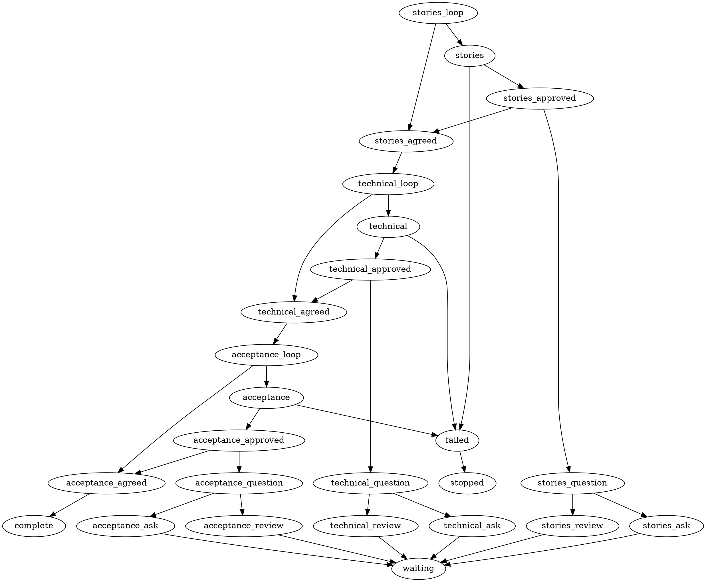

# Advisory Plan workflow draft

Research reference at revision 21f4d1771133983c4fd97e68bfd683611c190331. This is a design sketch for shaping, not an installed or executable Plan profile. No production Plan mode policy currently admits it. Names and contracts below are proposals.

## Current versus proposed

| Concern | Current Plan | Proposed loops |
|---|---|---|
| Starting point | Requirements engineer writes specification including acceptance criteria | Story facilitator discusses actor, need and benefit only |
| Architecture | Architect reviews specification before story decomposition | Architect reviews owner-promoted stories for reuse, boundaries and data fit |
| Stories | Product-owner role decomposes reviewed specification into complete stories | Stable story drafts exist from the first loop |
| Acceptance | Appears in specification and final decomposition | Dedicated conversation after technical shaping |
| Human control | Persistent discussion and later managed-scope approval exist | Explicit review of each stage's current candidate before promotion |

The expected benefit is earlier correction of the user need, smaller decisions for the owner, and less premature technical detail. This is an inference, not a measured outcome. Three gates can also increase round trips; show focused changes, preserve answers and ask only consequential questions.

## Stage contracts

| Stage | Agent remit | Output to retain | Human gate |
|---|---|---|---|
| Stories | Help articulate actor, want, benefit, boundaries and priority | Stable draft keys, story text, assumptions and unresolved user decisions; no tasks, architecture or acceptance criteria | Review story set and explicitly promote its displayed revision |
| Technical | Reuse existing owners; inspect interfaces, entities, relationships, invariants, migration and failure behavior | Architecture choices, data model, dependencies and provisional task placement linked to story keys | Review tradeoffs and promote displayed technical candidate |
| Acceptance | Discuss observable completion with examples, edge cases, quality requirements and proof | Stable criterion IDs; final task-to-criterion links; complete typed Plan | Review complete assembled candidate before publication handoff |

Phase-three criterion agreement defines future obligations. It does not certify implementation, waive checks, freeze implementation scope, or select Implement.

## DOT skeleton

This copies the Research shaping-loop pattern and its generic activity names. A Plan policy must supply result decoding, candidate-bound owner authorization, rendering, draft persistence and continuation. In particular, an agent saying approved is insufficient. Owner replies return through the existing durable wait mechanism to their source agent; they are not automatic DOT edges from waiting.

The complete terminal below means the three conversations are settled. It does not claim managed story publication or readiness. Final handoff must use the existing Plan validation/publication/index/save owner. The graph-to-Plan adapter is an implementation gap.



The limit of eight mirrors Research only as a sketch. Shaping must settle long-conversation exhaustion and reopening behavior. No automatic retries after an agent failure.

## Proposed application-shipped Markdown layout

Mirror the embedded Research directory layout, leaving Research files unchanged:

```text
internal/teamsource/plan/
  plan.dot
  stories.md
  technical.md
  acceptance.md
  skills/
    plan-evidence/
      SKILL.md
      node-result.md
      stage-state.md
    story-shaping/
      SKILL.md
    technical-shaping/
      SKILL.md
      data-model.md
    acceptance-shaping/
      SKILL.md
      completion.md
```

Each role Markdown uses the Research structure: Role, Voice, Goal, How You Are Invoked, When You Are Done, Must Do, Must Not Do, Writing the Report, Output. The graph owns sequencing and owner waits; roles own one bounded conversational contribution. Each stage skill references the shared plan-evidence contract. Reuse existing architect guidance within technical-shaping; adapt product-owner guidance for stories and requirements guidance for acceptance. Do not import the current planning-contracts skill unchanged into phase one: it requires complete stories.

Shared stage-state guidance should describe draft identity, stage, candidate revision, owner decisions, assumptions, upstream revision dependencies and invalidation. These are proposed requirements, not an accepted schema. Node-result guidance should separate stage-ready, question and authenticated promotion from whole-Plan completion. Exact result vocabulary and fields remain for shaping.

Use a shared plan_brief.md for human-readable scope, decisions and later the link-only Story Index. Retain canonical drafts through factory state/context rather than new per-story Markdown. Published managed stories keep GitHub as their editable source.

## Reuse before adding activities

- Reuse lf_agent for all three roles; role changes do not need activity handlers.
- Reuse lf_loop and lf_if for response-driven routing.
- Reuse lf_ask question/review for durable owner waits.
- Reuse lf_comment for reports; it does not publish managed stories.
- Reuse graph capture, attempts, recovery and candidate-bound approval mechanics through explicit Plan policy admission.
- Reuse typed Plan validation, proposal publication, current-base checks, index replacement and readiness gates.
- Do not reuse lf_research_brief for Plan; its document and mode contract is Research-specific.
- No new activity is established as necessary by this pass. If graph composition cannot invoke final Plan handoff with the required durable effect boundary, a narrowly scoped Plan publication adapter/activity is a candidate. Likewise, deterministic Plan document generation needs an explicit owner if adopted. Settle these after examining the adapter boundary, rather than cloning the activity catalog.

## Missing rules to settle during shaping

1. Draft persistence: completed typed stories require criteria and tasks. Existing discussion context retains scope, decisions, assumptions and questions but has no dedicated structured story/stage model.
2. Backward changes: a revised need must return to the story conversation and invalidate affected downstream approval; technical or acceptance discoveries must not silently rewrite approved intent.
3. Approval identity: approve the displayed candidate and upstream revisions; distinguish questions, proposed edits and promotion.
4. Final assembly: phase two cannot finalize task-to-criterion references before phase three creates criteria. Validate the assembled Plan before showing its final review.
5. Publication and reopening: preserve existing legacy/typed contracts, managed story identities, completed dependencies, readiness invalidation and explicit replan rules.
6. Acceptance coverage: distinguish per-story observable criteria from shared quality/completion requirements and identify how each obligation will be checked.
7. Adoption: explicitly admit Plan policy and source capture, preserve legacy active work, and verify host delivery and recovery. Offline tests are not authentic provider evidence.

No implementation or tests were run in this research pass. The draft was compared with current source and contracts; it has not passed runtime graph admission.

