The scope is one standalone Bug workflow, selected by the existing `bug` label, covering analysis, an approved repair, a separate test graph and approved delivery through issue closure. It does not move through Research, Plan, Implement or Validate, and needs no `Mode:` label. Your answers settle the four earlier questions; the draft below is ready for review.

## In scope

- Reuse the existing graph engine and available activities, with #319 completed before the dependent repair workflow is implemented.
- Keep Root Cause, Impact and Solution in one analysis report, including reproduction, severity, proposed remedy, complexity and observable success criteria.
- Let one analyst handle clarification and shaping, looping on owner feedback until the owner approves that analysis revision.
- Let one fixer change code and regression tests within the approved remedy.
- Invoke a separate, durable test graph that runs regression checks, the full suite and required quality checks.
- Prepare a reviewable PR after checks pass, obtain approval for that current change and target, confirm integration, then close the issue.
- Use MCP and versioned JSON for agent communication, with publication and delivery controlled by graph activities.

## Out of scope

Feature story breakdowns, switches between feature modes, automatic bug detection, incident management, bulk repair, unrelated cleanup, architectural redesign and destructive migrations are excluded. The child-graph capability is limited to the required test workflow; arbitrary recursive graph calls and parallel child fan-out are excluded.

## Draft flow

`bug label → analyze and shape ↔ owner answers/review → approve remedy → fix → test child ↔ bounded repair → tested PR → approve delivery → integrate → close`

This is **one workflow**, with two normal owner gates: approval of the remedy and approval of the tested PR for delivery. A ready analysis is a draft, not permission to repair. Missing facts use a question wait; feedback returns to the same analyst. Test failures return to the fixer while budget remains. A materially different remedy returns to analysis and needs renewed approval. No feature-mode handoff occurs.

The following DOT is an illustrative flow, not an executable engine configuration. Labels identify reuse points; “NEW” marks the child invocation capability. Owner-reply edges represent durable waits and later continuation, not an agent waiting in memory. Factory delivery boxes describe required effects, not claims that those activities already exist.

```dot
digraph bug {
  rankdir=LR;
  intake [label="bug label / admit once"];
  shape [label="lf_agent: bug analyst"];
  gate [label="lf_if: analysis result"];
  ask [label="lf_ask: missing facts"];
  review [label="lf_ask: approve remedy"];
  shape_loop [label="lf_loop: analysis budget"];
  fix [label="lf_agent: bug fixer"];
  tests [label="NEW: invoke / resume test child"];
  retry [label="lf_loop: shared repair budget"];
  pr [label="Factory: prepare tested PR"];
  delivery [label="lf_ask: approve current PR"];
  merge [label="Factory: integrate and confirm"];
  report [label="lf_comment: delivered"];
  partial [label="lf_comment: incomplete"];
  closed [label="Factory: confirm issue closure"];
  complete [label="Complete"];
  stopped [label="Stopped; evidence retained"];

  intake -> shape;
  shape -> gate;
  gate -> ask [label="missing facts"];
  gate -> review [label="draft ready"];
  gate -> fix [label="owner approved this revision"];
  gate -> partial [label="blocked"];
  ask -> shape_loop [label="owner replies"];
  review -> shape_loop [label="approval or feedback"];
  shape_loop -> shape [label="budget available"];
  shape_loop -> partial [label="exhausted"];
  fix -> tests [label="scoped patch ready"];
  fix -> partial [label="blocked"];
  fix -> shape_loop [label="remedy must change"];
  tests -> pr [label="all required checks pass"];
  tests -> retry [label="fixable failure"];
  retry -> fix [label="reserve next attempt"];
  retry -> partial [label="exhausted"];
  tests -> partial [label="blocked / cancelled / uncertain"];
  pr -> delivery;
  delivery -> merge [label="current PR and target approved"];
  delivery -> retry [label="scoped code feedback"];
  delivery -> shape_loop [label="scope feedback"];
  merge -> closed [label="integration confirmed"];
  merge -> tests [label="source or target changed"];
  closed -> report [label="closure confirmed"];
  report -> complete;
  partial -> stopped;
}
```

The test graph is a separate graph, not a DOT subgraph embedded in the parent:

```dot
digraph bug_tests {
  rankdir=LR;
  bind [label="Bind parent, source, criteria and recipe"];
  regression [label="Factory: regression and focused checks"];
  suite [label="Factory: full suite and required quality checks"];
  record [label="Factory: record structured evidence"];
  result [label="Return JSON result to parent"];

  bind -> regression [label="inputs valid"];
  bind -> record [label="invalid / unavailable"];
  regression -> suite [label="pass"];
  regression -> record [label="fail / blocked / interrupted"];
  suite -> record [label="pass / fail / blocked / interrupted"];
  record -> result;
}
```

Every activity failure, rejected permission or unhandled result stops with evidence; none falls through to success. Owner rejection stops the workflow. Cancellation propagates to a running child and prevents further repair or delivery. A closure failure remains pending closure and cannot claim a closed issue.

## Data, permissions and edge cases

One versioned bug record holds expected and actual behavior, affected environment/version, reproduction evidence, cause and preconditions, impact, severity rationale, remedy, complexity, success criteria and owner answers. Its execution record holds scope approval, source and target revisions, graph versions, child run identity, test recipe, attempts, outcomes, remaining budgets and delivery references.

The `bug` label selects this route within normal repository/task admission. For new tasks it takes precedence over feature-mode labels; an already running task keeps its admitted workflow, so relabeling cannot create a second run or silently migrate it. Removing the label does not revoke a recorded approval or cancel a running task; explicit cancellation does. These are shaping defaults, not additional owner answers.

Analysis can inspect and run bounded reproduction checks in the task environment, but cannot repair product code. Repair requires the recorded owner approval. Only the factory executes delivery effects, and only after current-head/target approval. No agent can declare its own scope approved, merge directly or close the issue.

Repair requires a concrete failure, a supported cause and a bounded remedy. Existing failing evidence can substitute for a locally reproduced failure when the report explains why; unsupported guesses cannot. An unreproduced bug stays incomplete after clarification. A larger remedy preserves the findings and stops for an owner decision inside Bug.

Default limits are eight analyst invocations and two repair attempts after the initial fix, configurable and persisted across restarts. Repair feedback and failed checks share the repair budget; neither a new child run nor a new reply resets it. Exhaustion produces an incomplete report; an explicit authorized continuation is needed to extend a budget.

The child receives the approved criteria, exact source revision, recipe/environment and parent identity; it returns pass, fail, blocked or cancelled with check-level evidence. Invocation uses a durable call identity so recovery resumes or retrieves the same child rather than launching a duplicate. Parent cancellation reaches the child, and the parent cannot advance while its child outcome is unknown. A changed source, recipe or relevant target invalidates affected evidence and requires fresh checks.

Full-suite success means the regression and all mandatory project checks pass against the final source. For this repository, the saved findings identify formatting, vet, pinned lint and race-enabled tests as required checks. Missing recipes, unavailable environments, flakes, unrelated failures, skipped checks and interrupted checks are reported distinctly and cannot count as passing. Failed regression checks may stop that child early; the next successful attempt must still run the full suite.

## Agents and reusable activities

Introduce **two bug-specific roles**: **Bug analyst** combines investigation and shaping, and **Bug fixer** performs the initial repair and bounded corrections. The graph is the orchestrator. Test execution, PR preparation and integration are factory activities, so they do not need extra reasoning agents.

Reuse `lf_agent`, `lf_if`, `lf_loop`, `lf_ask` and `lf_comment` where their admitted contracts fit, plus #319's delivered recipe, check, repair-budget and evidence activities. The new capability is invoking and recovering a separately executed test graph. Bug admission, the Bug result contract and delivery adapters are also in scope; exact #319 interfaces must be checked after delivery.

### Bug analyst specification

**Role:** Establish the cause and shape the smallest supported remedy.

**Voice:** Use short, plain sentences and explain technical consequences.

**Goal:** Produce one owner-approved analysis with clear success criteria.

**How you are invoked:** The graph supplies the bug record, evidence, prior answers, current revision and remaining analysis budget.

**When you are done:** Return a draft when the analysis is supported; report approval only when an authenticated owner reply accepts that exact revision.

**Must Do:** Cover Root Cause, Impact and Solution, separate evidence from assumptions, batch material questions with recommended options, and reuse settled answers.

**Must Not Do:** Repair product code, invent reproduction results, broaden scope silently, approve its own proposal or select another workflow.

**Writing the Report:** Lead with the observed defect, then Root Cause, Impact and Solution, ending with success criteria and any questions.

**Output:** Submit the versioned Bug JSON result through MCP and return the same retained result, using `ask`, `done`, `approved` or `blocked` according to the conditions below.

### Bug fixer specification

**Role:** Repair the approved defect and update regression tests.

**Voice:** State what changed, what evidence supports it and what remains unresolved.

**Goal:** Produce a scoped patch that the test child can verify.

**How you are invoked:** The graph supplies the approved analysis revision, task worktree, current source, check failures and reserved repair budget.

**When you are done:** Return the patch and relevant evidence for factory checks, or report why the agreed remedy cannot be completed.

**Must Do:** Address the recorded behavior, add or update a regression test, preserve evidence and identify any necessary scope change.

**Must Not Do:** Change the approved goal, weaken mandatory checks, reset budgets, claim unrun tests passed or publish, merge or close directly.

**Writing the Report:** Explain the correction, changed behavior, regression coverage and remaining failures.

**Output:** Submit the versioned Bug JSON result through MCP and return the same retained result, using `done`, `reshape` or `blocked`; `done` means the patch is ready for checks.

## JSON and MCP contract

Use the existing standard envelope: `version`, `response` and `result`. The Bug contract adds its own admitted payload rather than disguising a repair as Research. Results carry `outcome`, `comment`, an unfinished-work `reason`, stable-ID evidence/decisions/assumptions, and questions where needed; questions include audience, concrete options and a recommendation.

For the analyst, `ask` requires an incomplete result and questions; `done` means a completed analysis draft awaiting review; `approved` requires a matching owner approval; `blocked` retains an incomplete diagnosis with its reason. For the fixer, `done` means engineering work is ready for checks, `reshape` returns an incomplete result describing the changed remedy, and `blocked` records the obstacle. Child outcomes are distinct from agent responses and never grant owner approval.

Agents preflight, correct diagnostics, submit and read the matching MCP receipt, retaining its request identity. Lost replies require receipt recovery before retrying. The terminal result must match the retained candidate. Only graph communication activities publish comments or open owner waits; input acknowledgment, engineering completion, acceptance and publication remain separate.

The earlier findings establish existing reuse points and the dependency's status as observed on 22 September; they do not establish that #319 is delivered today. Your reply settles label entry, one-flow delivery, the analysis approval and a real child graph. The role split, limits and recovery rules above are shaping decisions/defaults offered for review. No implementation, test execution or delivery is claimed by this scope.
