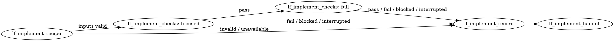

The scope is one standalone Bug workflow, selected by the existing `bug` label, covering analysis, an approved repair, a separate test graph and approved delivery through issue closure. It does not move through Research, Plan, Implement or Validate, and needs no `Mode:` label. #319 is not a prerequisite; all missing activities listed below are delivered within #367 and admitted only for Bug.

## In scope

- Reuse the existing graph engine and available activities, and deliver the missing lf_implement_* activities here for Bug without waiting for #319.
- Keep Root Cause, Impact and Solution in one analysis report, including reproduction, severity, proposed remedy, complexity and observable success criteria.
- Let one analyst handle clarification and shaping, looping on owner feedback until the owner approves that analysis revision.
- Let one fixer change code and regression tests within the approved remedy.
- Invoke a separate, durable test graph that runs regression checks, the full suite and required quality checks.
- Prepare a reviewable PR after checks pass, obtain approval for that current change and target, confirm integration, then close the issue.
- Use MCP and versioned JSON for agent communication, with publication and delivery controlled by graph activities.

## Out of scope

Feature story breakdowns, switches between feature modes, automatic bug detection, incident management, bulk repair, unrelated cleanup, architectural redesign and destructive migrations are excluded. The child-graph capability is limited to the required test workflow; arbitrary recursive graph calls and parallel child fan-out are excluded.

## Draft flow

`bug label → analyze and shape ↔ owner answers/review → approve remedy → fix → test child ↔ bounded repair → tested PR → approve delivery → integrate → close`

This is **one workflow**, with two normal owner gates: approval of the remedy and approval of the tested PR for delivery. A ready analysis is a draft, not permission to repair. Missing facts use a question wait; feedback returns to the same analyst. Test failures return to the fixer while budget remains. A materially different remedy returns to analysis and needs renewed approval. No feature-mode handoff occurs.

The following DOT is an illustrative flow, not an executable engine configuration. Labels identify reused generic activities and the proposed lf_implement_* activities. Owner-reply edges represent durable waits and later continuation, not an agent waiting in memory. Factory delivery boxes describe required effects, not claims that those activities already exist.

```dot
digraph bug {
  rankdir=LR;
  intake [label="bug label / admit once"];
  shape [label="lf_agent: bug analyst"];
  gate [label="lf_if: analysis result"];
  ask [label="lf_ask: missing facts"];
  review [label="lf_ask: approve remedy"];
  shape_loop [label="lf_loop: analysis budget"];
  prepare [label="lf_implement_prepare"];
  fix [label="lf_agent: bug fixer"];
  reserve [label="lf_implement_repair"];
  tests [label="lf_implement_test_graph"];
  retry [label="lf_loop: shared repair budget"];
  pr [label="lf_implement_pr"];
  delivery [label="lf_ask: approve current PR"];
  merge [label="lf_implement_merge"];
  report [label="lf_comment: delivered"];
  partial [label="lf_comment: incomplete"];
  closed [label="lf_implement_close"];
  complete [label="Complete"];
  stopped [label="Stopped; evidence retained"];

  intake -> shape;
  shape -> gate;
  gate -> ask [label="missing facts"];
  gate -> review [label="draft ready"];
  gate -> prepare [label="owner approved this revision"];
  prepare -> fix [label="ready"];
  prepare -> partial [label="blocked"];
  gate -> partial [label="blocked"];
  ask -> shape_loop [label="owner replies"];
  review -> shape_loop [label="approval or feedback"];
  shape_loop -> shape [label="budget available"];
  shape_loop -> partial [label="exhausted"];
  fix -> tests [label="scoped patch ready"];
  fix -> partial [label="blocked"];
  fix -> shape_loop [label="remedy must change"];
  tests -> pr [label="all required checks pass"];
  tests -> retry [label="fixable failure"];
  retry -> reserve [label="budget available"];
  reserve -> fix [label="reserved"];
  reserve -> partial [label="exhausted / blocked"];
  reserve -> shape_loop [label="reshape"];
  retry -> partial [label="exhausted"];
  tests -> partial [label="blocked / cancelled / uncertain"];
  pr -> delivery;
  delivery -> merge [label="current PR and target approved"];
  delivery -> retry [label="scoped code feedback"];
  delivery -> shape_loop [label="scope feedback"];
  merge -> closed [label="integration confirmed"];
  merge -> tests [label="source or target changed"];
  closed -> report [label="closure confirmed"];
  report -> complete;
  partial -> stopped;
}
```

The test graph is a separate graph, not a DOT subgraph embedded in the parent:

Every activity failure, rejected permission or unhandled result stops with evidence; none falls through to success. Owner rejection stops the workflow. Cancellation propagates to a running child and prevents further repair or delivery. A closure failure remains pending closure and cannot claim a closed issue.

## Data, permissions and edge cases

One versioned bug record holds expected and actual behavior, affected environment/version, reproduction evidence, cause and preconditions, impact, severity rationale, remedy, complexity, success criteria and owner answers. Its execution record holds scope approval, source and target revisions, graph versions, child run identity, test recipe, attempts, outcomes, remaining budgets and delivery references.

The `bug` label selects this route within normal repository/task admission. For new tasks it takes precedence over feature-mode labels; an already running task keeps its admitted workflow, so relabeling cannot create a second run or silently migrate it. Removing the label does not revoke a recorded approval or cancel a running task; explicit cancellation does. These are shaping defaults, not additional owner answers.

Analysis can inspect and run bounded reproduction checks in the task environment, but cannot repair product code. Repair requires the recorded owner approval. Only the factory executes delivery effects, and only after current-head/target approval. No agent can declare its own scope approved, merge directly or close the issue.

Repair requires a concrete failure, a supported cause and a bounded remedy. Existing failing evidence can substitute for a locally reproduced failure when the report explains why; unsupported guesses cannot. An unreproduced bug stays incomplete after clarification. A larger remedy preserves the findings and stops for an owner decision inside Bug.

Default limits are eight analyst invocations and two repair attempts after the initial fix, configurable and persisted across restarts. Repair feedback and failed checks share the repair budget; neither a new child run nor a new reply resets it. Exhaustion produces an incomplete report; an explicit authorized continuation is needed to extend a budget.

The child receives the approved criteria, exact source revision, recipe/environment and parent identity; it returns pass, fail, blocked or cancelled with check-level evidence. Invocation uses a durable call identity so recovery resumes or retrieves the same child rather than launching a duplicate. Parent cancellation reaches the child, and the parent cannot advance while its child outcome is unknown. A changed source, recipe or relevant target invalidates affected evidence and requires fresh checks.

Full-suite success means the regression and all mandatory project checks pass against the final source. For this repository, the saved findings identify formatting, vet, pinned lint and race-enabled tests as required checks. Missing recipes, unavailable environments, flakes, unrelated failures, skipped checks and interrupted checks are reported distinctly and cannot count as passing. Failed regression checks may stop that child early; the next successful attempt must still run the full suite.

## Agents and reusable activities

Introduce **two bug-specific roles**: **Bug analyst** combines investigation and shaping, and **Bug fixer** performs the initial repair and bounded corrections. The graph is the orchestrator. Test execution, PR preparation and integration are factory activities, so they do not need extra reasoning agents.

Reuse `lf_agent`, `lf_if`, `lf_loop`, `lf_ask` and `lf_comment` where their admitted contracts fit, and deliver the ten activities specified below within #367, admitted only for Bug. Bug admission, the Bug result contract and the narrow admission of these lf_implement_* names are included; #319 and feature Implement enablement are excluded.

### Bug analyst specification

**Role:** Establish the cause and shape the smallest supported remedy.

**Voice:** Use short, plain sentences and explain technical consequences.

**Goal:** Produce one owner-approved analysis with clear success criteria.

**How you are invoked:** The graph supplies the bug record, evidence, prior answers, current revision and remaining analysis budget.

**When you are done:** Return a draft when the analysis is supported; report approval only when an authenticated owner reply accepts that exact revision.

**Must Do:** Cover Root Cause, Impact and Solution, separate evidence from assumptions, batch material questions with recommended options, and reuse settled answers.

**Must Not Do:** Repair product code, invent reproduction results, broaden scope silently, approve its own proposal or select another workflow.

**Writing the Report:** Lead with the observed defect, then Root Cause, Impact and Solution, ending with success criteria and any questions.

**Output:** Submit the versioned Bug JSON result through MCP and return the same retained result, using `ask`, `done`, `approved` or `blocked` according to the conditions below.

### Bug fixer specification

**Role:** Repair the approved defect and update regression tests.

**Voice:** State what changed, what evidence supports it and what remains unresolved.

**Goal:** Produce a scoped patch that the test child can verify.

**How you are invoked:** The graph supplies the approved analysis revision, task worktree, current source, check failures and reserved repair budget.

**When you are done:** Return the patch and relevant evidence for factory checks, or report why the agreed remedy cannot be completed.

**Must Do:** Address the recorded behavior, add or update a regression test, preserve evidence and identify any necessary scope change.

**Must Not Do:** Change the approved goal, weaken mandatory checks, reset budgets, claim unrun tests passed or publish, merge or close directly.

**Writing the Report:** Explain the correction, changed behavior, regression coverage and remaining failures.

**Output:** Submit the versioned Bug JSON result through MCP and return the same retained result, using `done`, `reshape` or `blocked`; `done` means the patch is ready for checks.

## JSON and MCP contract

Use the existing standard envelope: `version`, `response` and `result`. The Bug contract adds its own admitted payload rather than disguising a repair as Research. Results carry `outcome`, `comment`, an unfinished-work `reason`, stable-ID evidence/decisions/assumptions, and questions where needed; questions include audience, concrete options and a recommendation.

For the analyst, `ask` requires an incomplete result and questions; `done` means a completed analysis draft awaiting review; `approved` requires a matching owner approval; `blocked` retains an incomplete diagnosis with its reason. For the fixer, `done` means engineering work is ready for checks, `reshape` returns an incomplete result describing the changed remedy, and `blocked` records the obstacle. Child outcomes are distinct from agent responses and never grant owner approval.

Agents preflight, correct diagnostics, submit and read the matching MCP receipt, retaining its request identity. Lost replies require receipt recovery before retrying. The terminal result must match the retained candidate. Only graph communication activities publish comments or open owner waits; input acknowledgment, engineering completion, acceptance and publication remain separate.

The earlier findings describe historical reuse points and #319 proposals; #319 is no longer a prerequisite. Owner replies settle label entry, one-flow delivery, analysis approval and a real child graph. The role split, limits and recovery rules above are shaping decisions/defaults offered for review. No implementation, test execution or delivery is claimed by this scope.

## Activity inventory and Bug-only boundary

These are proposed additions to deliver here, not dependencies on future work:

| New activity | Bug-only responsibility and result |
|---|---|
| `lf_implement_prepare` | Validate the current approved bug scope and task worktree; bind the initial attempt to that scope and source, or return blocked without starting repair. |
| `lf_implement_recipe` | Resolve and validate the regression, focused-test and full-suite recipe against approved criteria and the environment; return a versioned recipe or blocked. |
| `lf_implement_checks` | Execute one selected recipe phase under factory control; return pass, fail, blocked or cancelled with command, source, environment, exit status and log references. |
| `lf_implement_repair` | Atomically reserve one additional repair attempt and prepare its failure/feedback context; return reserved, exhausted, reshape or blocked before the fixer runs. |
| `lf_implement_record` | Persist each attempt and check result against its scope, source and recipe; acknowledge recorded evidence without granting approval. |
| `lf_implement_handoff` | Finalize the test child's aggregate JSON result and return its evidence references to the parent; return pass only when every mandatory check is current and passing. |
| `lf_implement_test_graph` | Invoke, resume or recover the separate test child using a durable call identity; propagate cancellation and return its recorded result without duplicating execution. |
| `lf_implement_pr` | Prepare or update the bug PR from the tested source through existing factory git/GitHub capabilities; return the PR, exact head and target for owner review. |
| `lf_implement_merge` | Recheck owner approval and test evidence for the exact PR head and target, integrate through existing factory capabilities and confirm the result; stale inputs return for fresh checks and review. |
| `lf_implement_close` | Close the bug issue only after confirmed integration and record the remote outcome; failed or uncertain closure stays pending and is recovered before retry. |

The first six names come from the earlier #319 proposal, but their behavior here is defined for one approved bug. The remaining four names make the previously unnamed child-execution and delivery steps explicit. Existing git, GitHub, persistence and execution capabilities should be reused behind these activities.

`lf_implement_next` is unnecessary because there is one bug rather than a queue of feature stories. No new reasoning agents are needed. The fixer still runs through `lf_agent`; `lf_implement_repair` reserves its attempt and supplies context rather than launching a second fixer.

## Placement in the graphs

The parent uses `lf_implement_prepare` after scope approval, then invokes the fixer and `lf_implement_test_graph`. A fixable check failure or scoped PR feedback goes through the existing loop and `lf_implement_repair` before returning to the fixer. The child uses `lf_implement_recipe`, `lf_implement_checks` for focused and full-suite phases, `lf_implement_record`, then `lf_implement_handoff`. Passing results lead to `lf_implement_pr`, owner approval, `lf_implement_merge` and `lf_implement_close`.

The record carries the bug and scope revisions, attempt identity, durable child-call identity, source and target revisions, recipe/environment, check results, remaining budgets and delivery references. Every activity validates its applicable identities and permissions. Replays recover an existing outcome; unknown outcomes cannot become success.

The initial fix does not consume a repair retry. Additional attempts are reserved once, before execution, from the shared default budget of two; restarts and owner replies cannot reset it. Analysis retains its configurable default of eight invocations. A changed remedy returns to analysis; changed source, recipe or relevant target invalidates affected checks and approval. Missing recipes, environment failures, interrupted tests and exhausted budgets remain explicit incomplete outcomes.

The current registry couples activity prefixes to admitted modes. The required change is to admit this exact activity set for Bug, not to relabel the workflow as Implement or allow arbitrary cross-workflow activities. Validation must show that the Bug lifecycle works while #319 is absent and that unrelated feature workflows gain no new activity authority.

Your reply removes the dependency and authorizes defining the missing activities here. The exact ten-activity split is my shaping proposal. The complete saved scope now includes this inventory and updated DOT labels; the earlier agent specifications and behavioral rules remain part of it. No product code, tests or remote delivery were executed in this shaping pass.
