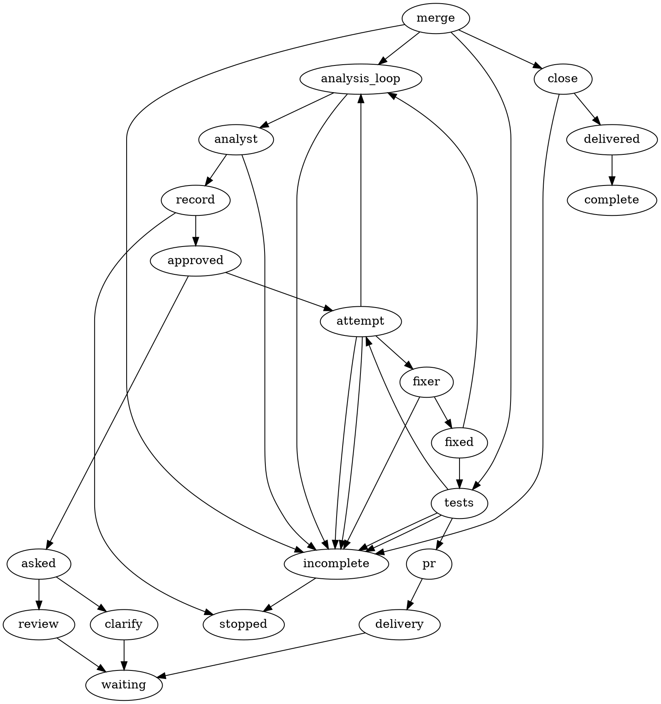
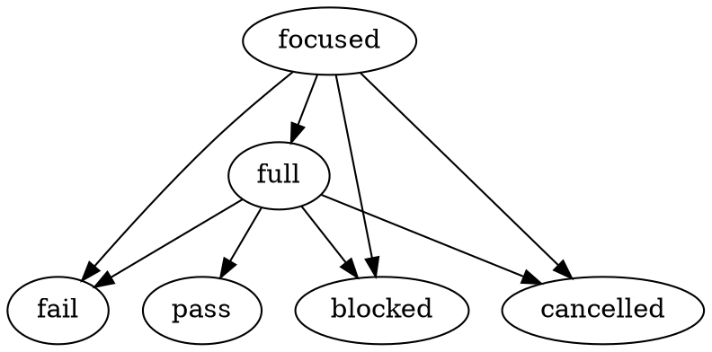

# Bug workflow: agreed scope (shaping revision 5)

One standalone Bug workflow, selected by the existing `bug` label when no `Mode:` label is present. It covers analysis, one owner-approved repair, a separate test graph and approved delivery through issue closure. It never enters Research, Plan, Implement or Validate. #319 is not a prerequisite. Every missing activity is delivered in #367, is named `lf_bug_*` and is admitted only for Bug.

This revision answers the assumption challenge. It changes four things from revision 4: the label rule, how Bug gets its own activity names, who owns test commands, and the number of activities (ten become seven).

## Decisions from the owner (settled)

- The existing `bug` label is reused; no `Mode: Bug` label; Bug sits outside Research - Plan - Implement - Validate.
- One approval of the analysis before repair; the flow stays simple.
- One mode covers the whole lifecycle through integration and closure.
- The test run is a separately executed child graph (durable invocation, recovery, cancellation, result).
- Agents follow the Research specification layout, use MCP and the versioned JSON envelope.
- #319 is not a prerequisite; missing activities are delivered here.
- Activities are `lf_implement_*` only if reusable like for like in Implement. They are not established as such, so all are `lf_bug_*`.

## Decisions taken in shaping (defaults the owner can overturn)

- **S1 Label rule.** A new task with the `bug` label and no `Mode:` label runs Bug. An explicit `Mode:` label always wins. Reason: many open bug-labelled issues already carry a deliberate Mode label and must not be re-routed. To force Bug on such an issue, remove the Mode label.
- **S2 Namespace.** Bug is a workflow identity that sits beside the five modes. The engine accepts `lf_<workflow>_<capability>` for the five modes and for `bug`. No sixth Mode value and no `Mode: Bug` label are created. The graph declares its workflow identity instead of a mode.
- **S3 Test commands.** The factory runs only commands declared by project configuration (for this repository: format, vet, pinned lint and race tests, the existing full check). Agents never write or change commands. A missing recipe returns blocked.
- **S4 Seven activities, not ten.** See the inventory below.
- **S5 Shared repair budget.** One attempt node holds the budget, so test failures and PR feedback share one counter. The engine already bounds a node's dispatches per instance across all entry edges. Default: one initial fix plus two repairs. Analysis default: eight passes.
- **S6 Question permission.** The Bug analyst gets an explicit grant to ask questions and to open review waits; the fixer gets none.

## In scope

- Reuse `lf_agent`, `lf_if`, `lf_loop`, `lf_ask` and `lf_comment`.
- Two reasoning agents: Bug analyst and Bug fixer.
- Seven new Bug-only activities (below), Bug workflow identity, Bug label routing, a Bug result policy on the shared MCP result service and a minimal child-graph invocation limited to the test graph.
- One versioned bug record and one execution record.
- Two owner gates: approve the analysis revision; approve the tested PR head and target.
- Bounded repair, recoverable waits, and honest incomplete outcomes.

## Out of scope

- Implementing #319, enabling these activities in Implement, feature story breakdowns and feature-mode handoffs.
- Automatic bug detection, incident response, bulk repair, unrelated cleanup, architectural redesign, destructive migration.
- General recursive graph execution and parallel child graphs.
- Treating passing tests as owner acceptance or as merge permission.
- Agent-authored test commands.
- Running tests, changing product code or publishing during this shaping pass.

## Interface surface

- **Entry:** issue labelled `bug`, no `Mode:` label, admitted once. A running task keeps its workflow if relabelled. Removing the label cancels nothing and revokes nothing.
- **Owner touchpoints:** issue comments only. Questions and the analysis review arrive as durable comments. The delivery review names the PR, its exact head and its target. Owner replies continue the run.
- **Agent communication:** MCP preflight, submit, receipt, then the versioned JSON envelope (`version`, `response`, `result`). Only graph comment and ask activities publish.
- **Analyst responses:** `ask`, `done`, `approved`, `blocked`. `approved` only when an authenticated owner reply accepts that exact revision.
- **Fixer responses:** `done`, `reshape`, `blocked`.

## Activity inventory (all new, Bug-only)

| Activity | Responsibility |
|---|---|
| `lf_bug_record` | After each analyst pass, persist the retained candidate into the versioned bug record and render its saved documents. Mirrors the Research brief step. |
| `lf_bug_attempt` | Check the approved scope and worktree, reserve the initial or an additional repair attempt once, and prepare the fixer's context. Returns reserved, exhausted, reshape or blocked. |
| `lf_bug_test_graph` | Start, resume or recover the separate test child by a durable call identity, propagate cancellation, return its recorded result. |
| `lf_bug_checks` | Child only. Run one recipe phase (focused, then full) under factory control from project-declared commands; record command, source, environment, exit status, logs and outcome. |
| `lf_bug_pr` | Prepare or update the PR from the tested source; return PR, exact head and target. |
| `lf_bug_merge` | Recheck owner approval and test evidence for that head and target, integrate, confirm. Stale input returns for fresh checks and review. |
| `lf_bug_close` | Close the issue only after confirmed integration; failed or unknown closure stays pending and is recovered before retry. |

Dropped from revision 4: `lf_bug_prepare` and `lf_bug_repair` (merged into attempt), `lf_bug_recipe` and the child's `lf_bug_record` (folded into checks, which records what it runs), `lf_bug_handoff` (the child's recorded terminal outcome is the result). No `lf_bug_next`: there is one bug.

## Parent graph (illustrative, not an executable profile)

## Test child graph (a separate graph, not a subgraph)

The parent's `lf_bug_test_graph` maps the child's terminal to its own outcome. Fixed limit of one child at a time; no recursion.

## Agent specifications

### Bug analyst

- **Role:** Establish the cause and shape the smallest supported remedy.
- **Voice:** Short plain sentences; explain technical consequences to a non-expert.
- **Goal:** One owner-approved analysis with observable success criteria.
- **How you are invoked:** The graph supplies the bug record, evidence, prior answers, current revision, remaining analysis budget, and (when returning) a fixer reshape note or owner PR feedback.
- **When you are done:** Return `done` with a supported draft; return `approved` only when an authenticated owner reply accepts that exact revision; `ask` for missing facts; `blocked` when no safe remedy exists.
- **Must Do:** Cover Root Cause, Impact and Solution; separate evidence from assumptions; batch material questions with options and a recommendation; reuse settled answers; classify PR feedback as within or outside the approved remedy; name the regression test the fixer must add.
- **Must Not Do:** Repair product code; write test commands; invent reproduction results; broaden scope silently; approve its own proposal; select another workflow.
- **Writing the Report:** Observed defect first, then Root Cause, Impact, Solution, success criteria, questions.
- **Output:** Preflight, submit and read the MCP receipt, then return the same versioned JSON result.

### Bug fixer

- **Role:** Repair the approved defect and update regression tests.
- **Voice:** State what changed, what evidence supports it, what remains unresolved.
- **Goal:** A scoped patch the test child can verify.
- **How you are invoked:** The graph supplies the approved revision, worktree, current source, prior check failures and the reserved attempt.
- **When you are done:** Return `done` when the patch and regression test are ready for factory checks; `reshape` when the approved remedy cannot work; `blocked` for an obstacle.
- **Must Do:** Address the recorded behavior; add or update a regression test; preserve evidence; flag any needed scope change.
- **Must Not Do:** Change the goal; weaken or skip mandatory checks; change test commands; reset budgets; claim unrun tests passed; publish, merge or close.
- **Writing the Report:** The correction, changed behavior, regression coverage, remaining failures.
- **Output:** Preflight, submit and read the MCP receipt, then return the same versioned JSON result.

## Data model

**Bug record (versioned; one revision per analyst pass):** expected behavior, actual behavior, environment and version, reproduction steps and evidence, root cause and preconditions, impact and severity rationale, remedy, complexity, success criteria including the regression test to add, owner answers, revision.

**Execution record:** bug revision approved, approval identity and time, base source, attempt number and outcome per attempt, patch source revision, recipe version, child call identity and terminal outcome, per-check results (command, source, environment, exit status, log reference, outcome), remaining analysis and repair budgets, PR reference, head and target revisions, owner delivery approval, merge and closure outcomes.

**States:** analyzing, awaiting owner, ready for repair, repairing, checking, ready for review, integrating, pending closure, blocked, delivered, stopped. Engineering, test, acceptance and delivery outcomes are tracked separately.

## Permissions

- Analyst may read, run bounded reproduction checks and ask questions; it may not change product code.
- Fixer may edit only the task worktree, and only after the recorded approval.
- Only authenticated owner replies authorize repair and delivery.
- Only factory activities run checks, push, merge or close. Agents never do.
- Bug activities are admitted only in the Bug workflow; other workflows gain no new authority.

## Validation rules

- Repair needs expected vs actual behavior, a reproduced or explained equivalent failure, a supported cause, a bounded remedy and observable success criteria.
- A fix needs a regression test that fails before and passes after, or an explained reason a before-fix run is unavailable.
- Pass means the focused and full recipes both pass on the exact final source. Skipped, interrupted, stale, flaky, unrelated-failure and missing-recipe results are reported distinctly and are never a pass.
- Changed remedy invalidates approval. Changed source, recipe or target invalidates affected evidence and approval.
- Approval binds to the exact bug revision, and at delivery to the exact PR head and target.
- Bug results use the shared MCP result service; no terminal-text bypass.

## Edge cases

- Ambiguous location: one batched question with options; still unreproduced afterwards means incomplete.
- Conflicting evidence, larger remedy, or fixer `reshape`: back to analysis; renewed approval.
- Test failure: back to the fixer while budget remains; exhausted means incomplete report. A new reply or a new child run never resets budgets; only an explicit authorized continuation does.
- Duplicate or late owner replies: no repeated child call, PR, merge or closure.
- Restart mid-child: recover the same child by its call identity; unknown outcome blocks the parent.
- Cancellation: stops new work and reaches the child; no further repair or delivery.
- Owner rejects the PR: stops with evidence retained.
- Target moved or head changed after approval: fresh checks and fresh review.
- Closure fails after merge: stays pending closure; never reported closed.
- Relabelling a running task creates no second run and migrates nothing.
- Task with both `bug` and a `Mode:` label: the Mode label wins.

## Assumptions and risks to carry into planning

- New capability, not reuse: factory-run test execution (allowed commands, timeouts, environment, logs, cancellation), child-graph invocation, Bug workflow identity, Bug PR/merge/close bookkeeping (existing delivery bookkeeping is feature-shaped and always targets `main`).
- Where the project recipe is declared is a planning question; this repository's existing full check is the first recipe.
- How a delivery-review reply resumes at the merge step, rather than at the start, is a planning question.
- Bug issue #377 (workflows must use the shared MCP result service) applies from the first day.
