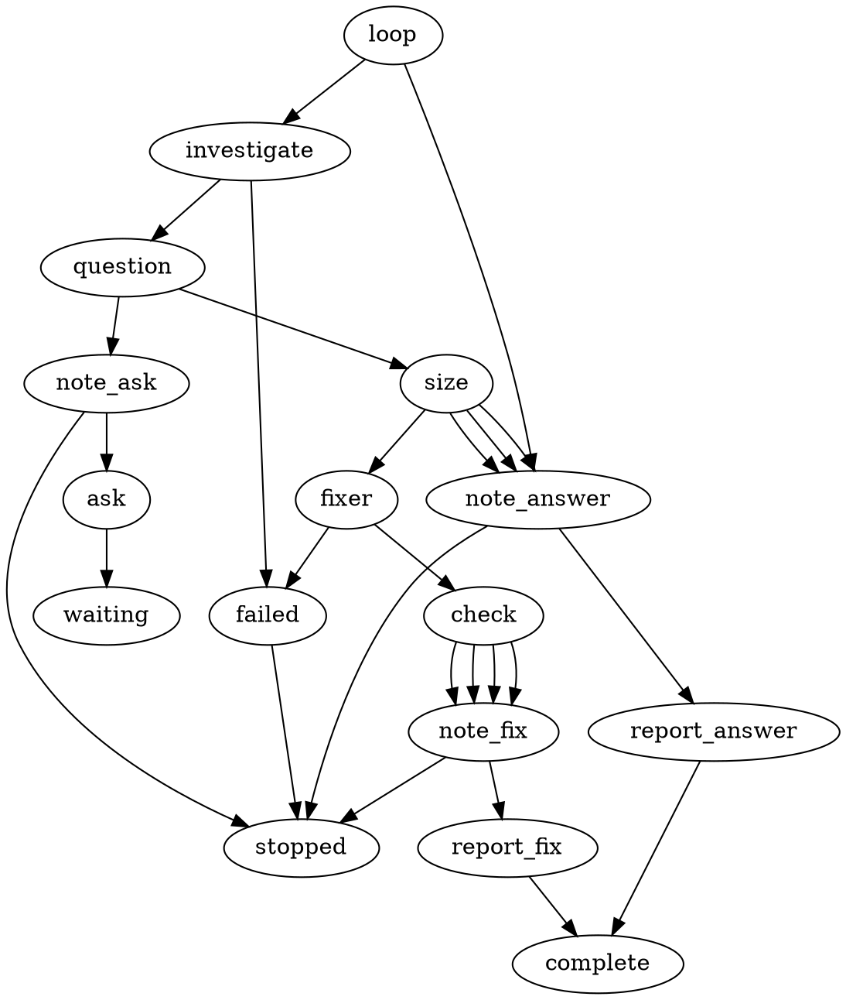

# Graph Spike: sample graph, activities and result shape

Sample only. It shows the intended shape so the owner can judge reuse. It is not
an implementation and nothing here is registered.

## 1. Sample graph (DOT, same dialect as the Research graph)



Reads as: investigate -> (ask?) -> size check -> [none | too big | blocked] note and report, or [small] fix -> check -> note -> report.

## 2. What is reused and what is new

| Piece | Status | Notes |
|---|---|---|
| lf_agent, lf_loop, lf_if, lf_ask, lf_comment | Reused as is | Same shared steps, same limits, same owner-wait and resume behaviour as Research. |
| Result envelope (`version`, `response` ask or done, `result`) | Reused | Same JSON. Same MCP helper route: preflight, submit, receipt. |
| Result payload key `spike` | Reused, small additions | Existing fields kept. Additions listed in section 3. |
| Graph loader, DOT dialect, limits, continuation, usage metering | Reused | No change to the engine. |
| lf_spike_note | NEW activity | Renders SPIKE.md from the retained result and the gate outcome. Research has the same idea but it is Research-only. |
| lf_spike_gate | NEW activity | Deterministic size check of the proposed fix (phase `proposal`). |
| lf_spike_check | NEW activity | After the fix: counts real changed files, refuses forbidden paths, runs the repository checks. |
| Spike workflow policy | NEW (not an activity) | Response words ask and done, a decoder that accepts questions only for graph Spike, a renderer for the report, failure text. Same pattern as Plan and Bug policies. |
| Two roles and one skill | NEW Markdown | spike-investigator (read-only), spike-fixer (write), spike-result skill (worked envelopes). |
| Per-role tool profile | NEW (small) | Investigator gets read-only tools; fixer gets Implement-level tools. Today Spike gets Implement tools for everything. |
| Repo switch | NEW (small) | Own setting file, `execution: graph` or `legacy`, default legacy. Same strict reader pattern as Research. |
| Docs | NEW | Spike guide, fix broken links in agent guidance files. |

Naming rule: the engine only admits a mode-specific activity when its name starts
with the workflow name, so Bug's check runner cannot be borrowed by name. The new
check activity can still reuse its runner code.

## 3. Result shape (same envelope, small additions to the spike payload)

Investigator, small fix proposed:

```json
{
  "version": 1,
  "response": "done",
  "result": {
    "outcome": "completed",
    "comment": "Root cause found. One small fix proposed.",
    "recommendation": {"next": "fix"},
    "artifacts": [],
    "payload": {
      "spike": {
        "request": "Why does commit staging fail when the repo is empty?",
        "work_done": ["Reproduced with an empty repo"],
        "findings": ["Staging path skips the first commit case"],
        "decisions": ["One defect, fix is local"],
        "not_done": [],
        "proposed_fix": {
          "defect": "First commit is staged with the wrong flag",
          "files": ["<source file>", "<test file>"],
          "regression_test": "<test name>"
        }
      }
    }
  }
}
```

Investigator, too big (hand-back):

```json
{
  "version": 1,
  "response": "done",
  "result": {
    "outcome": "completed",
    "comment": "This exceeds a spike. Recommend Research.",
    "recommendation": {"next": "research", "reason": "Needs a schema change"},
    "payload": {"spike": {"request": "...", "findings": ["..."], "not_done": ["Fix"]}}
  }
}
```

Investigator, blocked (one question round):

```json
{
  "version": 1,
  "response": "ask",
  "result": {
    "outcome": "incomplete",
    "comment": "Blocked on one decision.",
    "reason": "The answer depends on which environment counts.",
    "questions": [
      {"id": "q1", "audience": "technical", "text": "Which environment is the target?",
       "options": [{"id": "a", "text": "CI"}, {"id": "b", "text": "Local"}],
       "recommended_option": "a"}
    ],
    "payload": {"spike": {"request": "...", "work_done": ["..."]}}
  }
}
```

Fixer, done:

```json
{
  "version": 1,
  "response": "done",
  "result": {
    "outcome": "completed",
    "comment": "Fix made with a regression test.",
    "payload": {
      "spike": {
        "request": "...",
        "work_done": ["Fixed the flag", "Added regression test"],
        "fix": {
          "files_changed": ["<source file>", "<test file>"],
          "regression_test": "<test name>",
          "failed_before": true,
          "passed_after": true
        }
      }
    }
  }
}
```

The `fix` block is the agent's own claim. `lf_spike_check` is what proves it: it
re-counts the files and runs the checks. Whether the test failed before the fix is
still the agent's claim; the check can only prove it passes after.

## 4. Rules the graph enforces (from owner answers q1 to q5)

- Small fix (q2 = a): one defect, at most three changed files including the test, a regression test, no new package, dependency, schema or API change. Checked twice: on the proposal, then on the real diff.
- Read-only investigation (q1 = b): only the fixer role can write.
- No approval stage (q3 = a): the graph runs to one report.
- One question round (q4 = b): the investigator may ask once; the owner reply re-enters the investigator once (limit 2). The fixer cannot ask.
- Own switch (q5 = a): default legacy, graph is opt-in.
- SPIKE.md is written on every path, including the blocked path, before any owner wait.
- A hand-back is a recommendation in the report. The graph never starts Research or Plan.

## 5. Things to confirm during planning (not verified here)

- Whether the existing check-runner code can be shared by the new check activity without change.
- Whether one mode can hold two tool profiles the way Bug does, or whether a small permission change is needed.
- Whether the comment step can show the check outcome, or whether the note must carry it.
- That failed_before cannot be proven by the graph, only claimed by the fixer.
