# Graph Spike: sample graph, activities, result shape, graph-led rule and retirement

Sample only. It shows the intended shape so the owner can judge reuse. It is not
an implementation and nothing here is registered. Revision 2 of this sample: the
graph file now carries the rules (thresholds, access level, note status), so Go
holds no Spike flow.

## 1. Sample graph (DOT, same dialect as the Research graph)

```dot
// Spike answers one narrow question. It investigates, writes SPIKE.md, and
// either stops at an answer or makes one small, tested fix. Anything bigger is
// reported as a hand-back. There is no owner approval stage; the only owner wait
// is one question round.
//
// This file is the only place the flow lives. Order, branches, limits, access
// level, size thresholds and the status written into SPIKE.md are all declared
// here. Go supplies steps; it never picks the next step.
digraph spike {
 graph [team="builtin", mode="spike", profile_version="1", start="loop"];

 // ---- 1. Investigate (read-only) -----------------------------------------
 loop        [lf_action="lf_loop", lf_outcomes="true,false", lf_field="response", lf_condition="ask", lf_default="ask", lf_limit="2", lf_source="investigate"];
 investigate [lf_action="lf_agent", lf_outcomes="success,failed", lf_agent_markdown="spike-investigator", lf_skills="spike-result", lf_access="read", lf_limit="2"];
 question    [lf_action="lf_if", lf_outcomes="true,false", lf_field="response", lf_condition="ask", lf_source="investigate", lf_limit="2"];
 note_asking [lf_action="lf_spike_note", lf_status="asking", lf_outcomes="success,failed", lf_source="investigate", lf_limit="2"];
 ask         [lf_action="lf_ask", lf_outcomes="published", lf_kind="question", lf_source="investigate", lf_limit="1"];

 // ---- 2. Size check on the proposed fix -----------------------------------
 size        [lf_action="lf_spike_gate", lf_max_files="3", lf_forbid="package,dependency,schema,api", lf_outcomes="none,small,too_big,blocked", lf_source="investigate", lf_limit="1"];

 // ---- 3a. Answer or hand-back: no code change -----------------------------
 note_answered [lf_action="lf_spike_note", lf_status="answered", lf_outcomes="success,failed", lf_source="investigate", lf_limit="1"];
 note_handback [lf_action="lf_spike_note", lf_status="hand_back", lf_outcomes="success,failed", lf_source="investigate", lf_limit="1"];
 note_blocked  [lf_action="lf_spike_note", lf_status="blocked", lf_outcomes="success,failed", lf_source="investigate", lf_limit="1"];
 report_answer [lf_action="lf_comment", lf_outcomes="published", lf_kind="final", lf_source="investigate", lf_limit="1"];

 // ---- 3b. One small fix (write) --------------------------------------------
 fixer       [lf_action="lf_agent", lf_outcomes="success,failed", lf_agent_markdown="spike-fixer", lf_skills="spike-result", lf_access="write", lf_limit="1"];
 check       [lf_action="lf_spike_check", lf_max_files="3", lf_forbid="package,dependency,schema,api", lf_outcomes="passed,failed,too_big,blocked", lf_source="fixer", lf_limit="1"];
 note_fixed      [lf_action="lf_spike_note", lf_status="fixed", lf_outcomes="success,failed", lf_source="fixer", lf_limit="1"];
 note_unverified [lf_action="lf_spike_note", lf_status="fix_unverified", lf_outcomes="success,failed", lf_source="fixer", lf_limit="1"];
 note_fix_big    [lf_action="lf_spike_note", lf_status="fix_too_big", lf_outcomes="success,failed", lf_source="fixer", lf_limit="1"];
 note_fix_stuck  [lf_action="lf_spike_note", lf_status="blocked", lf_outcomes="success,failed", lf_source="fixer", lf_limit="1"];
 report_fix  [lf_action="lf_comment", lf_outcomes="published", lf_kind="final", lf_source="fixer", lf_limit="1"];

 // ---- Failure and terminals ------------------------------------------------
 failed      [lf_action="lf_comment", lf_outcomes="published", lf_kind="failure", lf_limit="1"];
 waiting     [lf_terminal="true"];
 complete    [lf_terminal="true"];
 stopped     [lf_terminal="true"];

 // 1. Investigate. An owner reply re-enters at "loop" and runs the role again.
 loop        -> investigate   [lf_on="true"];
 loop        -> note_answered [lf_on="false"];
 investigate -> question      [lf_on="success"];
 investigate -> failed        [lf_on="failed"];
 question    -> note_asking   [lf_on="true"];    // blocked: keep SPIKE.md, then ask
 question    -> size          [lf_on="false"];
 note_asking -> ask           [lf_on="success"];
 note_asking -> stopped       [lf_on="failed"];
 ask         -> waiting       [lf_on="published"];

 // 2. Size check decides fix or hand-back.
 size -> note_answered [lf_on="none"];
 size -> note_handback [lf_on="too_big"];
 size -> note_blocked  [lf_on="blocked"];
 size -> fixer         [lf_on="small"];

 // 3a. Report the answer.
 note_answered -> report_answer [lf_on="success"];
 note_handback -> report_answer [lf_on="success"];
 note_blocked  -> report_answer [lf_on="success"];
 note_answered -> stopped [lf_on="failed"];
 note_handback -> stopped [lf_on="failed"];
 note_blocked  -> stopped [lf_on="failed"];
 report_answer -> complete [lf_on="published"];

 // 3b. Fix once, check once, report. A failed check is reported, not retried.
 fixer -> check  [lf_on="success"];
 fixer -> failed [lf_on="failed"];
 check -> note_fixed      [lf_on="passed"];
 check -> note_unverified [lf_on="failed"];
 check -> note_fix_big    [lf_on="too_big"];
 check -> note_fix_stuck  [lf_on="blocked"];
 note_fixed      -> report_fix [lf_on="success"];
 note_unverified -> report_fix [lf_on="success"];
 note_fix_big    -> report_fix [lf_on="success"];
 note_fix_stuck  -> report_fix [lf_on="success"];
 note_fixed      -> stopped [lf_on="failed"];
 note_unverified -> stopped [lf_on="failed"];
 note_fix_big    -> stopped [lf_on="failed"];
 note_fix_stuck  -> stopped [lf_on="failed"];
 report_fix -> complete [lf_on="published"];

 failed -> stopped [lf_on="published"];
}
```



Reads as: investigate -> (ask?) -> size check -> [none | too big | blocked] note and report, or [small] fix -> check -> note -> report.

Attribute names `lf_access`, `lf_status`, `lf_max_files`, `lf_forbid` are illustrative.
The engine only validates declared attributes against a closed value list, so the
exact encoding (for example enumerated numbers 1 to 5) is a planning detail.

## 2. Graph-led rule (owner instruction)

**The DOT file is the only place the Spike flow lives. Go holds no workflow logic
for Spike.**

| Lives in the DOT file | May live in Go |
|---|---|
| Which steps exist and their order | The generic engine (loader, limits, resume, owner wait) |
| Every branch: which outcome goes to which node | Leaf steps that do one thing and return an outcome: write the note, measure the size, run the checks |
| Every limit (runs, question round, check count) | The closed response words (ask, done) and result decoding |
| Access level of each agent (read or write) | Enforcing that access level when it is declared |
| Size thresholds and forbidden change kinds | Reading those declared values |
| The status written into SPIKE.md on each path | Rendering text for a given status |

Go must never: name a Spike node, choose the next node, count passes, or decide
which path a run takes.

How this is kept honest (proposed acceptance checks):

1. **Swap test.** A test loads a second, different DOT (for example: no fix branch, or a threshold of 2) and runs it with no Go change. It behaves as the file says.
2. **No Spike-specific topology validator.** Plan hard-codes its stage names in a Go validator. Spike must not copy that. Only the generic structural checks apply (an owner wait ends at a terminal, a document step reads an agent).
3. **No node names in Go.** A test fails if Spike Go code contains a node name from the DOT.
4. **One source.** The DOT is embedded once; no second copy of the flow in Go tables or prompts.
5. **Roles do not carry flow.** Role Markdown describes the job, never the next step.

Known small gap to settle in planning: a response the DOT does not route (for
example the fixer answering ask). Recommendation: fail the node loudly, never
ignore it.

## 3. What is reused and what is new

| Piece | Status | Notes |
|---|---|---|
| lf_agent, lf_loop, lf_if, lf_ask, lf_comment | Reused as is | Same shared steps, limits, owner-wait and resume as Research. |
| Result envelope (`version`, `response` ask or done, `result`) | Reused | Same JSON. Same MCP helper route: preflight, submit, receipt. |
| Result payload key `spike` | Reused, small additions | Existing fields kept. Additions in section 4. |
| Graph loader, DOT dialect, limits, continuation, usage metering | Reused | No engine change for the flow. |
| lf_spike_note | NEW activity | Writes SPIKE.md from the retained result and the status the DOT gives it. |
| lf_spike_gate | NEW activity | Measures the proposed fix against the thresholds the DOT gives it. Returns an outcome only. |
| lf_spike_check | NEW activity | Measures the real change and runs the repository checks. Returns an outcome only. |
| Spike workflow policy | NEW (not an activity) | Response words, decoder that accepts questions for graph Spike, report renderer, failure text. No flow. |
| Two roles and one skill | NEW Markdown | spike-investigator, spike-fixer, spike-result. |
| Access enforcement | NEW (small) | Maps a declared access level to a tool profile. Replaces Spike borrowing Implement's tools. |
| Repo switch | NEW (small, temporary) | Own setting, default legacy. Removed at retirement. |
| Docs | NEW | Spike guide, fix broken links. |

## 4. Result shape (same envelope, small additions to the spike payload)

Investigator, small fix proposed:

```json
{
  "version": 1,
  "response": "done",
  "result": {
    "outcome": "completed",
    "comment": "Root cause found. One small fix proposed.",
    "recommendation": {"next": "fix"},
    "artifacts": [],
    "payload": {
      "spike": {
        "request": "Why does commit staging fail when the repo is empty?",
        "work_done": ["Reproduced with an empty repo"],
        "findings": ["Staging path skips the first commit case"],
        "decisions": ["One defect, fix is local"],
        "not_done": [],
        "proposed_fix": {
          "defect": "First commit is staged with the wrong flag",
          "files": ["<source file>", "<test file>"],
          "regression_test": "<test name>"
        }
      }
    }
  }
}
```

Investigator, blocked (one question round):

```json
{
  "version": 1,
  "response": "ask",
  "result": {
    "outcome": "incomplete",
    "comment": "Blocked on one decision.",
    "reason": "The answer depends on which environment counts.",
    "questions": [
      {"id": "q1", "audience": "technical", "text": "Which environment is the target?",
       "options": [{"id": "a", "text": "CI"}, {"id": "b", "text": "Local"}],
       "recommended_option": "a"}
    ],
    "payload": {"spike": {"request": "...", "work_done": ["..."]}}
  }
}
```

Fixer, done:

```json
{
  "version": 1,
  "response": "done",
  "result": {
    "outcome": "completed",
    "comment": "Fix made with a regression test.",
    "payload": {
      "spike": {
        "request": "...",
        "work_done": ["Fixed the flag", "Added regression test"],
        "fix": {
          "files_changed": ["<source file>", "<test file>"],
          "regression_test": "<test name>",
          "failed_before": true,
          "passed_after": true
        }
      }
    }
  }
}
```

The `fix` block is the agent's own claim. `lf_spike_check` proves it by recounting
the files and running the checks. Whether the test failed before the fix stays the
fixer's claim; the check can only prove it passes after.

## 5. Retiring the old Spike (owner instruction)

**Reading I took:** retire the legacy single-agent Spike path. The `/spike` command
and the Spike mode identity stay, because the graph is keyed to them and about 50
source files, the database schema and the reporting all reference the mode. Removing
the identity itself would be a large migration and is not what the graph needs.
If you meant removing the `/spike` command as well, say so.

**Removed at retirement:**

- The single-agent Spike route: the router handling Spike as a fast lane and the legacy admission branch.
- The Spike mode instruction file (its content moves into the new Spike guide and the two roles).
- The rule that Spike results may not carry questions (graph Spike is the only Spike).
- The Spike guidance in the result-finalization skill that describes the legacy shape.
- Spike borrowing Implement's tool profile.
- The temporary repo switch and its reader.
- The broken guide links (fixed by pointing at the real guide).

**Kept:** `/spike`, the Spike mode identity, SPIKE.md as the output note, archived SPIKE.md files (history, never rewritten).

**When:** the last step of this work, as its own final story, after graph Spike is
the default and has completed real runs. It cannot ship before the graph. The switch
exists only until then, as the owner-chosen rollback (q5 a).

**To settle in planning:** Research's own docs say an existing task keeps the path it
was admitted on. Any Spike task already admitted on the legacy path needs a drain
rule (finish, or close) before the legacy code is deleted.

## 6. Rules the graph enforces (from owner answers q1 to q5)

- Small fix (q2 a): one defect, at most three changed files including the test, a regression test, no new package, dependency, schema or API change. Checked twice: on the proposal, then on the real change. Thresholds are set in the DOT file.
- Read-only investigation (q1 b): only the fixer role can write.
- No approval stage (q3 a): the graph runs to one report.
- One question round (q4 b): the investigator may ask once; the owner reply re-enters the investigator once (limit 2). The fixer cannot ask.
- Own switch (q5 a): default legacy, graph opt-in, removed at retirement.
- SPIKE.md is written on every path, including the blocked path, before any owner wait.
- A hand-back is a recommendation in the report. The graph never starts Research or Plan.

## 7. Things to confirm during planning (not verified here)

- Whether the existing check-runner code can be shared by the new check activity without change.
- Whether the agent step can accept a declared access attribute, or needs a small generic addition.
- Whether numeric thresholds fit the engine's closed attribute values (enumerated 1 to 5) or need a small generic addition.
- Whether the comment step can show the note status, or whether the note must carry it.
- That failed_before cannot be proven by the graph, only claimed by the fixer.
- The drain rule for Spike tasks already admitted on the legacy path.
