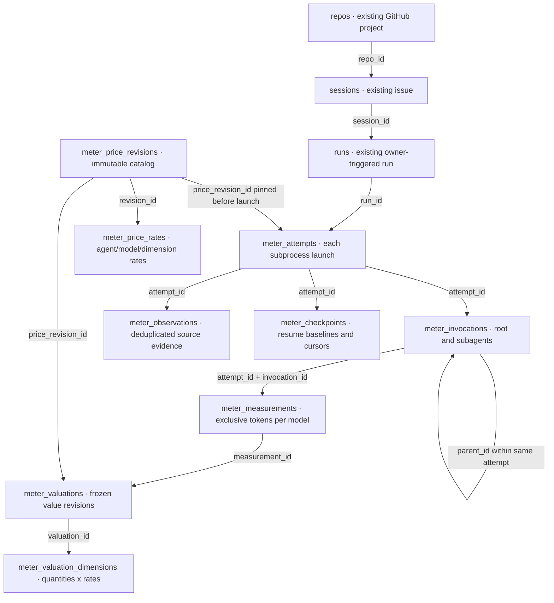
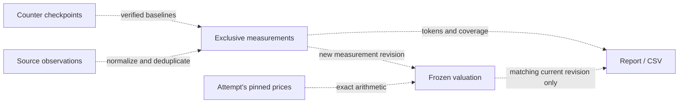

# Metering data model explained

Run 0011 · 2026-09-09 · explanatory architecture review

The proposal adds **nine tables**, alongside existing `repos`, `sessions` and `runs`. They separate execution identity, replay-safe token accounting and immutable pricing. Nine is a design choice, not a minimum imposed by token metering. This document explains the current proposal without changing its stories or acceptance criteria. Full column definitions remain in [ARCH_REVIEW.md](ARCH_REVIEW.md); GitHub stories remain the implementation authority.

## Main relationships

The diagram shows the main foreign-key relationships. An arrow runs from the referenced parent to its referencing children; each parent can have zero or many child rows unless the label says otherwise. All boxes beginning `meter_` are proposed tables. `sessions` is the existing project/issue record, not a new task table.



There is **one root per attempt**, and a root or child can have many children. An invocation can have several measurement rows if it uses several actual models. A measurement can have several historical valuation rows as additional usage arrives, but only the valuation matching its current measurement revision contributes to a current report.

The main diagram omits some cross-links for readability. These are also actual proposed foreign keys:

| Referencing table/columns | Referenced table/columns | Purpose |
|---|---|---|
| `meter_observations(attempt_id, invocation_id)` | `meter_invocations(attempt_id, id)` | Attach an observation when its invocation is known; invocation is nullable for summaries. |
| `meter_checkpoints(attempt_id, invocation_id)` | `meter_invocations(attempt_id, id)` | Attach a counter stream when known. |
| `meter_measurements(attempt_id)` | `meter_attempts(id)` | Explicit attempt ownership. |
| `meter_checkpoints(last_observation_id)` | `meter_observations(id)` | Most recent accepted source evidence; nullable before one exists. |
| `meter_measurements(last_observation_id)` | `meter_observations(id)` | Evidence supporting the latest aggregate revision. |

Some correctness rules are **application invariants, not additional foreign keys**: ancestry must be acyclic; an observation referenced by a checkpoint or measurement must belong to the same attempt; a valuation must use its attempt's pinned price revision. The report selects a valuation by both `measurement_id` and `measurement_revision = meter_measurements.revision`. There is a foreign key on measurement identity, but no historical measurement-revision table or composite revision FK in this proposal.

## Why each table exists

| Concern | Table | What one row represents | Why keep it separate? |
|---|---|---|---|
| Execution | `meter_attempts` | One subprocess launch, including unsuccessful launches and fallback | A run can launch more than once; failed work must survive and remain additive. |
| Execution | `meter_invocations` | The root or one descendant within that attempt | Stores ancestry and failure/coverage even when no token record arrives. |
| Collection | `meter_observations` | One identified normalized source event or summary | Deduplicates replay and retains evidence explaining disagreements. These are bounded accounting fields, not transcripts. |
| Collection | `meter_checkpoints` | One source counter stream and epoch | Remembers lifetime baselines and replay position so cumulative/resumed usage yields only new consumption. |
| Consumption | `meter_measurements` | Current exclusive token totals for one invocation/model | Gives reports a consistent additive source, independent of provider event formats. |
| Pricing | `meter_price_revisions` | One complete immutable catalog version | Pins a whole catalog before launch, including missing prices for models discovered later. |
| Pricing | `meter_price_rates` | One agent/model/token-dimension rate in a catalog | Represents many models and independently priced input/output/cache dimensions. |
| Valuation | `meter_valuations` | One frozen value for a measurement revision | Preserves the amount and pricing completeness without consulting newer prices. |
| Valuation | `meter_valuation_dimensions` | One frozen billable quantity, rate and amount | Explains the arithmetic and missing prices, including cache-duration fallback. |

CSV does not introduce a tenth permanent table. It reads a bounded temporary snapshot of these measurements, matching valuations and coverage, then releases the database before writing output. Repository, issue and mode rollups are queries over existing identities; no permanent total table is needed for each reporting scope.

## A concrete run

Suppose issue 73 has run 12:

```text
run 12
├── attempt A: resume refused; observed consumption remains unknown
└── attempt B: fallback launch
    └── root invocation
        ├── child 1
        │   └── grandchild 1
        └── child 2: failed after some measured work
```

This produces two attempt records. Attempt A is retained even if no usable token counters arrive; it does not get a fabricated zero. Attempt B contains one root and four descendants. Child 2's measured tokens still contribute despite failure. Its coverage says whether the measurement is complete. Every invocation's consumption is recorded separately by actual model; changing models creates another measurement row, not another invocation solely because the model changed.

For a simplified complete measurement of one token dimension, imagine root usage is 100, child 1 is 40, grandchild 1 is 20 and child 2 is 30. The exclusive total is **190**. A provider might also report child 1's descendant-inclusive total as 60 and the root's inclusive total as 190. Those summaries stay as observations for reconciliation; adding them to measurements would inflate the total. Missing evidence leaves a known subtotal with incomplete coverage.

If one invocation reports cumulative snapshots `100`, `150`, and repeats `150`, observations identify the source messages and checkpoints remember progress. The additive consumption is **150**, not 400. If a new attempt resumes a verified lifetime baseline of 150 and reaches 180, its new contribution is **30**. Missing or ambiguous baselines prevent inventing that delta.

The relationship between evidence and usable totals is therefore:



These dotted arrows describe computation and selection, **not foreign keys**.

## Why price revisions and valuations both exist

A price revision records the agreement; a valuation records the measured quantities and resulting estimate. Before attempt B starts, it pins catalog 7. Editing prices publishes catalog 8. A child discovered later in B still uses catalog 7, even if catalog 8 contains a newly added model price. If that model was absent from catalog 7, its usage remains unpriced for B. A later attempt can use catalog 8.

During B, new usage may create measurement revision 2 and a corresponding valuation revision. A report selects revision 2, not the sum of valuations 1 and 2. Additional work can increase an in-flight estimate, but price edits cannot revalue its existing work. Stored monetary arithmetic is exact; public all-in estimates remain blank when relevant collection or pricing is incomplete, while a known priced subtotal stays visible.

## Could there be fewer tables?

Yes. The proposal favors explainable accounting and replay diagnostics over the smallest schema. Full subagent support chiefly needs attempts, invocation ancestry and per-model measurements; the remaining separation protects collection and valuation behavior.

The most plausible structural simplification is moving `meter_valuation_dimensions` into bounded, validated JSON inside `meter_valuations`. That reduces nine tables to eight while preserving quantities and applied rates. It trades relational constraints and easy per-dimension SQL inspection for JSON validation and more application decoding. It does not eliminate the underlying information or its tests.

A larger simplification could reduce or omit retained observations after ingestion. That saves writes and storage, but the current schema references observations from both checkpoints and measurements. Equivalent durable event deduplication, conflict detection, reconciliation evidence and provenance would have to remain elsewhere. A raw-log-only design would weaken crash/replay and diagnostic guarantees. Removing observations is therefore a redesign, not dropping an unused audit table; whether it really reduces complexity needs a separate comparison.

Checkpoints could also be embedded into invocation state, but there can be several source/model/counter epochs per invocation. Packing that into JSON moves rather than removes replay complexity. Merging attempts into runs loses the distinction between fallback launches; merging invocations into measurements loses children with missing evidence. Those are poor savings for the requested first release.

**Recommendation:** retain the current nine-table proposal for this explanatory pass. If schema size is a priority, evaluate the eight-table valuation-JSON variant first; do not silently change the managed story contract. No schema change is made here.

## Architectural boundaries and review outcome

All tables, constraints and queries remain in `internal/store`, reusing the one-connection SQLite ownership. `internal/meter` owns pure normalization and exact valuation; `turn` maps usage into store records and pins prices before launch; `cli` and `report` render prepared values. Real SQLite must test transactional claims (TEST-6), accessors take context first (CONC-5), and accounting persistence remains independent of report acknowledgement (CONC-4). Managed GitHub bodies remain authoritative and the Story Index remains link-only (CONC-12).

This review explains the supplied design and its tradeoffs. It does not prove provider capability, implement migrations, run paid agents, create historical recovery tooling, or change the seven stories' acceptance obligations.
